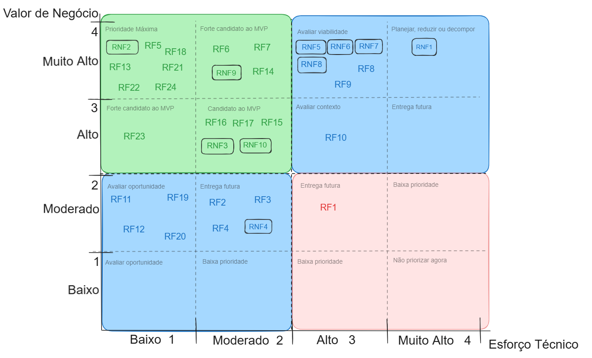

# 10. Backlog do Produto e MVP

O Backlog do Produto **SIGMA** é estruturado a partir do [Catálogo Unificado de Requisitos](8_requisitos.md), no qual os **Casos de Uso** representam a declaração oficial das necessidades funcionais da Creche Estação Vida. 

Esta página estabelece o estado atual de acompanhamento dos itens do backlog, o método de priorização aplicado e o recorte justificado e validado do **MVP (Mínimo Produto Viável)**.

---

## 10.1 Backlog Geral do Produto

Para permitir o acompanhamento claro da evolução do produto (diferenciando especificação, validação com stakeholder e implementação técnica), o estado atual de cada item do backlog é apresentado a seguir:

| ID | Caso de Uso | Especificação (ER) | Validação com Cliente | Implementação Técnica | Iteração Prevista |
| :--- | :--- | :--- | :--- | :--- | :--- |
| [UC01](casos-uso/uc01.md) | Gerenciar Autenticação | Documentado | Validado em Reunião | Em desenvolvimento | Iteração 5 (Construção) |
| [UC02](casos-uso/uc02.md) | Gerenciar Usuários Administrativos | Documentado | Validado em Reunião | Em desenvolvimento | Iteração 5 (Construção) |
| [UC03](casos-uso/uc03.md) | Gerenciar Quadro de Avisos | Documentado | Validado em Reunião | Backlog Futuro (Pós-MVP) | Evolução posterior |
| [UC04](casos-uso/uc04.md) | Gerenciar Fichas de Matrícula | Documentado | Validado em Reunião | Planejado | Iteração 5 (Construção) |
| [UC05](casos-uso/uc05.md) | Gerenciar Documentos Digitais | Documentado | Validado em Reunião | Planejado | Iteração 6 (Construção) |
| [UC06](casos-uso/uc06.md) | Gerenciar Estrutura Escolar | Documentado | Validado em Reunião | Planejado | Iteração 7 (Construção) |
| [UC07](casos-uso/uc07.md) | Alocar Alunos em Turmas | Documentado | Validado em Reunião | Planejado | Iteração 7 (Construção) |
| [UC08](casos-uso/uc08.md) | Consultar Registros (Busca) | Documentado | Validado em Reunião | Planejado | Iteração 7 (Construção) |

> A relação de cada capacidade funcional (RF01 a RF24) e de qualidade (RNF01 a RNF10) aos Casos de Uso está disponível no [Catálogo Unificado de Requisitos](8_requisitos.md#83-rastreabilidade-dos-requisitos-funcionais-aos-casos-de-uso). As regras de negócio podem ser consultadas em [Regras de Negócio](Regras-Negocio.md).

---

## 10.2 Priorização do Backlog e Recorte do MVP

Para a seleção do MVP, realizou-se uma avaliação combinada entre o **Valor de Negócio** (priorizado com a diretoria e secretaria da creche via método MoSCoW e escala 1 a 4) e o **Esforço Técnico** (avaliado pela equipe técnica considerando esforço, complexidade e lacuna de capacidade).

### Matriz 4x4 de Priorização

Abaixo está o mapeamento dos requisitos na Matriz de Priorização (Valor vs. Esforço):

:material-open-in-new: **[Acessar Matriz Interativa de Requisitos no Excalidraw](https://excalidraw.ufpi.br/#room=18ce979a0731349ffb5c,xyFmMOtSPX3E6eJx2N1H_g)**

---

### Avaliação e Consolidação dos Requisitos

| ID | Nome do Requisito | Justificativa do Cliente / Negócio | V. Negócio | Esforço | Compl. | Lacuna | Esforço Consolidado |
| :--- | :--- | :--- | :---: | :---: | :---: | :---: | :---: |
| RF01 | Disponibilizar quadro de avisos | Desejo da cliente para comunicação interna | 2 | 2 | 3 | 1 | 2.0 |
| RF02 | Lançar avisos | Desejo da cliente para comunicação interna | 2 | 2 | 3 | 1 | 2.0 |
| RF03 | Exibir avisos | Desejo da cliente para comunicação interna | 2 | 2 | 3 | 1 | 2.0 |
| RF04 | Apagar avisos | Desejo da cliente para comunicação interna | 2 | 2 | 3 | 1 | 2.0 |
| RF05 | Cadastrar usuários | Necessidade de cadastrar a equipe administrativa | 4 | 1 | 2 | 1 | 1.3 |
| RF06 | Realizar login | Proteção de acesso e segurança das informações | 4 | 1 | 2 | 2 | 1.6 |
| RF07 | Realizar logout | Encerramento seguro de sessão | 4 | 1 | 2 | 2 | 1.6 |
| RF08 | Cadastrar card de aluno | Função essencial, resolve o problema principal | 4 | 3 | 3 | 2 | 2.6 |
| RF09 | Preenchimento de fichas | Função essencial para substituir fichas físicas | 4 | 3 | 3 | 2 | 2.6 |
| RF10 | Editar fichas de card | Manutenção dos dados de matrícula atualizados | 3 | 3 | 3 | 2 | 2.6 |
| RF11 | Inativar card de aluno | Organização interna (adiado pós-MVP em ata) | 2 | 1 | 1 | 1 | 1.0 |
| RF12 | Reativar card de aluno | Organização interna (adiado pós-MVP em ata) | 2 | 1 | 1 | 1 | 1.0 |
| RF13 | Vincular aluno a turma | Organização das turmas da creche | 4 | 1 | 1 | 2 | 1.3 |
| RF14 | Anexar documentos | Digitalização de certidões e comprovantes | 4 | 1 | 2 | 2 | 1.6 |
| RF15 | Editar/substituir documento | Correção de arquivos anexados | 3 | 1 | 2 | 1 | 1.3 |
| RF16 | Baixar fichas e documentos | Recuperação digital de arquivos em PDF | 3 | 1 | 2 | 4 | 2.3 |
| RF17 | Apresentar histórico de edições | Auditoria e integridade das alterações | 3 | 2 | 2 | 2 | 2.0 |
| RF18 | Cadastrar Etapa | Estrutura escolar básica | 4 | 1 | 1 | 1 | 1.0 |
| RF19 | Inativar Turma e Etapa | Gestão de turmas inativas (adiado pós-MVP) | 2 | 1 | 1 | 1 | 1.0 |
| RF20 | Vincular turma à etapa | Gestão de turmas inativas (adiado pós-MVP) | 2 | 1 | 1 | 2 | 1.3 |
| RF21 | Buscar aluno pelo nome | Redução imediata do tempo de busca de fichas | 4 | 1 | 1 | 1 | 1.0 |
| RF22 | Buscar Turmas e Etapas | Consulta ágil da estrutura escolar | 4 | 1 | 1 | 1 | 1.0 |
| RF23 | Salvamento com confirmação | Segurança contra perdas acidentais de dados | 3 | 1 | 1 | 1 | 1.0 |
| RF24 | Cadastrar Turma | Estrutura de turmas obrigatória para alocação | 4 | 1 | 1 | 1 | 1.0 |
| RNF01 | Privacidade de dados e proteção LGPD | Obrigação legal e proteção de dados de crianças | 4 | 3 | 4 | 4 | 3.6 |
| RNF02 | Restrição de acesso não autenticado | Segurança indispensável contra acessos indevidos | 4 | 1 | 1 | 2 | 1.3 |
| RNF03 | Interface responsiva | Usabilidade em múltiplos dispositivos | 3 | 2 | 2 | 3 | 2.3 |
| RNF04 | Modo escuro alternável | Usabilidade visual | 2 | 1 | 2 | 1 | 1.3 |
| RNF05 | Tempo de resposta no login (<2s) | Requisito de desempenho essencial | 4 | 2 | 3 | 3 | 2.6 |
| RNF06 | Tempo de busca de alunos (<2s) | Agilidade na rotina de atendimento | 4 | 2 | 3 | 3 | 2.6 |
| RNF07 | Tempo de busca de turmas (<2s) | Agilidade na navegação | 4 | 2 | 3 | 3 | 2.6 |
| RNF08 | Tempo de salvamento de ficha (<5s) | Eficiência e resposta ao usuário | 4 | 2 | 3 | 3 | 2.6 |
| RNF09 | Disponibilidade do sistema (99,5%) | Confiabilidade durante o expediente comercial | 4 | 2 | 2 | 2 | 2.0 |
| RNF10 | Suporte a acessos concorrentes | Suporte à equipe da creche | 3 | 2 | 2 | 2 | 2.0 |

---

### Priorização Consolidada por Caso de Uso no MVP

Como os requisitos foram declarados e estruturados como Casos de Uso, a seleção do MVP apoia-se na consolidação dos valores de negócio e esforço técnico de cada Caso de Uso:

| ID | Caso de Uso | V. Negócio Médio | Esforço Técnico Médio | Razão (V/E) | Compõe o MVP? | Justificativa do Recorte |
| :--- | :--- | :---: | :---: | :---: | :---: | :--- |
| [UC01](casos-uso/uc01.md) | Gerenciar Autenticação | 4.0 | 1.8 | 2.22 | **SIM** | Porta de entrada e segurança indispensável de acesso aos dados. |
| [UC02](casos-uso/uc02.md) | Gerenciar Usuários Administrativos | 4.0 | 1.3 | 3.08 | **SIM** | Necessário para conceder e controlar acessos da equipe da secretaria. |
| [UC03](casos-uso/uc03.md) | Gerenciar Quadro de Avisos | 2.0 | 2.0 | 1.00 | **NÃO** | Funcionalidade secundária de comunicação; adiada para priorizar o núcleo de matrículas. |
| [UC04](casos-uso/uc04.md) | Gerenciar Fichas de Matrícula | 3.4 | 1.7 | 2.00 | **SIM** | **Núcleo essencial do sistema**. Resolve o problema central de papel e fichas físicas. Os fluxos de inativação/reativação (RF11/RF12) foram postergados. |
| [UC05](casos-uso/uc05.md) | Gerenciar Documentos Digitais | 3.5 | 1.5 | 2.33 | **SIM** | Anexação e download de certidões/termos em PDF (RF14, RF15, RF16), protegendo os documentos. |
| [UC06](casos-uso/uc06.md) | Gerenciar Estrutura Escolar | 3.0 | 1.1 | 2.73 | **SIM** | Base obrigatória para cadastrar turmas e etapas onde os alunos serão alocados. Inativações postergadas. |
| [UC07](casos-uso/uc07.md) | Alocar Alunos | 4.0 | 1.7 | 2.35 | **SIM** | Enturmação e associação de alunos a salas de aula ativas. |
| [UC08](casos-uso/uc08.md) | Consultar Registros (Busca) | 4.0 | 1.8 | 2.22 | **SIM** | Recuperação rápida de alunos por nome em menos de 2s, substituindo a busca em armários físicos. |

> **Nota sobre Requisitos Não Funcionais Transversais:** Os requisitos [RNF01 (LGPD/Privacidade)](8_requisitos.md#req-rnf01) e [RNF02 (Acesso Autenticado)](8_requisitos.md#req-rnf02) são condições obrigatórias de conformidade transversal da entrega, aplicando-se sobre todos os casos de uso selecionados para o MVP.

---

## 10.3 Validação do MVP com o Stakeholder

A composição do MVP foi formalmente apresentada e validada junto à **Cirlene Sena**, diretora e coordenadora da **Creche Estação Vida** (stakeholder principal do projeto), através de reunião remota com apresentação dos fluxos e matriz de valor.

- **Confirmação do Cliente:** A coordenadora confirmou que o conjunto dos Casos de Uso selecionados (UC01, UC02, UC04, UC05, UC06, UC07 e UC08) contempla com precisão o objetivo do *mínimo indispensável para operação*, substituindo as rotinas manuais mais críticas (cadastro de fichas, busca de alunos e anexação de documentos).
- **Decisões Registradas:** Ficou acordado o adiamento do quadro de avisos (UC03) e das rotinas de inativação complexa para após a primeira entrega homologada, concentrando a primeira versão no ciclo de matrículas de 2026.
- **Registro da Validação:** As evidências e a ata detalhada estão disponíveis na seção [Atas de Reunião - Unidade 2](../reunioes/ata1.md).
