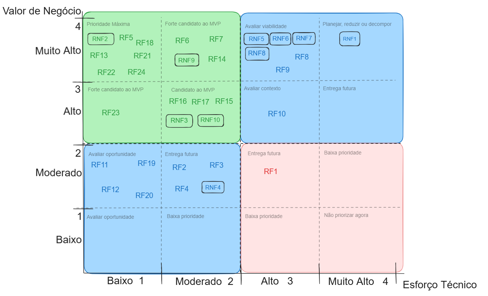

# 10 Backlog do produto

Aqui vale ressaltar que todos os **casos de uso** a seguir são derivados das nossas listas de requisitos apresentado anteriormente nesse documento.
Essa é uma lista tem o intuito de atender a representação de **requisitos de produto**, pra auxiliar duranto o desenvolvimento, e tamebm é  preliminar e deverá sofrer ajustes sempre que necessário durante o desenvolvimento do produto do SIGMA;

## 10.1 Backlog Geral do produto 

A baixo está o link dos casos de uso relacionados, cada link , redireciona para a descrição respectiva de seu caso de uso.

|Casos de Uso|Status|
|---|---|
|[UC01 - Gerenciar Autenticação](casos-uso/uc01.md)| NÃO FEITO|
|[UC02 - Gerenciar Usuários Administrativos](casos-uso/uc02.md)|NÃO FEITA|
|[UC03 - Gerenciamento de quadros de avisos](casos-uso/uc03.md)|NÃO FEITA|
|[UC04 - Gerenciar Fichas de Matrícula](casos-uso/uc04.md)|NÃO FEITA|
|[UC05 - Gerenciar Documentos Digitais](casos-uso/uc05.md)|NÃO FEITA|
|[UC06 - Gerenciar Estrutura Escolar (Etapas e Turmas)](casos-uso/uc06.md)|NÃO FEITA|
|[UC07 - Alocar Alunos](casos-uso/uc07.md)|NÃO FEITA|
|[UC08 - Consultar Registros (Busca)](casos-uso/uc08.md)|NÃO FEITA|

A seguir uma tabela que Relaciona os requisitos do nosso sistema com os casos de uso.

### Rastreabilidade entre Requisitos e Casos de Uso
 
| ID | Nome | Casos de uso vinculados |
|---|---|---|
| RF01 | Disponibilizar quadro de avisos | UC03 - Gerenciamento de quadros de avisos |
| RF02 | Lançar avisos | UC03 - Gerenciamento de quadros de avisos |
| RF03 | Exibir avisos | UC03 - Gerenciamento de quadros de avisos |
| RF04 | Apagar avisos | UC03 - Gerenciamento de quadros de avisos |
| RF05 | Cadastrar Usuários | UC02 - Gerenciar usuários administrativos / UC03 - Gerenciamento de quadros de avisos |
| RF06 | Realizar login | UC01 - Gerenciar autenticação |
| RF07 | Realizar logout | UC01 - Gerenciar autenticação / UC03 - Gerenciamento de quadros de avisos |
| RF08 | Cadastrar card de aluno | UC04 - Gerenciar cards de matrícula |
| RF09 | Preenchimento de fichas | UC04 - Gerenciar cards de matrícula |
| RF10 | Editar fichas do card | UC04 - Gerenciar cards de matrícula |
| RF11 | Inativar card de aluno | UC04 - Gerenciar cards de matrícula |
| RF12 | Reativar card de aluno | UC04 - Gerenciar cards de matrícula |
| RF13 | Vincular aluno a turma | UC07 - Alocar alunos |
| RF14 | Anexar documentos | UC05 - Gerenciar Documentos Digitais |
| RF15 | Editar documento | UC05 - Gerenciar Documentos Digitais |
| RF16 | Baixar fichas e documentos | UC05 - Gerenciar Documentos Digitais |
| RF17 | Apresentar histórico de edições | UC04 - Gerenciar cards de matrícula |
| RF18 | Cadastrar Etapa | UC06 - Gerenciar estrutura escolar (Etapas e Turmas) |
| RF19 | Inativar turma e etapa | UC06 - Gerenciar Estrutura Escolar (Etapas e Turmas) |
| RF20 | Vincular turma à etapa | UC06 - Gerenciar Estrutura Escolar (Etapas e Turmas) |
| RF21 | Buscar aluno pelo nome | UC08 - Consultar Registros (Busca) / UC07 - Alocar Alunos |
| RF22 | Buscar turmas e etapas | UC08 - Consultar Registros (Busca) / UC07 - Alocar Alunos |
| RF23 | Possibilitar salvamento de dados | UC04 - Gerenciar cards de matrícula |
| RF24 | Cadastrar Turma | UC06 - Gerenciar Estrutura Escolar (Etapas e Turmas) |
| RNF01 | Privacidade de Dados e Retenção Segura | UC03 - Gerenciar Quadro de Avisos |
| RNF02 | Restrição de Acesso não Autenticado | UC01 - Gerenciar autenticação / UC07 - Alocar Alunos / UC02 - Gerenciar usuários administrativos |
| RNF03 | Interface responsiva e adaptável a múltiplos dispositivos | GLOBAL |
| RNF04 | Interface com suporte a Modo Escuro alternável | GLOBAL |
| RNF05 | Tempo de Resposta do Sistema ao Logar | UC01 - Gerenciar autenticação |
| RNF06 | Tempo de Resposta do Sistema ao Buscar aluno | UC07 - Alocar Alunos / UC08 - Consultar Registros (Busca) |
| RNF07 | Tempo de resposta do sistema para buscar turmas ou etapas | UC07 - Alocar Alunos / UC08 - Consultar Registros (Busca) |
| RNF08 | Tempo de resposta para salvar uma ficha | UC04 - Gerenciar cards de matrícula |
| RNF09 | Disponibilidade do sistema | GLOBAL |
| RNF10 | Acessos Múltiplos | GLOBAL |

## 10.2 Priorização do Backlog e MVP

Para a inserção dos requisitos no MVP, efetuamos uma análise plural considerando as posições de cada requisito funcional e não-funcional na Matrix 4x4, alocando aqueles que apresentavam mais valor de negócio e menos esforço técnico. Além das posições da Matriz 4x4, foi considerado uma análise de contribuição para a solução do problema e relacionamento direto com o cumprimento dos objetivos do projeto. Em geral, acrescentamos ao MVP, aqueles requisitos indispensáveis e vitais para o desenvolvimento e implementação da solução, cujos complementam as funcionalidades que ja estariam no MVP .

### Consolidação das Avaliações
 
| ID | Requisito | Justificativa do cliente | V. Negócio | Esforço | Complexidade | Lacuna de Capacidade | Esforço técnico consolidado |
|---|---|---|---|---|---|---|---|
| RF1 | Disponibilizar quadro de avisos | Se manifestou como um desejo da cliente | 2 | 2 | 3 | 1 | 2.6 |
| RF2 | Lançar avisos | Se manifestou como um desejo da cliente | 2 | 2 | 3 | 1 | 2 |
| RF3 | Exibir avisos | Se manifestou como um desejo da cliente | 2 | 2 | 3 | 1 | 2 |
| RF4 | Apagar avisos | Se manifestou como um desejo da cliente | 2 | 2 | 3 | 1 | 2 |
| RF5 | Cadastrar usuários | Necessidade da cliente, para cadastrar possíveis novos usuários | 4 | 1 | 2 | 1 | 1.3 |
| RF6 | Realizar login | O sistema deve ser protegido por login | 4 | 1 | 2 | 2 | 1.6 |
| RF7 | Realizar logout | O logout é necessário para garantir a segurança física do computador contra acessos indevidos | 4 | 1 | 2 | 2 | 1.6 |
| RF8 | Cadastrar card de aluno | Função essencial, visa resolver o problema principal | 4 | 3 | 3 | 2 | 2.6 |
| RF9 | Preenchimento de fichas | Função essencial, visa resolver o problema principal | 4 | 3 | 3 | 2 | 2.6 |
| RF10 | Editar fichas de card | Função essencial, visa resolver o problema principal | 3 | 3 | 3 | 2 | 2.6 |
| RF11 | Inativar card de aluno | Útil para organização interna | 2 | 1 | 1 | 1 | 1 |
| RF12 | Reativar card de aluno | Útil para organização interna | 2 | 1 | 1 | 1 | 1 |
| RF13 | Vincular aluno a turma | Útil para organização interna | 4 | 1 | 1 | 2 | 1.3 |
| RF14 | Anexar documentos | Função essencial, visa resolver o problema principal | 4 | 1 | 2 | 2 | 1.6 |
| RF15 | Editar documento | Função essencial, visa resolver o problema principal | 3 | 1 | 2 | 1 | 1.3 |
| RF16 | Baixar fichas e documentos | Função essencial, visa resolver o problema principal | 3 | 1 | 2 | 4 | 2.3 |
| RF17 | Apresentar histórico de edições | Útil para organização interna | 3 | 2 | 2 | 2 | 2 |
| RF18 | Cadastrar Etapa | Útil para organização interna | 4 | 1 | 1 | 1 | 1 |
| RF19 | Inativar Turma e Etapa | Útil para organização interna | 2 | 1 | 1 | 1 | 1 |
| RF20 | Vincular turma à etapa | Útil para organização interna | 2 | 1 | 1 | 2 | 1.3 |
| RF21 | Buscar aluno pelo nome | Função essencial, visa resolver o problema principal | 4 | 1 | 1 | 1 | 1 |
| RF22 | Buscar Turmas e Etapas | Útil para organização interna | 4 | 1 | 1 | 1 | 1 |
| RF23 | Possibilitar salvamento de dados | Função essencial, visa resolver o problema principal | 3 | 1 | 1 | 1 | 1 |
| RF24 | Cadastrar Turma | Útil para organização interna | 4 | 1 | 1 | 1 | 1 |
| RNF1 | Privacidade de dados e retenção segura | Necessário, obrigação legal | 4 | 3 | 4 | 4 | 3.6 |
| RNF2 | Restrição de acesso não autenticado | Necessário, proteção contra acessos indesejados | 4 | 1 | 1 | 2 | 1.3 |
| RNF3 | Interface responsiva e adaptável a múltiplos dispositivos | Útil, mas não essencial para primeiro uso | 3 | 2 | 2 | 3 | 2.3 |
| RNF4 | Interface com suporte a modo escuro alternável | Útil, mas não essencial para primeiro uso | 2 | 1 | 2 | 1 | 1.3 |
| RNF5 | Tempo de resposta do sistema ao logar | Necessário, a velocidade do sistema foi uma queixa forte do cliente | 4 | 2 | 3 | 3 | 2.6 |
| RNF6 | Tempo de resposta do sistema ao buscar aluno | Necessário, a velocidade do sistema foi uma queixa forte do cliente | 4 | 2 | 3 | 3 | 2.6 |
| RNF7 | Tempo de resposta do sistema para buscar turmas ou etapas | Necessário, a velocidade do sistema foi uma queixa forte do cliente | 4 | 2 | 3 | 3 | 2.6 |
| RNF8 | Tempo de resposta para salvar uma ficha | Necessário, a velocidade do sistema foi uma queixa forte do cliente | 4 | 2 | 3 | 3 | 2.6 |
| RNF9 | Disponibilidade do sistema | Necessário, o sistema deve permanecer acessível durante todo o expediente | 4 | 2 | 2 | 2 | 2 |
| RNF10 | Acessos múltiplos | Essencial, para acompanhar a necessidade do cliente | 3 | 2 | 2 | 2 | 2 |

A seguir a imagem e o link da nossa matriz de requisitos, 
[link do excalidraw](https://excalidraw.ufpi.br/#room=18ce979a0731349ffb5c,xyFmMOtSPX3E6eJx2N1H_g)
---

Considerando a Tabela de Consolidação de Produto , decidimos fazer uma priorização mais aplicada aos nossos Casos de Uso, abaixo há uma tabela que indica o agrupamento da média das médias de Valor de Negócio e Esforço Técnico dos requisitos correspondentes à cada Caso de Uso

### Priorização dos Casos de Uso
 
#### Valor de Negócio e Esforço Técnico por Caso de Uso
 
| Caso de Uso | Valor de Negócio | Esforço Técnico | Média do Valor de Negócio | Média do Esforço Técnico |
|---|---|---|---|---|
| UC1 | RF06: 4 RF07: 4 RNF02: 4 RNF05: 4 | RF06: 1.6 RF07: 1.6 RNF02: 1.3 RNF05: 2.6 | 4 | 1.8 |
| UC2 | RF05: 4 RNF02: 4 | RF05: 1.3 RNF02: 1.3 | 4 | 1.3 |
| UC3 | RF01: 2 RF02: 2 RF03: 2 RF04: 2 RF05: 4 RF07: 4 | RF01: 2 RF02: 2 RF03: 2 RF04: 2 RF05: 1.3 RF07: 1.6 | 2.7 | 1.8 |
| UC4 | RF08: 4 RF09: 4 RF10: 3 RF11: 2 RF12: 2 RF17: 3 RF23: 3 RNF08: 4 | RF08: 2.6 RF09: 2.6 RF10: 2.6 RF11: 1 RF12: 1 RF17: 2 RF23: 1 RNF08: 2.6 | 3.1 | 1.9 |
| UC5 | RF14: 4 RF15: 3 | RF14: 1.6 RF15: 1.3 | 3.5 | 1.45 |
| UC6 | RF18: 4 RF19: 2 RF20: 2 RF24: 4 | RF18: 1 RF19: 1 RF20: 1.3 RF24: 1 | 3 | 1.1 |
| UC7 | RF13: 4 RF21: 4 RF22: 4 RNF06: 4 RNF07: 4 | RF13: 1.3 RF21: 1 RF22: 1 RNF06: 2.6 RNF07: 2.6 | 4 | 1.7 |
| UC8 | RF21: 4 RF22: 4 RNF06: 4 RNF07: 4 | RF21: 1 RF22: 1 RNF06: 2.6 RNF07: 2.6 | 4 | 1.8 |
 
#### Tabela de Priorização dos Casos de Uso no MVP
 
A seguir, a tabela de priorização dos Casos de Uso no MVP, seguindo os dados da tabela anterior.
 
| ID | Caso de Uso | Valor de Negócio | Esforço Técnico | Valor Resultante (V. Negócio / E. Técnico) | Compõe a Entrega? |
|---|---|---|---|---|---|
| [UC01](./casos-uso/uc01.md) | Gerenciar Autenticar | 4 | 1.8 | 2.22 | SIM |
| [UC02](./casos-uso/uc02.md) | Gerenciar Usuários Administrativos | 4 | 1.3 | 3.08 | SIM |
| [UC03](./casos-uso/uc03.md) | Gerenciar Quadro de Avisos | 2.7 | 1.8 | 1.5 | NÃO |
| [UC04](./casos-uso/uc04.md) | Gerenciar Fichas de Matrícula | 3.4 | 1.7 | 1.90 | SIM |
| [UC05](./casos-uso/uc05.md) | Gerenciar Documentos Digitais | 3.5 | 1.45 | 2.41 | SIM |
| [UC06](./casos-uso/uc06.md) | Gerenciar Estrutura Escolar | 3 | 1.1 | 2.73 | SIM |
| [UC07](./casos-uso/uc07.md) | Alocar Alunos | 4 | 1.7 | 2.35 | SIM |
| [UC08](./casos-uso/uc08.md) | Consultar Registros (Busca) | 4 | 1.8 | 2.22 | SIM |

Para a composição da entrega, consideramos aqueles Casos de Uso cujo Valor de Negócio é maior ou igual à 3 e cujo Valor Resultante é maior ou igual 1.9, além desses critérios analíticos, analisamos cada Caso de Uso de acordo com sua importância para o cumprimento do objetivo do projeto, selecionando aqueles que, caso não fossem selecionados, não seria possível criar um protótipo minimamente funcional. 

> Para consultar as regras de negócio consolidadas, acesse o documento de [**Regras de Negócio**](./Regras-Negocio.md).
