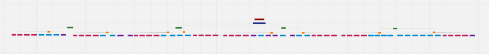

# 8. Catálogo Unificado de Requisitos

Este documento consolida os requisitos funcionais e não funcionais do sistema **SIGMA**, estruturando suas relações com os objetivos do produto, regras de negócio e planejamento de entregas.

---

## 8.1 Estrutura Hierárquica e Organização do Escopo

A organização do escopo segue a hierarquia conceitual que conecta o problema real identificado no cliente até a declaração detalhada da solução:

  

    Problema
    Gestão manual em papel
  

  ➔
  

    Objetivo Geral
    Centralização digital
  

  ➔
  

    Objetivos Específicos
    OE.1 a OE.4
  

  ➔
  

    Características
    CP1 a CP8
  

  ➔
  

    Requisitos
    Casos de Uso (UC01-UC08)
  

- **[Problema](1_cenarioAtual.md#14-identificacao-da-oportunidade-ou-problema):** Sobrecarga e lentidão no gerenciamento manual em papel das fichas de matrícula de mais de 200 crianças na Creche Estação Vida, com risco contínuo de perda e deterioração documental.
- **[Objetivo Geral](2_solucao.md#21-objetivo-geral-do-produto):** Centralizar e digitalizar a organização e recuperação das informações de matrículas em cards digitais ágeis e seguros.
- **[Objetivos Específicos (OEs)](2_solucao.md#22-objetivos-especificos-oe-do-produto):**
    - **OE.1:** Facilitar e agilizar a organização e a continuidade do processo administrativo.
    - **OE.2:** Preservar e centralizar o histórico e as informações das matrículas.
    - **OE.3:** Controlar o acesso e garantir a segurança das informações do sistema.
    - **OE.4:** Facilitar a comunicação interna entre a equipe administrativa.
- **[Características do Produto (CPs)](2_solucao.md#23-caracteristicas-de-produto):** CP1 (Cards de matrícula), CP2 (Edição de cards), CP3 (Consulta de informações), CP4 (Controle de acesso), CP5 (Gerenciamento de documentos), CP6 (Avisos rápidos), CP7 (Gerenciamento de turmas e etapas) e CP8 (Auditoria e integridade).
- **Declaração de Requisitos:** Os requisitos funcionais do sistema são declarados como **Casos de Uso (UC)**, abrangendo fluxos de operação, exceções e critérios de aceitação.

---

## 8.2 Catálogo de Casos de Uso

O painel a seguir apresenta os Casos de Uso do sistema, indicando o vínculo com Características do Produto (CP) e Objetivos Específicos (OE), capacidades funcionais (RF), requisitos não funcionais (RNF), regras de negócio (RN) e status no MVP:

  <!-- UC01 -->
  

    

      

        <h3 class="catalogo-card__title"><a href="../casos-uso/uc01/">UC01 - Gerenciar Autenticação</a></h3>
        <a href="../10_backlog/#102-priorizacao-do-backlog-e-mvp">MVP: Sim</a>
      

      

        <a href="../2_solucao/#23-caracteristicas-de-produto">CP4 - Controle de Acesso</a> • <a href="../2_solucao/#22-objetivos-especificos-oe-do-produto">OE.3 - Segurança</a>
      

      

        Permitir que as secretárias e administradores acessem e encerrem suas sessões com credenciais seguras, protegendo o acesso aos dados sensíveis da instituição.
      

      

        

          Requisitos Funcionais (RF)
          

            <a href="#req-rf06" class="chip chip--rf" title="Realizar login">RF06 - Realizar Login</a>
            <a href="#req-rf07" class="chip chip--rf" title="Realizar logout">RF07 - Realizar Logout</a>
          

        

        

          Requisitos Não Funcionais (RNF)
          

            <a href="#req-rnf01" class="chip chip--rnf" title="Privacidade de Dados">RNF01</a>
            <a href="#req-rnf02" class="chip chip--rnf" title="Restrição de Acesso">RNF02</a>
            <a href="#req-rnf05" class="chip chip--rnf" title="Tempo de Resposta ao Logar < 2s">RNF05</a>
          

        

        

          Regras de Negócio (RN)
          

            <a href="../Regras-Negocio/#rn16" class="chip chip--rn" title="Bloqueio após 5 tentativas consecutivas inválidas">RN16</a>
            <a href="../Regras-Negocio/#rn17" class="chip chip--rn" title="Encerramento de sessão após 30 min de inatividade">RN17</a>
            <a href="../Regras-Negocio/#rn18" class="chip chip--rn" title="Apenas contas com status Ativo">RN18</a>
          

        

      

    

    

      <a href="../casos-uso/uc01/" class="catalogo-card__link">Ver especificação completa →</a>
    

  

  <!-- UC02 -->
  

    

      

        <h3 class="catalogo-card__title"><a href="../casos-uso/uc02/">UC02 - Gerenciar Usuários Administrativos</a></h3>
        <a href="../10_backlog/#102-priorizacao-do-backlog-e-mvp">MVP: Sim</a>
      

      

        <a href="../2_solucao/#23-caracteristicas-de-produto">CP4 - Controle de Acesso</a> • <a href="../2_solucao/#22-objetivos-especificos-oe-do-produto">OE.3 - Segurança</a>
      

      

        Permitir o cadastro, controle e inativação de contas da equipe administrativa da creche com restrições e políticas de senhas fortes.
      

      

        

          Requisitos Funcionais (RF)
          

            <a href="#req-rf05" class="chip chip--rf" title="Cadastrar Usuários">RF05 - Cadastrar Usuários</a>
          

        

        

          Requisitos Não Funcionais (RNF)
          

            <a href="#req-rnf01" class="chip chip--rnf" title="Privacidade de Dados">RNF01</a>
            <a href="#req-rnf02" class="chip chip--rnf" title="Restrição de Acesso não Autenticado">RNF02</a>
          

        

        

          Regras de Negócio (RN)
          

            <a href="../Regras-Negocio/#rn18" class="chip chip--rn" title="Bloqueio imediato de contas inativas">RN18</a>
            <a href="../Regras-Negocio/#rn19" class="chip chip--rn" title="E-mail único cadastrado">RN19</a>
            <a href="../Regras-Negocio/#rn20" class="chip chip--rn" title="Senha de 8 caracteres com letras, números e especiais">RN20</a>
            <a href="../Regras-Negocio/#rn21" class="chip chip--rn" title="Impedimento de exclusão física, apenas inativação">RN21</a>
          

        

      

    

    

      <a href="../casos-uso/uc02/" class="catalogo-card__link">Ver especificação completa →</a>
    

  

  <!-- UC03 -->
  

    

      

        <h3 class="catalogo-card__title"><a href="../casos-uso/uc03/">UC03 - Gerenciar Quadro de Avisos</a></h3>
        <a href="../10_backlog/#102-priorizacao-do-backlog-e-mvp">MVP: Não</a>
      

      

        <a href="../2_solucao/#23-caracteristicas-de-produto">CP6 - Avisos Rápidos</a> • <a href="../2_solucao/#22-objetivos-especificos-oe-do-produto">OE.4 - Comunicação Interna</a>
      

      

        Disponibilizar espaço central para lançamento, visualização e remoção de avisos internos entre a equipe administrativa da creche.
      

      

        

          Requisitos Funcionais (RF)
          

            <a href="#req-rf01" class="chip chip--rf" title="Disponibilizar quadro de avisos">RF01</a>
            <a href="#req-rf02" class="chip chip--rf" title="Lançar avisos">RF02</a>
            <a href="#req-rf03" class="chip chip--rf" title="Exibir avisos">RF03</a>
            <a href="#req-rf04" class="chip chip--rf" title="Apagar avisos">RF04</a>
          

        

        

          Requisitos Não Funcionais (RNF)
          

            <a href="#req-rnf01" class="chip chip--rnf" title="Privacidade de Dados">RNF01</a>
            <a href="#req-rnf02" class="chip chip--rnf" title="Restrição de Acesso">RNF02</a>
          

        

        

          Regras de Negócio (RN)
          

            <a href="../Regras-Negocio/#rn09" class="chip chip--rn" title="Assunto, descrição, data e autor obrigatórios">RN09</a>
            <a href="../Regras-Negocio/#rn17" class="chip chip--rn" title="Timeout de inatividade 30 min">RN17</a>
            <a href="../Regras-Negocio/#rn18" class="chip chip--rn" title="Apenas contas ativas">RN18</a>
          

        

      

    

    

      <a href="../casos-uso/uc03/" class="catalogo-card__link">Ver especificação completa →</a>
    

  

  <!-- UC04 -->
  

    

      

        <h3 class="catalogo-card__title"><a href="../casos-uso/uc04/">UC04 - Gerenciar Fichas de Matrícula</a></h3>
        <a href="../10_backlog/#102-priorizacao-do-backlog-e-mvp">MVP: Sim</a>
      

      

        <a href="../2_solucao/#23-caracteristicas-de-produto">CP1, CP2, CP8</a> • <a href="../2_solucao/#22-objetivos-especificos-oe-do-produto">OE.1, OE.2, OE.3</a>
      

      

        Cadastrar cards de alunos, preencher fichas socioeconômicas e termos escolares, editar dados, registrar histórico e exigir confirmação de salvamento.
      

      

        

          Requisitos Funcionais (RF)
          

            <a href="#req-rf08" class="chip chip--rf" title="Cadastrar card de aluno">RF08</a>
            <a href="#req-rf09" class="chip chip--rf" title="Preenchimento de fichas">RF09</a>
            <a href="#req-rf10" class="chip chip--rf" title="Editar fichas do card">RF10</a>
            <a href="#req-rf11" class="chip chip--rf" title="Inativar card de aluno (Pós-MVP)">RF11</a>
            <a href="#req-rf12" class="chip chip--rf" title="Reativar card de aluno (Pós-MVP)">RF12</a>
            <a href="#req-rf17" class="chip chip--rf" title="Apresentar histórico de edições">RF17</a>
            <a href="#req-rf23" class="chip chip--rf" title="Possibilitar salvamento com confirmação">RF23</a>
          

        

        

          Requisitos Não Funcionais (RNF)
          

            <a href="#req-rnf01" class="chip chip--rnf" title="Privacidade de Dados LGPD">RNF01</a>
            <a href="#req-rnf02" class="chip chip--rnf" title="Restrição de Acesso">RNF02</a>
            <a href="#req-rnf08" class="chip chip--rnf" title="Tempo de salvamento de ficha < 5s">RNF08</a>
          

        

        

          Regras de Negócio (RN)
          

            <a href="../Regras-Negocio/#rn01" class="chip chip--rn" title="Apenas uma matrícula ativa por vez">RN01</a>
            <a href="../Regras-Negocio/#rn03" class="chip chip--rn" title="Matrícula ativa mediante 5 fichas completas">RN03</a>
            <a href="../Regras-Negocio/#rn06" class="chip chip--rn" title="Validação de campos obrigatórios">RN06</a>
            <a href="../Regras-Negocio/#rn07" class="chip chip--rn" title="Impedir dois alunos com mesmo CPF ou matrícula">RN07</a>
            <a href="../Regras-Negocio/#rn10" class="chip chip--rn" title="Matrícula inativa não pode ser editada">RN10</a>
            <a href="../Regras-Negocio/#rn15" class="chip chip--rn" title="Alterações confirmadas antes de salvar">RN15</a>
          

        

      

    

    

      <a href="../casos-uso/uc04/" class="catalogo-card__link">Ver especificação completa →</a>
    

  

  <!-- UC05 -->
  

    

      

        <h3 class="catalogo-card__title"><a href="../casos-uso/uc05/">UC05 - Gerenciar Documentos Digitais</a></h3>
        <a href="../10_backlog/#102-priorizacao-do-backlog-e-mvp">MVP: Sim</a>
      

      

        <a href="../2_solucao/#23-caracteristicas-de-produto">CP5 - Gerenciamento de Documentos</a> • <a href="../2_solucao/#22-objetivos-especificos-oe-do-produto">OE.2 - Preservar Informações</a>
      

      

        Anexar documentos digitalizados (certidões, declarações) em formato PDF, realizar download e substituir arquivos vinculados às fichas.
      

      

        

          Requisitos Funcionais (RF)
          

            <a href="#req-rf14" class="chip chip--rf" title="Anexar documentos">RF14 - Anexar</a>
            <a href="#req-rf15" class="chip chip--rf" title="Editar/Substituir documento">RF15 - Substituir</a>
            <a href="#req-rf16" class="chip chip--rf" title="Baixar fichas e documentos">RF16 - Baixar PDF</a>
          

        

        

          Requisitos Não Funcionais (RNF)
          

            <a href="#req-rnf01" class="chip chip--rnf" title="Privacidade e Retenção Segura LGPD">RNF01</a>
            <a href="#req-rnf02" class="chip chip--rnf" title="Restrição de Acesso">RNF02</a>
          

        

        

          Regras de Negócio (RN)
          

            <a href="../Regras-Negocio/#rn05" class="chip chip--rn" title="Formato obrigatório em PDF">RN05</a>
            <a href="../Regras-Negocio/#rn10" class="chip chip--rn" title="Matrícula inativa não pode receber novos anexos">RN10</a>
          

        

      

    

    

      <a href="../casos-uso/uc05/" class="catalogo-card__link">Ver especificação completa →</a>
    

  

  <!-- UC06 -->
  

    

      

        <h3 class="catalogo-card__title"><a href="../casos-uso/uc06/">UC06 - Gerenciar Estrutura Escolar</a></h3>
        <a href="../10_backlog/#102-priorizacao-do-backlog-e-mvp">MVP: Sim</a>
      

      

        <a href="../2_solucao/#23-caracteristicas-de-produto">CP7 - Turmas e Etapas</a> • <a href="../2_solucao/#22-objetivos-especificos-oe-do-produto">OE.1 - Organização Administrativa</a>
      

      

        Cadastrar novas etapas de ensino e turmas da creche, vincular turmas às suas respectivas etapas e gerenciar inativações com histórico.
      

      

        

          Requisitos Funcionais (RF)
          

            <a href="#req-rf18" class="chip chip--rf" title="Cadastrar Etapa">RF18 - Cadastrar Etapa</a>
            <a href="#req-rf19" class="chip chip--rf" title="Inativar turma e etapa">RF19 - Inativar</a>
            <a href="#req-rf20" class="chip chip--rf" title="Vincular turma à etapa">RF20 - Vincular</a>
            <a href="#req-rf24" class="chip chip--rf" title="Cadastrar Turma">RF24 - Cadastrar Turma</a>
          

        

        

          Requisitos Não Funcionais (RNF)
          

            <a href="#req-rnf02" class="chip chip--rnf" title="Restrição de Acesso">RNF02</a>
            <a href="#req-rnf07" class="chip chip--rnf" title="Tempo de busca de turmas/etapas < 2s">RNF07</a>
          

        

        

          Regras de Negócio (RN)
          

            <a href="../Regras-Negocio/#rn04" class="chip chip--rn" title="Turma obrigatoriamente vinculada a etapa">RN04</a>
            <a href="../Regras-Negocio/#rn11" class="chip chip--rn" title="Apenas estruturas ativas recebem vínculos">RN11</a>
            <a href="../Regras-Negocio/#rn12" class="chip chip--rn" title="Inativação mantém vínculos existentes">RN12</a>
            <a href="../Regras-Negocio/#rn13" class="chip chip--rn" title="Impedir etapas duplicadas">RN13</a>
            <a href="../Regras-Negocio/#rn14" class="chip chip--rn" title="Impedir turmas duplicadas na mesma etapa">RN14</a>
            <a href="../Regras-Negocio/#rn22" class="chip chip--rn" title="Campos obrigatórios de etapa e turma">RN22</a>
          

        

      

    

    

      <a href="../casos-uso/uc06/" class="catalogo-card__link">Ver especificação completa →</a>
    

  

  <!-- UC07 -->
  

    

      

        <h3 class="catalogo-card__title"><a href="../casos-uso/uc07/">UC07 - Alocar Alunos</a></h3>
        <a href="../10_backlog/#102-priorizacao-do-backlog-e-mvp">MVP: Sim</a>
      

      

        <a href="../2_solucao/#23-caracteristicas-de-produto">CP7, CP1</a> • <a href="../2_solucao/#22-objetivos-especificos-oe-do-produto">OE.1 - Organização Administrativa</a>
      

      

        Vincular o card de matrícula do aluno a uma turma existente ativa, garantindo alocação única e consistência na formação de salas.
      

      

        

          Requisitos Funcionais (RF)
          

            <a href="#req-rf13" class="chip chip--rf" title="Vincular aluno a turma">RF13 - Vincular Turma</a>
            <a href="#req-rf21" class="chip chip--rf" title="Buscar aluno pelo nome">RF21 - Buscar Aluno</a>
            <a href="#req-rf22" class="chip chip--rf" title="Buscar turmas e etapas">RF22 - Buscar Turma</a>
          

        

        

          Requisitos Não Funcionais (RNF)
          

            <a href="#req-rnf02" class="chip chip--rnf" title="Restrição de Acesso">RNF02</a>
            <a href="#req-rnf06" class="chip chip--rnf" title="Tempo de busca de aluno < 2s">RNF06</a>
            <a href="#req-rnf07" class="chip chip--rnf" title="Tempo de busca de turmas < 2s">RNF07</a>
          

        

        

          Regras de Negócio (RN)
          

            <a href="../Regras-Negocio/#rn02" class="chip chip--rn" title="Matrícula vinculada a 1 turma e 1 etapa">RN02</a>
            <a href="../Regras-Negocio/#rn03" class="chip chip--rn" title="Fichas completas para ativação">RN03</a>
            <a href="../Regras-Negocio/#rn04" class="chip chip--rn" title="Turma vinculada a etapa">RN04</a>
            <a href="../Regras-Negocio/#rn06" class="chip chip--rn" title="Validação de campos antes de salvar">RN06</a>
            <a href="../Regras-Negocio/#rn08" class="chip chip--rn" title="Impedir aluno em duas turmas simultaneamente">RN08</a>
            <a href="../Regras-Negocio/#rn10" class="chip chip--rn" title="Matrícula inativa não pode ter alocação alterada">RN10</a>
            <a href="../Regras-Negocio/#rn11" class="chip chip--rn" title="Apenas turmas ativas recebem novos alunos">RN11</a>
          

        

      

    

    

      <a href="../casos-uso/uc07/" class="catalogo-card__link">Ver especificação completa →</a>
    

  

  <!-- UC08 -->
  

    

      

        <h3 class="catalogo-card__title"><a href="../casos-uso/uc08/">UC08 - Consultar Registros (Busca)</a></h3>
        <a href="../10_backlog/#102-priorizacao-do-backlog-e-mvp">MVP: Sim</a>
      

      

        <a href="../2_solucao/#23-caracteristicas-de-produto">CP3, CP7</a> • <a href="../2_solucao/#22-objetivos-especificos-oe-do-produto">OE.1 - Organização e Continuidade</a>
      

      

        Consultar alunos por nome completo ou parcial (sem distinção de maiúsculas/acentos) e pesquisar turmas e etapas em tempo hábil.
      

      

        

          Requisitos Funcionais (RF)
          

            <a href="#req-rf21" class="chip chip--rf" title="Buscar aluno pelo nome">RF21 - Buscar Aluno</a>
            <a href="#req-rf22" class="chip chip--rf" title="Buscar turmas e etapas">RF22 - Buscar Turmas</a>
          

        

        

          Requisitos Não Funcionais (RNF)
          

            <a href="#req-rnf02" class="chip chip--rnf" title="Restrição de Acesso">RNF02</a>
            <a href="#req-rnf06" class="chip chip--rnf" title="Tempo de busca de aluno < 2s">RNF06</a>
            <a href="#req-rnf07" class="chip chip--rnf" title="Tempo de busca de turmas < 2s">RNF07</a>
          

        

        

          Regras de Negócio (RN)
          

            <a href="../Regras-Negocio/#rn07" class="chip chip--rn" title="Resultados únicos de matrícula e CPF">RN07</a>
            <a href="../Regras-Negocio/#rn11" class="chip chip--rn" title="Identificação de status ativo/inativo">RN11</a>
            <a href="../Regras-Negocio/#rn12" class="chip chip--rn" title="Inativos permanecem visíveis na consulta">RN12</a>
            <a href="../Regras-Negocio/#rn13" class="chip chip--rn" title="Unicidade de nomes de etapas">RN13</a>
            <a href="../Regras-Negocio/#rn14" class="chip chip--rn" title="Unicidade de nomes de turmas na etapa">RN14</a>
            <a href="../Regras-Negocio/#rn18" class="chip chip--rn" title="Apenas usuários autenticados">RN18</a>
          

        

      

    

    

      <a href="../casos-uso/uc08/" class="catalogo-card__link">Ver especificação completa →</a>
    

  

---

## 8.3 Rastreabilidade de Capacidades Funcionais (RF)

A tabela a seguir relaciona as capacidades funcionais do sistema aos respectivos Casos de Uso, Características do Produto (CP) e ao planejamento de entrega do MVP:

| ID | Capacidade / Funcionalidade | Caso de Uso | Característica (CP) | Entrega MVP |
| :--- | :--- | :--- | :--- | :--- |
| RF01 | Disponibilizar quadro de avisos | [UC03 - Gerenciar Quadro de Avisos](casos-uso/uc03.md) | [CP6 - Avisos Rápidos](2_solucao.md#23-caracteristicas-de-produto) | [Não (Pós-MVP)](10_backlog.md#102-priorizacao-do-backlog-e-mvp) |
| RF02 | Lançar avisos | [UC03 - Gerenciar Quadro de Avisos](casos-uso/uc03.md) | [CP6 - Avisos Rápidos](2_solucao.md#23-caracteristicas-de-produto) | [Não (Pós-MVP)](10_backlog.md#102-priorizacao-do-backlog-e-mvp) |
| RF03 | Exibir avisos | [UC03 - Gerenciar Quadro de Avisos](casos-uso/uc03.md) | [CP6 - Avisos Rápidos](2_solucao.md#23-caracteristicas-de-produto) | [Não (Pós-MVP)](10_backlog.md#102-priorizacao-do-backlog-e-mvp) |
| RF04 | Apagar avisos | [UC03 - Gerenciar Quadro de Avisos](casos-uso/uc03.md) | [CP6 - Avisos Rápidos](2_solucao.md#23-caracteristicas-de-produto) | [Não (Pós-MVP)](10_backlog.md#102-priorizacao-do-backlog-e-mvp) |
| RF05 | Cadastrar Usuários | [UC02 - Gerenciar Usuários Administrativos](casos-uso/uc02.md) | [CP4 - Controle de Acesso](2_solucao.md#23-caracteristicas-de-produto) | [Sim](10_backlog.md#102-priorizacao-do-backlog-e-mvp) |
| RF06 | Realizar login | [UC01 - Gerenciar Autenticação](casos-uso/uc01.md) | [CP4 - Controle de Acesso](2_solucao.md#23-caracteristicas-de-produto) | [Sim](10_backlog.md#102-priorizacao-do-backlog-e-mvp) |
| RF07 | Realizar logout | [UC01 - Gerenciar Autenticação](casos-uso/uc01.md) | [CP4 - Controle de Acesso](2_solucao.md#23-caracteristicas-de-produto) | [Sim](10_backlog.md#102-priorizacao-do-backlog-e-mvp) |
| RF08 | Cadastrar card de aluno | [UC04 - Gerenciar Fichas de Matrícula](casos-uso/uc04.md) | [CP1 - Cards de Matrícula](2_solucao.md#23-caracteristicas-de-produto) | [Sim](10_backlog.md#102-priorizacao-do-backlog-e-mvp) |
| RF09 | Preenchimento de fichas | [UC04 - Gerenciar Fichas de Matrícula](casos-uso/uc04.md) | [CP1 - Cards de Matrícula](2_solucao.md#23-caracteristicas-de-produto) | [Sim](10_backlog.md#102-priorizacao-do-backlog-e-mvp) |
| RF10 | Editar fichas do card | [UC04 - Gerenciar Fichas de Matrícula](casos-uso/uc04.md) | [CP2 - Edição e Atualização](2_solucao.md#23-caracteristicas-de-produto) | [Sim](10_backlog.md#102-priorizacao-do-backlog-e-mvp) |
| RF11 | Inativar card de aluno | [UC04 - Gerenciar Fichas de Matrícula](casos-uso/uc04.md) | [CP2 - Edição e Atualização](2_solucao.md#23-caracteristicas-de-produto) | [Não (Adiado pós-MVP)](10_backlog.md#102-priorizacao-do-backlog-e-mvp) |
| RF12 | Reativar card de aluno | [UC04 - Gerenciar Fichas de Matrícula](casos-uso/uc04.md) | [CP2 - Edição e Atualização](2_solucao.md#23-caracteristicas-de-produto) | [Não (Adiado pós-MVP)](10_backlog.md#102-priorizacao-do-backlog-e-mvp) |
| RF13 | Vincular aluno a turma | [UC07 - Alocar Alunos](casos-uso/uc07.md) | [CP7 - Turmas e Etapas](2_solucao.md#23-caracteristicas-de-produto) | [Sim](10_backlog.md#102-priorizacao-do-backlog-e-mvp) |
| RF14 | Anexar documentos | [UC05 - Gerenciar Documentos Digitais](casos-uso/uc05.md) | [CP5 - Gerenciamento de Documentos](2_solucao.md#23-caracteristicas-de-produto) | [Sim](10_backlog.md#102-priorizacao-do-backlog-e-mvp) |
| RF15 | Editar/Substituir documento | [UC05 - Gerenciar Documentos Digitais](casos-uso/uc05.md) | [CP5 - Gerenciamento de Documentos](2_solucao.md#23-caracteristicas-de-produto) | [Sim](10_backlog.md#102-priorizacao-do-backlog-e-mvp) |
| RF16 | Baixar fichas e documentos (PDF) | [UC05 - Gerenciar Documentos Digitais](casos-uso/uc05.md) | [CP3 - Consulta](2_solucao.md#23-caracteristicas-de-produto) | [Sim](10_backlog.md#102-priorizacao-do-backlog-e-mvp) |
| RF17 | Apresentar histórico de edições | [UC04 - Gerenciar Fichas de Matrícula](casos-uso/uc04.md) | [CP8 - Auditoria e Integridade](2_solucao.md#23-caracteristicas-de-produto) | [Sim](10_backlog.md#102-priorizacao-do-backlog-e-mvp) |
| RF18 | Cadastrar Etapa | [UC06 - Gerenciar Estrutura Escolar](casos-uso/uc06.md) | [CP7 - Turmas e Etapas](2_solucao.md#23-caracteristicas-de-produto) | [Sim](10_backlog.md#102-priorizacao-do-backlog-e-mvp) |
| RF19 | Inativar turma e etapa | [UC06 - Gerenciar Estrutura Escolar](casos-uso/uc06.md) | [CP7 - Turmas e Etapas](2_solucao.md#23-caracteristicas-de-produto) | [Não (Adiado pós-MVP)](10_backlog.md#102-priorizacao-do-backlog-e-mvp) |
| RF20 | Vincular turma à etapa | [UC06 - Gerenciar Estrutura Escolar](casos-uso/uc06.md) | [CP7 - Turmas e Etapas](2_solucao.md#23-caracteristicas-de-produto) | [Não (Adiado pós-MVP)](10_backlog.md#102-priorizacao-do-backlog-e-mvp) |
| RF21 | Buscar aluno pelo nome | [UC08 - Busca](casos-uso/uc08.md) & [UC07](casos-uso/uc07.md) | [CP3 - Consulta](2_solucao.md#23-caracteristicas-de-produto) | [Sim](10_backlog.md#102-priorizacao-do-backlog-e-mvp) |
| RF22 | Buscar turmas e etapas | [UC08 - Busca](casos-uso/uc08.md) & [UC07](casos-uso/uc07.md) | [CP7 - Turmas e Etapas](2_solucao.md#23-caracteristicas-de-produto) | [Sim](10_backlog.md#102-priorizacao-do-backlog-e-mvp) |
| RF23 | Possibilitar salvamento com confirmação | [UC04 - Gerenciar Fichas de Matrícula](casos-uso/uc04.md) | [CP8 - Auditoria e Integridade](2_solucao.md#23-caracteristicas-de-produto) | [Sim](10_backlog.md#102-priorizacao-do-backlog-e-mvp) |
| RF24 | Cadastrar Turma | [UC06 - Gerenciar Estrutura Escolar](casos-uso/uc06.md) | [CP7 - Turmas e Etapas](2_solucao.md#23-caracteristicas-de-produto) | [Sim](10_backlog.md#102-priorizacao-do-backlog-e-mvp) |

---

## 8.4 Lista de Requisitos Não Funcionais (Especificação Suplementar)

Os requisitos não funcionais definem atributos de qualidade, desempenho, usabilidade, confiabilidade e segurança do sistema SIGMA, classificados segundo o modelo FURPS+/URPS.

> **Natureza Transversal dos RNFs:** Requisitos como segurança (RNF01, RNF02) e usabilidade (RNF03, RNF04) cobrem toda a aplicação internamente, enquanto requisitos de desempenho estabelecem limites temporais sob condições operacionais esperadas da creche.

| ID | Nome do Requisito | Descrição e Critério de Aceitação | Classificação URPS+ | Casos de Uso Vinculados |
| :--- | :--- | :--- | :--- | :--- |
| RNF01 | Privacidade de Dados e Proteção LGPD | Garantir a privacidade dos dados pessoais e sensíveis das crianças e famílias, restringindo o acesso e a visualização exclusivamente a usuários autenticados da creche, em conformidade com a LGPD. | Segurança | Transversal ([UC01](casos-uso/uc01.md), [UC02](casos-uso/uc02.md), [UC04](casos-uso/uc04.md), [UC05](casos-uso/uc05.md)) |
| RNF02 | Restrição de Acesso não Autenticado | O sistema deve restringir o acesso a todas as rotas e funcionalidades internas exclusivamente a usuários autenticados com credenciais válidas. Requisições não autenticadas devem retornar HTTP 401 e redirecionar para login. | Segurança | Transversal (Todos os UCs internos) |
| RNF03 | Interface Responsiva e Adaptável | O sistema deve adaptar seus componentes visuais para monitores desktop e dispositivos móveis (resoluções de 360px mobile, 768px tablet e 1280px desktop), preservando layout e funcionalidade. | Usabilidade | Global |
| RNF04 | Suporte a Modo Escuro Alternável | O sistema deve disponibilizar alternância de tema visual (claro/escuro), assegurando índices de contraste e legibilidade adequados em ambas as paletas. | Usabilidade | Global |
| RNF05 | Tempo de Resposta ao Logar | Garantir tempo de resposta inferior a 2 segundos entre o clique no botão de login e a autorização de acesso ao painel, sob conexão de rede estável. | Desempenho | [UC01 - Autenticação](casos-uso/uc01.md) |
| RNF06 | Tempo de Resposta ao Buscar Aluno | Retornar os resultados da consulta de alunos em tempo inferior a 2 segundos para 95% das requisições na base da creche (estimada em ~200-300 registros anuais). | Desempenho | [UC07](casos-uso/uc07.md), [UC08](casos-uso/uc08.md) |
| RNF07 | Tempo de Resposta para Buscar Turmas ou Etapas | Retornar os resultados da consulta de turmas e etapas em tempo inferior a 2 segundos para 95% das requisições. | Desempenho | [UC06](casos-uso/uc06.md), [UC07](casos-uso/uc07.md), [UC08](casos-uso/uc08.md) |
| RNF08 | Tempo de Resposta para Salvar Ficha | O sistema deve concluir o salvamento de uma ficha de matrícula em tempo inferior a 5 segundos para 95% das requisições, exibindo confirmação de sucesso. | Desempenho | [UC04 - Fichas de Matrícula](casos-uso/uc04.md) |
| RNF09 | Disponibilidade Operacional | O sistema deve assegurar disponibilidade de 99,5% durante o horário de expediente comercial da creche (segunda a sexta-feira, das 07h00 às 19h30). | Confiabilidade | Global |
| RNF10 | Suporte a Acessos Concorrentes | O sistema deve suportar simultaneamente a equipe administrativa (mínimo de 10 usuários simultâneos) sem degradação perceptível de tempo de resposta. | Desempenho | Global |

---

## 8.5 Árvore de Rastreabilidade

A representação gráfica abaixo conecta o problema, objetivos específicos (OEs), características do produto (CPs) e os requisitos no Miro:

<iframe width="100%" height="650" src="https://miro.com/app/live-embed/uXjVEbrie7A=/" frameborder="0" scrolling="no" allow="fullscreen; clipboard-read; clipboard-write" allowfullscreen title="Árvore de Rastreabilidade no Miro"></iframe>

:material-open-in-new: **[Abrir Árvore de Rastreabilidade diretamente no Miro](https://miro.com/app/board/uXjVEbrie7A=/)**

---

### Captura da Árvore de Rastreabilidade

<em>Registro atualizado da rastreabilidade estrutural dos requisitos do SIGMA.</em>

