# 8. Catálogo Unificado de Requisitos

Este documento consolida os requisitos funcionais e não funcionais do sistema **SIGMA**, estruturando suas relações com os objetivos do produto, regras de negócio e planejamento de entregas. Os requisitos funcionais são declarados através de **Casos de Uso (UC)**, detalhando fluxos principais, alternativos, exceções e critérios de aceitação.

---

## 8.1 Catálogo de Casos de Uso

O painel a seguir apresenta os Casos de Uso do sistema, indicando o vínculo com Características do Produto (CP) e Objetivos Específicos (OE), capacidades funcionais (RF), requisitos não funcionais (RNF), regras de negócio (RN) e status no MVP:

<!-- Âncoras para compatibilidade de links e deep-linking de modais -->

  
  
  
  
  
  
  
  
  
  
  
  
  
  
  
  
  
  
  
  
  
  
  
  
  
  
  
  
  
  
  
  
  
  
  
  
  
  
  
  
  
  
  
  
  
  
  
  
  
  
  
  
  
  
  
  
  
  
  

<!-- Barra de Filtros do Catálogo (MVP) -->

  

    Filtrar por MVP:
  

  

    <button type="button" class="catalogo-filter-btn is-active" data-filter="todos">
      Todos 8
    </button>
    <button type="button" class="catalogo-filter-btn" data-filter="sim">
      No MVP 7
    </button>
    <button type="button" class="catalogo-filter-btn" data-filter="nao">
      Fora do MVP 1
    </button>
  

  <!-- UC01 -->
  

    

      

        <h3 class="catalogo-card__title"><a href="../casos-uso/uc01/">UC01 - Gerenciar Autenticação</a></h3>
        <a href="../10_backlog/#102-priorizacao-do-backlog-e-mvp">MVP: Sim</a>
      

      

        <a href="../2_solucao/#23-caracteristicas-de-produto">CP4 - Controle de Acesso</a> • <a href="../2_solucao/#22-objetivos-especificos-oe-do-produto">OE.3 - Segurança</a>
      

      

        Permitir que as secretárias e administradores acessem e encerrem suas sessões com credenciais seguras, protegendo o acesso aos dados sensíveis da instituição.
      

      

        

          Requisitos Funcionais (RF)
          

            <button type="button" class="chip chip--rf" data-modal-id="RF06" title="Clique para ver detalhes do RF06">RF06 - Realizar Login</button>
            <button type="button" class="chip chip--rf" data-modal-id="RF07" title="Clique para ver detalhes do RF07">RF07 - Realizar Logout</button>
          

        

        

          Requisitos Não Funcionais (RNF)
          

            <button type="button" class="chip chip--rnf" data-modal-id="RNF01" title="Clique para ver detalhes do RNF01">RNF01</button>
            <button type="button" class="chip chip--rnf" data-modal-id="RNF02" title="Clique para ver detalhes do RNF02">RNF02</button>
            <button type="button" class="chip chip--rnf" data-modal-id="RNF05" title="Clique para ver detalhes do RNF05">RNF05</button>
          

        

        

          Regras de Negócio (RN)
          

            <button type="button" class="chip chip--rn" data-modal-id="RN16" title="Clique para ver detalhes da RN16">RN16</button>
            <button type="button" class="chip chip--rn" data-modal-id="RN17" title="Clique para ver detalhes da RN17">RN17</button>
            <button type="button" class="chip chip--rn" data-modal-id="RN18" title="Clique para ver detalhes da RN18">RN18</button>
          

        

      

    

    

      <a href="../casos-uso/uc01/" class="catalogo-card__link">Ver especificação completa →</a>
    

  

  <!-- UC02 -->
  

    

      

        <h3 class="catalogo-card__title"><a href="../casos-uso/uc02/">UC02 - Gerenciar Usuários Administrativos</a></h3>
        <a href="../10_backlog/#102-priorizacao-do-backlog-e-mvp">MVP: Sim</a>
      

      

        <a href="../2_solucao/#23-caracteristicas-de-produto">CP4 - Controle de Acesso</a> • <a href="../2_solucao/#22-objetivos-especificos-oe-do-produto">OE.3 - Segurança</a>
      

      

        Permitir o cadastro, controle e inativação de contas da equipe administrativa da creche com restrições e políticas de senhas fortes.
      

      

        

          Requisitos Funcionais (RF)
          

            <button type="button" class="chip chip--rf" data-modal-id="RF05" title="Clique para ver detalhes do RF05">RF05 - Gerenciar Usuários</button>
          

        

        

          Requisitos Não Funcionais (RNF)
          

            <button type="button" class="chip chip--rnf" data-modal-id="RNF01" title="Clique para ver detalhes do RNF01">RNF01</button>
            <button type="button" class="chip chip--rnf" data-modal-id="RNF02" title="Clique para ver detalhes do RNF02">RNF02</button>
          

        

        

          Regras de Negócio (RN)
          

            <button type="button" class="chip chip--rn" data-modal-id="RN15" title="Clique para ver detalhes da RN15">RN15</button>
            <button type="button" class="chip chip--rn" data-modal-id="RN18" title="Clique para ver detalhes da RN18">RN18</button>
            <button type="button" class="chip chip--rn" data-modal-id="RN19" title="Clique para ver detalhes da RN19">RN19</button>
            <button type="button" class="chip chip--rn" data-modal-id="RN20" title="Clique para ver detalhes da RN20">RN20</button>
            <button type="button" class="chip chip--rn" data-modal-id="RN21" title="Clique para ver detalhes da RN21">RN21</button>
          

        

      

    

    

      <a href="../casos-uso/uc02/" class="catalogo-card__link">Ver especificação completa →</a>
    

  

  <!-- UC03 -->
  

    

      

        <h3 class="catalogo-card__title"><a href="../casos-uso/uc03/">UC03 - Gerenciar Quadro de Avisos</a></h3>
        <a href="../10_backlog/#102-priorizacao-do-backlog-e-mvp">MVP: Não</a>
      

      

        <a href="../2_solucao/#23-caracteristicas-de-produto">CP6 - Avisos Rápidos</a> • <a href="../2_solucao/#22-objetivos-especificos-oe-do-produto">OE.4 - Comunicação Interna</a>
      

      

        Disponibilizar espaço central para lançamento, visualização e remoção de avisos internos entre a equipe administrativa da creche.
      

      

        

          Requisitos Funcionais (RF)
          

            <button type="button" class="chip chip--rf" data-modal-id="RF01" title="Clique para ver detalhes do RF01">RF01</button>
            <button type="button" class="chip chip--rf" data-modal-id="RF02" title="Clique para ver detalhes do RF02">RF02</button>
            <button type="button" class="chip chip--rf" data-modal-id="RF03" title="Clique para ver detalhes do RF03">RF03</button>
            <button type="button" class="chip chip--rf" data-modal-id="RF04" title="Clique para ver detalhes do RF04">RF04</button>
          

        

        

          Requisitos Não Funcionais (RNF)
          

            <button type="button" class="chip chip--rnf" data-modal-id="RNF01" title="Clique para ver detalhes do RNF01">RNF01</button>
            <button type="button" class="chip chip--rnf" data-modal-id="RNF02" title="Clique para ver detalhes do RNF02">RNF02</button>
          

        

        

          Regras de Negócio (RN)
          

            <button type="button" class="chip chip--rn" data-modal-id="RN09" title="Clique para ver detalhes da RN09">RN09</button>
            <button type="button" class="chip chip--rn" data-modal-id="RN17" title="Clique para ver detalhes da RN17">RN17</button>
            <button type="button" class="chip chip--rn" data-modal-id="RN18" title="Clique para ver detalhes da RN18">RN18</button>
          

        

      

    

    

      <a href="../casos-uso/uc03/" class="catalogo-card__link">Ver especificação completa →</a>
    

  

  <!-- UC04 -->
  

    

      

        <h3 class="catalogo-card__title"><a href="../casos-uso/uc04/">UC04 - Gerenciar Fichas de Matrícula</a></h3>
        <a href="../10_backlog/#102-priorizacao-do-backlog-e-mvp">MVP: Sim</a>
      

      

        <a href="../2_solucao/#23-caracteristicas-de-produto">CP1, CP2, CP8</a> • <a href="../2_solucao/#22-objetivos-especificos-oe-do-produto">OE.1, OE.2, OE.3</a>
      

      

        Cadastrar cards de alunos, preencher fichas socioeconômicas e termos escolares, editar dados, registrar histórico e exigir confirmação de salvamento.
      

      

        

          Requisitos Funcionais (RF)
          

            <button type="button" class="chip chip--rf" data-modal-id="RF08" title="Clique para ver detalhes do RF08">RF08</button>
            <button type="button" class="chip chip--rf" data-modal-id="RF09" title="Clique para ver detalhes do RF09">RF09</button>
            <button type="button" class="chip chip--rf" data-modal-id="RF10" title="Clique para ver detalhes do RF10">RF10</button>
            <button type="button" class="chip chip--rf" data-modal-id="RF11" title="Clique para ver detalhes do RF11">RF11</button>
            <button type="button" class="chip chip--rf" data-modal-id="RF12" title="Clique para ver detalhes do RF12">RF12</button>
            <button type="button" class="chip chip--rf" data-modal-id="RF17" title="Clique para ver detalhes do RF17">RF17</button>
          

        

        

          Requisitos Não Funcionais (RNF)
          

            <button type="button" class="chip chip--rnf" data-modal-id="RNF01" title="Clique para ver detalhes do RNF01">RNF01</button>
            <button type="button" class="chip chip--rnf" data-modal-id="RNF02" title="Clique para ver detalhes do RNF02">RNF02</button>
            <button type="button" class="chip chip--rnf" data-modal-id="RNF08" title="Clique para ver detalhes do RNF08">RNF08</button>
          

        

        

          Regras de Negócio (RN)
          

            <button type="button" class="chip chip--rn" data-modal-id="RN01" title="Clique para ver detalhes da RN01">RN01</button>
            <button type="button" class="chip chip--rn" data-modal-id="RN03" title="Clique para ver detalhes da RN03">RN03</button>
            <button type="button" class="chip chip--rn" data-modal-id="RN06" title="Clique para ver detalhes da RN06">RN06</button>
            <button type="button" class="chip chip--rn" data-modal-id="RN07" title="Clique para ver detalhes da RN07">RN07</button>
            <button type="button" class="chip chip--rn" data-modal-id="RN10" title="Clique para ver detalhes da RN10">RN10</button>
            <button type="button" class="chip chip--rn" data-modal-id="RN15" title="Clique para ver detalhes da RN15">RN15</button>
          

        

      

    

    

      <a href="../casos-uso/uc04/" class="catalogo-card__link">Ver especificação completa →</a>
    

  

  <!-- UC05 -->
  

    

      

        <h3 class="catalogo-card__title"><a href="../casos-uso/uc05/">UC05 - Gerenciar Documentos Digitais</a></h3>
        <a href="../10_backlog/#102-priorizacao-do-backlog-e-mvp">MVP: Sim</a>
      

      

        <a href="../2_solucao/#23-caracteristicas-de-produto">CP5 - Gerenciamento de Documentos</a> • <a href="../2_solucao/#22-objetivos-especificos-oe-do-produto">OE.2 - Preservar Informações</a>
      

      

        Anexar documentos digitalizados (certidões, declarações) em formato PDF, realizar download e substituir arquivos vinculados às fichas.
      

      

        

          Requisitos Funcionais (RF)
          

            <button type="button" class="chip chip--rf" data-modal-id="RF14" title="Clique para ver detalhes do RF14">RF14 - Anexar</button>
            <button type="button" class="chip chip--rf" data-modal-id="RF15" title="Clique para ver detalhes do RF15">RF15 - Substituir</button>
            <button type="button" class="chip chip--rf" data-modal-id="RF16" title="Clique para ver detalhes do RF16">RF16 - Baixar PDF</button>
          

        

        

          Requisitos Não Funcionais (RNF)
          

            <button type="button" class="chip chip--rnf" data-modal-id="RNF01" title="Clique para ver detalhes do RNF01">RNF01</button>
            <button type="button" class="chip chip--rnf" data-modal-id="RNF02" title="Clique para ver detalhes do RNF02">RNF02</button>
          

        

        

          Regras de Negócio (RN)
          

            <button type="button" class="chip chip--rn" data-modal-id="RN05" title="Clique para ver detalhes da RN05">RN05</button>
            <button type="button" class="chip chip--rn" data-modal-id="RN10" title="Clique para ver detalhes da RN10">RN10</button>
          

        

      

    

    

      <a href="../casos-uso/uc05/" class="catalogo-card__link">Ver especificação completa →</a>
    

  

  <!-- UC06 -->
  

    

      

        <h3 class="catalogo-card__title"><a href="../casos-uso/uc06/">UC06 - Gerenciar Estrutura Escolar</a></h3>
        <a href="../10_backlog/#102-priorizacao-do-backlog-e-mvp">MVP: Sim</a>
      

      

        <a href="../2_solucao/#23-caracteristicas-de-produto">CP7 - Turmas e Etapas</a> • <a href="../2_solucao/#22-objetivos-especificos-oe-do-produto">OE.1 - Organização Administrativa</a>
      

      

        Cadastrar novas etapas de ensino e turmas da creche, vincular turmas às suas respectivas etapas e gerenciar inativações com histórico.
      

      

        

          Requisitos Funcionais (RF)
          

            <button type="button" class="chip chip--rf" data-modal-id="RF18" title="Clique para ver detalhes do RF18">RF18 - Cadastrar Etapa</button>
            <button type="button" class="chip chip--rf" data-modal-id="RF19" title="Clique para ver detalhes do RF19">RF19 - Inativar</button>
            <button type="button" class="chip chip--rf" data-modal-id="RF20" title="Clique para ver detalhes do RF20">RF20 - Vincular</button>
            <button type="button" class="chip chip--rf" data-modal-id="RF24" title="Clique para ver detalhes do RF24">RF24 - Cadastrar Turma</button>
          

        

        

          Requisitos Não Funcionais (RNF)
          

            <button type="button" class="chip chip--rnf" data-modal-id="RNF02" title="Clique para ver detalhes do RNF02">RNF02</button>
            <button type="button" class="chip chip--rnf" data-modal-id="RNF07" title="Clique para ver detalhes do RNF07">RNF07</button>
          

        

        

          Regras de Negócio (RN)
          

            <button type="button" class="chip chip--rn" data-modal-id="RN04" title="Clique para ver detalhes da RN04">RN04</button>
            <button type="button" class="chip chip--rn" data-modal-id="RN11" title="Clique para ver detalhes da RN11">RN11</button>
            <button type="button" class="chip chip--rn" data-modal-id="RN12" title="Clique para ver detalhes da RN12">RN12</button>
            <button type="button" class="chip chip--rn" data-modal-id="RN13" title="Clique para ver detalhes da RN13">RN13</button>
            <button type="button" class="chip chip--rn" data-modal-id="RN14" title="Clique para ver detalhes da RN14">RN14</button>
            <button type="button" class="chip chip--rn" data-modal-id="RN22" title="Clique para ver detalhes da RN22">RN22</button>
          

        

      

    

    

      <a href="../casos-uso/uc06/" class="catalogo-card__link">Ver especificação completa →</a>
    

  

  <!-- UC07 -->
  

    

      

        <h3 class="catalogo-card__title"><a href="../casos-uso/uc07/">UC07 - Alocar Alunos</a></h3>
        <a href="../10_backlog/#102-priorizacao-do-backlog-e-mvp">MVP: Sim</a>
      

      

        <a href="../2_solucao/#23-caracteristicas-de-produto">CP7, CP1</a> • <a href="../2_solucao/#22-objetivos-especificos-oe-do-produto">OE.1 - Organização Administrativa</a>
      

      

        Vincular o card de matrícula do aluno a uma turma existente ativa, garantindo alocação única e consistência na formação de salas.
      

      

        

          Requisitos Funcionais (RF)
          

            <button type="button" class="chip chip--rf" data-modal-id="RF13" title="Clique para ver detalhes do RF13">RF13 - Vincular Turma</button>
            <button type="button" class="chip chip--rf" data-modal-id="RF21" title="Clique para ver detalhes do RF21">RF21 - Buscar Aluno</button>
            <button type="button" class="chip chip--rf" data-modal-id="RF22" title="Clique para ver detalhes do RF22">RF22 - Buscar Turma</button>
          

        

        

          Requisitos Não Funcionais (RNF)
          

            <button type="button" class="chip chip--rnf" data-modal-id="RNF02" title="Clique para ver detalhes do RNF02">RNF02</button>
            <button type="button" class="chip chip--rnf" data-modal-id="RNF06" title="Clique para ver detalhes do RNF06">RNF06</button>
            <button type="button" class="chip chip--rnf" data-modal-id="RNF07" title="Clique para ver detalhes do RNF07">RNF07</button>
          

        

        

          Regras de Negócio (RN)
          

            <button type="button" class="chip chip--rn" data-modal-id="RN02" title="Clique para ver detalhes da RN02">RN02</button>
            <button type="button" class="chip chip--rn" data-modal-id="RN03" title="Clique para ver detalhes da RN03">RN03</button>
            <button type="button" class="chip chip--rn" data-modal-id="RN04" title="Clique para ver detalhes da RN04">RN04</button>
            <button type="button" class="chip chip--rn" data-modal-id="RN06" title="Clique para ver detalhes da RN06">RN06</button>
            <button type="button" class="chip chip--rn" data-modal-id="RN08" title="Clique para ver detalhes da RN08">RN08</button>
            <button type="button" class="chip chip--rn" data-modal-id="RN10" title="Clique para ver detalhes da RN10">RN10</button>
            <button type="button" class="chip chip--rn" data-modal-id="RN11" title="Clique para ver detalhes da RN11">RN11</button>
          

        

      

    

    

      <a href="../casos-uso/uc07/" class="catalogo-card__link">Ver especificação completa →</a>
    

  

  <!-- UC08 -->
  

    

      

        <h3 class="catalogo-card__title"><a href="../casos-uso/uc08/">UC08 - Consultar Registros (Busca)</a></h3>
        <a href="../10_backlog/#102-priorizacao-do-backlog-e-mvp">MVP: Sim</a>
      

      

        <a href="../2_solucao/#23-caracteristicas-de-produto">CP3, CP7</a> • <a href="../2_solucao/#22-objetivos-especificos-oe-do-produto">OE.1 - Organização e Continuidade</a>
      

      

        Consultar alunos por nome completo ou parcial (sem distinção de maiúsculas/acentos) e pesquisar turmas e etapas em tempo hábil.
      

      

        

          Requisitos Funcionais (RF)
          

            <button type="button" class="chip chip--rf" data-modal-id="RF21" title="Clique para ver detalhes do RF21">RF21 - Buscar Aluno</button>
            <button type="button" class="chip chip--rf" data-modal-id="RF22" title="Clique para ver detalhes do RF22">RF22 - Buscar Turmas</button>
          

        

        

          Requisitos Não Funcionais (RNF)
          

            <button type="button" class="chip chip--rnf" data-modal-id="RNF02" title="Clique para ver detalhes do RNF02">RNF02</button>
            <button type="button" class="chip chip--rnf" data-modal-id="RNF06" title="Clique para ver detalhes do RNF06">RNF06</button>
            <button type="button" class="chip chip--rnf" data-modal-id="RNF07" title="Clique para ver detalhes do RNF07">RNF07</button>
          

        

        

          Regras de Negócio (RN)
          

            <button type="button" class="chip chip--rn" data-modal-id="RN07" title="Clique para ver detalhes da RN07">RN07</button>
            <button type="button" class="chip chip--rn" data-modal-id="RN11" title="Clique para ver detalhes da RN11">RN11</button>
            <button type="button" class="chip chip--rn" data-modal-id="RN12" title="Clique para ver detalhes da RN12">RN12</button>
            <button type="button" class="chip chip--rn" data-modal-id="RN13" title="Clique para ver detalhes da RN13">RN13</button>
            <button type="button" class="chip chip--rn" data-modal-id="RN14" title="Clique para ver detalhes da RN14">RN14</button>
            <button type="button" class="chip chip--rn" data-modal-id="RN18" title="Clique para ver detalhes da RN18">RN18</button>
          

        

      

    

    

      <a href="../casos-uso/uc08/" class="catalogo-card__link">Ver especificação completa →</a>
    

  

<!-- Mensagem de estado vazio caso nenhum card corresponda ao filtro -->

  
Nenhum Caso de Uso encontrado para o filtro selecionado.

### Requisitos Não Funcionais Transversais

Requisitos não funcionais aplicáveis a todo o sistema (clique nos chips para ver os detalhes):

  <button type="button" class="chip chip--rnf" data-modal-id="RNF03" title="Clique para ver detalhes do RNF03">RNF03 - Interface Responsiva</button>
  <button type="button" class="chip chip--rnf" data-modal-id="RNF04" title="Clique para ver detalhes do RNF04">RNF04 - Modo Escuro</button>
  <button type="button" class="chip chip--rnf" data-modal-id="RNF09" title="Clique para ver detalhes do RNF09">RNF09 - Disponibilidade</button>
  <button type="button" class="chip chip--rnf" data-modal-id="RNF10" title="Clique para ver detalhes do RNF10">RNF10 - Acessos Concorrentes</button>
  <button type="button" class="chip chip--rnf" data-modal-id="RNF11" title="Clique para ver detalhes do RNF11">RNF11 - Retenção e Descarte</button>
  <button type="button" class="chip chip--rnf" data-modal-id="RNF12" title="Clique para ver detalhes do RNF12">RNF12 - Backup e Restauração</button>

---

## 8.2 Árvore de Rastreabilidade

A árvore abaixo segue a derivação **Problema → Objetivo Geral → Objetivos Específicos (OE) → Características do Produto (CP) → Casos de Uso (UC) → Requisitos (RF, RNF e RN)**, conforme o [Catálogo de Casos de Uso](#81-catalogo-de-casos-de-uso) e as [Características de Produto](2_solucao.md#23-caracteristicas-de-produto). Os requisitos não funcionais transversais, que valem para todo o sistema, derivam diretamente do Objetivo Geral.

Use a roda do mouse (ou o gesto de pinça) para dar zoom, arraste para mover a árvore e passe o mouse sobre um item para destacar o seu caminho: de onde ele deriva e o que deriva dele. Clique em um requisito para ver os seus detalhes. Os botões no canto superior direito aproximam, afastam, mostram a árvore inteira e abrem em tela cheia.

```mermaid-caminho
%% arvore
flowchart LR
    prob["Problema - Dificuldade na organização e gerenciamento das fichas de matrícula"]
    og["Objetivo Geral - Sistema digital de gerenciamento dos cards de matrícula da Creche Estação Vida"]
    prob --> og
    oe1["OE.1 - Facilitar e agilizar a organização e a continuidade do processo administrativo"]
    og --> oe1
    oe2["OE.2 - Preservar e centralizar o histórico e as informações das matrículas"]
    og --> oe2
    oe3["OE.3 - Controlar o acesso e garantir a segurança das informações do sistema"]
    og --> oe3
    oe4["OE.4 - Facilitar a comunicação interna entre a equipe administrativa"]
    og --> oe4
    cp1["CP1 - Concepção de cards de matrícula"]
    oe2 --> cp1
    cp2["CP2 - Edição e Atualização de cards de matrícula"]
    oe1 --> cp2
    cp3["CP3 - Consulta de informações dos cards de matrícula"]
    oe1 --> cp3
    cp4["CP4 - Controle de acesso de usuários"]
    oe3 --> cp4
    cp5["CP5 - Gerenciamento de documentos"]
    oe2 --> cp5
    cp6["CP6 - Avisos Rápidos"]
    oe4 --> cp6
    cp7["CP7 - Gerenciamento de turmas e etapas"]
    oe1 --> cp7
    cp8["CP8 - Auditoria e Integridade"]
    oe3 --> cp8
    cp9["CP9 - Gestão de Notificações e Alertas"]
    oe4 --> cp9
    uc01["UC01 - Gerenciar Autenticação"]
    cp4 --> uc01
    uc01rf06["RF06 - Realizar login"]
    uc01 --> uc01rf06
    uc01rf07["RF07 - Realizar logout"]
    uc01 --> uc01rf07
    uc01rnf01["RNF01 - Privacidade de Dados e Proteção LGPD"]
    uc01 --> uc01rnf01
    uc01rnf02["RNF02 - Restrição de Acesso não Autenticado"]
    uc01 --> uc01rnf02
    uc01rnf05["RNF05 - Tempo de Resposta ao Logar"]
    uc01 --> uc01rnf05
    uc01rn16["RN16 - Bloqueio por Tentativas Inválidas de Login"]
    uc01 --> uc01rn16
    uc01rn17["RN17 - Timeout de Sessão por Inatividade"]
    uc01 --> uc01rn17
    uc01rn18["RN18 - Restrição de Acesso a Contas Ativas"]
    uc01 --> uc01rn18
    uc02["UC02 - Gerenciar Usuários Administrativos"]
    cp4 --> uc02
    uc02rf05["RF05 - Gerenciar Usuários (Cadastro e Manutenção de Acesso)"]
    uc02 --> uc02rf05
    uc02rnf01["RNF01 - Privacidade de Dados e Proteção LGPD"]
    uc02 --> uc02rnf01
    uc02rnf02["RNF02 - Restrição de Acesso não Autenticado"]
    uc02 --> uc02rnf02
    uc02rn18["RN18 - Restrição de Acesso a Contas Ativas"]
    uc02 --> uc02rn18
    uc02rn19["RN19 - E-mail Único por Usuário"]
    uc02 --> uc02rn19
    uc02rn20["RN20 - Complexidade e Tamanho de Senha"]
    uc02 --> uc02rn20
    uc02rn21["RN21 - Inativação Lógica de Usuários"]
    uc02 --> uc02rn21
    uc03["UC03 - Gerenciar Quadro de Avisos (fora do MVP)"]
    cp6 --> uc03
    uc03rf01["RF01 - Disponibilizar quadro de avisos"]
    uc03 --> uc03rf01
    uc03rf02["RF02 - Lançar avisos"]
    uc03 --> uc03rf02
    uc03rf03["RF03 - Exibir avisos"]
    uc03 --> uc03rf03
    uc03rf04["RF04 - Apagar avisos"]
    uc03 --> uc03rf04
    uc03rnf01["RNF01 - Privacidade de Dados e Proteção LGPD"]
    uc03 --> uc03rnf01
    uc03rnf02["RNF02 - Restrição de Acesso não Autenticado"]
    uc03 --> uc03rnf02
    uc03rn09["RN09 - Requisitos Mínimos para Publicação de Avisos"]
    uc03 --> uc03rn09
    uc03rn17["RN17 - Timeout de Sessão por Inatividade"]
    uc03 --> uc03rn17
    uc03rn18["RN18 - Restrição de Acesso a Contas Ativas"]
    uc03 --> uc03rn18
    uc04["UC04 - Gerenciar Fichas de Matrícula"]
    cp1 --> uc04
    cp2 --> uc04
    cp8 --> uc04
    uc04rf08["RF08 - Cadastrar card de aluno"]
    uc04 --> uc04rf08
    uc04rf09["RF09 - Preenchimento de fichas"]
    uc04 --> uc04rf09
    uc04rf10["RF10 - Editar fichas do card"]
    uc04 --> uc04rf10
    uc04rf11["RF11 - Inativar card de aluno"]
    uc04 --> uc04rf11
    uc04rf12["RF12 - Reativar card de aluno"]
    uc04 --> uc04rf12
    uc04rf17["RF17 - Apresentar histórico de edições"]
    uc04 --> uc04rf17
    uc04rnf01["RNF01 - Privacidade de Dados e Proteção LGPD"]
    uc04 --> uc04rnf01
    uc04rnf02["RNF02 - Restrição de Acesso não Autenticado"]
    uc04 --> uc04rnf02
    uc04rnf08["RNF08 - Tempo de Resposta para Salvar Ficha"]
    uc04 --> uc04rnf08
    uc04rn01["RN01 - Matrícula Única por Aluno"]
    uc04 --> uc04rn01
    uc04rn03["RN03 - Ativação Mediante Fichas Completas e Alocação"]
    uc04 --> uc04rn03
    uc04rn06["RN06 - Validação Prévia de Campos Obrigatórios"]
    uc04 --> uc04rn06
    uc04rn07["RN07 - Unicidade de Matrícula e CPF"]
    uc04 --> uc04rn07
    uc04rn10["RN10 - Bloqueio de Edição em Matrículas Inativas"]
    uc04 --> uc04rn10
    uc04rn15["RN15 - Confirmação Prévia de Salvamento e Operações Críticas"]
    uc04 --> uc04rn15
    uc05["UC05 - Gerenciar Documentos Digitais"]
    cp5 --> uc05
    uc05rf14["RF14 - Anexar documentos"]
    uc05 --> uc05rf14
    uc05rf15["RF15 - Editar/Substituir documento"]
    uc05 --> uc05rf15
    uc05rf16["RF16 - Baixar fichas e documentos"]
    uc05 --> uc05rf16
    uc05rnf01["RNF01 - Privacidade de Dados e Proteção LGPD"]
    uc05 --> uc05rnf01
    uc05rnf02["RNF02 - Restrição de Acesso não Autenticado"]
    uc05 --> uc05rnf02
    uc05rn05["RN05 - Formato Obrigatório de Documentos"]
    uc05 --> uc05rn05
    uc05rn10["RN10 - Bloqueio de Edição em Matrículas Inativas"]
    uc05 --> uc05rn10
    uc06["UC06 - Gerenciar Estrutura Escolar"]
    cp7 --> uc06
    uc06rf18["RF18 - Cadastrar Etapa"]
    uc06 --> uc06rf18
    uc06rf19["RF19 - Inativar turma e etapa"]
    uc06 --> uc06rf19
    uc06rf20["RF20 - Vincular turma à etapa"]
    uc06 --> uc06rf20
    uc06rf24["RF24 - Cadastrar Turma"]
    uc06 --> uc06rf24
    uc06rnf02["RNF02 - Restrição de Acesso não Autenticado"]
    uc06 --> uc06rnf02
    uc06rnf07["RNF07 - Tempo de Resposta para Buscar Turmas ou Etapas"]
    uc06 --> uc06rnf07
    uc06rn04["RN04 - Vínculo Obrigatório de Turma a Etapa"]
    uc06 --> uc06rn04
    uc06rn11["RN11 - Vínculos Restritos a Estruturas Ativas"]
    uc06 --> uc06rn11
    uc06rn12["RN12 - Preservação de Histórico na Inativação"]
    uc06 --> uc06rn12
    uc06rn13["RN13 - Unicidade de Nomes de Etapas"]
    uc06 --> uc06rn13
    uc06rn14["RN14 - Unicidade de Nomes de Turmas na Etapa"]
    uc06 --> uc06rn14
    uc06rn22["RN22 - Campos Obrigatórios de Estrutura Escolar"]
    uc06 --> uc06rn22
    uc07["UC07 - Alocar Alunos"]
    cp7 --> uc07
    cp1 --> uc07
    uc07rf13["RF13 - Vincular aluno a turma"]
    uc07 --> uc07rf13
    uc07rf21["RF21 - Buscar aluno pelo nome"]
    uc07 --> uc07rf21
    uc07rf22["RF22 - Buscar turmas e etapas"]
    uc07 --> uc07rf22
    uc07rnf02["RNF02 - Restrição de Acesso não Autenticado"]
    uc07 --> uc07rnf02
    uc07rnf06["RNF06 - Tempo de Resposta ao Buscar Aluno"]
    uc07 --> uc07rnf06
    uc07rnf07["RNF07 - Tempo de Resposta para Buscar Turmas ou Etapas"]
    uc07 --> uc07rnf07
    uc07rn02["RN02 - Vínculo Único de Turma e Etapa"]
    uc07 --> uc07rn02
    uc07rn03["RN03 - Ativação Mediante Fichas Completas e Alocação"]
    uc07 --> uc07rn03
    uc07rn04["RN04 - Vínculo Obrigatório de Turma a Etapa"]
    uc07 --> uc07rn04
    uc07rn06["RN06 - Validação Prévia de Campos Obrigatórios"]
    uc07 --> uc07rn06
    uc07rn08["RN08 - Alocação Exclusiva em Turma"]
    uc07 --> uc07rn08
    uc07rn10["RN10 - Bloqueio de Edição em Matrículas Inativas"]
    uc07 --> uc07rn10
    uc07rn11["RN11 - Vínculos Restritos a Estruturas Ativas"]
    uc07 --> uc07rn11
    uc08["UC08 - Consultar Registros (Busca)"]
    cp3 --> uc08
    cp7 --> uc08
    uc08rf21["RF21 - Buscar aluno pelo nome"]
    uc08 --> uc08rf21
    uc08rf22["RF22 - Buscar turmas e etapas"]
    uc08 --> uc08rf22
    uc08rnf02["RNF02 - Restrição de Acesso não Autenticado"]
    uc08 --> uc08rnf02
    uc08rnf06["RNF06 - Tempo de Resposta ao Buscar Aluno"]
    uc08 --> uc08rnf06
    uc08rnf07["RNF07 - Tempo de Resposta para Buscar Turmas ou Etapas"]
    uc08 --> uc08rnf07
    uc08rn07["RN07 - Unicidade de Matrícula e CPF"]
    uc08 --> uc08rn07
    uc08rn11["RN11 - Vínculos Restritos a Estruturas Ativas"]
    uc08 --> uc08rn11
    uc08rn12["RN12 - Preservação de Histórico na Inativação"]
    uc08 --> uc08rn12
    uc08rn13["RN13 - Unicidade de Nomes de Etapas"]
    uc08 --> uc08rn13
    uc08rn14["RN14 - Unicidade de Nomes de Turmas na Etapa"]
    uc08 --> uc08rn14
    uc08rn18["RN18 - Restrição de Acesso a Contas Ativas"]
    uc08 --> uc08rn18
    transv["RNF Transversais - Valem para todo o sistema"]
    og --> transv
    trrnf03["RNF03 - Interface Responsiva e Adaptável"]
    transv --> trrnf03
    trrnf04["RNF04 - Suporte a Modo Escuro Alternável"]
    transv --> trrnf04
    trrnf09["RNF09 - Disponibilidade Operacional"]
    transv --> trrnf09
    trrnf10["RNF10 - Suporte a Acessos Concorrentes"]
    transv --> trrnf10
    trrnf11["RNF11 - Política de Retenção e Descarte de Dados"]
    transv --> trrnf11
    trrnf12["RNF12 - Backup e Restauração de Dados"]
    transv --> trrnf12

    class prob cls_prob
    class og cls_og
    class oe1,oe2,oe3,oe4 cls_oe
    class cp1,cp2,cp3,cp4,cp5,cp6,cp7,cp8,cp9 cls_cp
    class uc01,uc02,uc04,uc05,uc06,uc07,uc08 cls_uc
    class uc03 cls_pos
    class transv cls_transv
    class uc01rf06,uc01rf07,uc02rf05,uc03rf01,uc03rf02,uc03rf03,uc03rf04,uc04rf08,uc04rf09,uc04rf10,uc04rf11,uc04rf12,uc04rf17,uc05rf14,uc05rf15,uc05rf16,uc06rf18,uc06rf19,uc06rf20,uc06rf24,uc07rf13,uc07rf21,uc07rf22,uc08rf21,uc08rf22 cls_rf
    class uc01rnf01,uc01rnf02,uc01rnf05,uc02rnf01,uc02rnf02,uc03rnf01,uc03rnf02,uc04rnf01,uc04rnf02,uc04rnf08,uc05rnf01,uc05rnf02,uc06rnf02,uc06rnf07,uc07rnf02,uc07rnf06,uc07rnf07,uc08rnf02,uc08rnf06,uc08rnf07,trrnf03,trrnf04,trrnf09,trrnf10,trrnf11,trrnf12 cls_rnf
    class uc01rn16,uc01rn17,uc01rn18,uc02rn18,uc02rn19,uc02rn20,uc02rn21,uc03rn09,uc03rn17,uc03rn18,uc04rn01,uc04rn03,uc04rn06,uc04rn07,uc04rn10,uc04rn15,uc05rn05,uc05rn10,uc06rn04,uc06rn11,uc06rn12,uc06rn13,uc06rn14,uc06rn22,uc07rn02,uc07rn03,uc07rn04,uc07rn06,uc07rn08,uc07rn10,uc07rn11,uc08rn07,uc08rn11,uc08rn12,uc08rn13,uc08rn14,uc08rn18 cls_rn
```

:material-open-in-new: **[Abrir a versão anterior da Árvore de Rastreabilidade no Miro](https://miro.com/app/board/uXjVERXWbnA=/?inviteKey=eEFMdGhhL2tCWTBOTjVsNWRqc0tQRXlVY2ZhWTh5MXp2dHRaR2pwcnZKU2JIRzFvcGJUOCtxYk1zV2E3V3dFNGFWaHVTd09TdTRXb0lETk9pZUlBejI4QnZUb2VsQVFzc1FYMEErNjMzOUpEemd3NjYyOS9VOWkweVJXazdkd1NzVXVvMm53MW9OWFg5bkJoVXZxdFhRPT0hdjE%3D)**

---

## Histórico de Versões

| Versão | Data | Descrição da Alteração | Autor(es) | Revisor(es) |
|---|---|---|---|---|
| [2.0](../versoes/v2/8_requisitos.md) | 12/10/2026 | Consolidação inicial dos requisitos, regras de negócio e árvore de rastreabilidade (Unidade 2). | Pedro Luca, Gabriel Octacilio | Equipe SIGMA |
| [2.1](../versoes/v2_1/8_requisitos.md) | 04/11/2026 | Criação do Catálogo Unificado de Requisitos e remoção de declarações duplicadas ([PR #50](https://github.com/mdsreq-fga-unb/REQ-2026.2-T01-Sigma/pull/50)). | Pedro Luca | Gabriel Octacilio |
| **2.2 (Atual)** | 11/11/2026 | Inclusão de modais interativos (`modal.js`), filtros de MVP, ajustes de CP7/OE.1 e embed do Miro ([PR #63](https://github.com/mdsreq-fga-unb/REQ-2026.2-T01-Sigma/pull/63)). | Pedro Luca | Equipe SIGMA |
