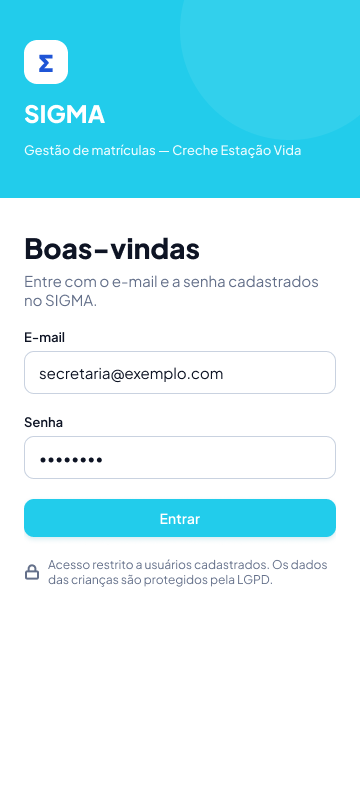

# UC01 - Gerenciar Autenticar

[← Voltar para o Painel de Casos de Uso](index.md) • [Catálogo Unificado de Requisitos](../8_requisitos.md)

## 1. Atores

**Atores principais:** Secretária, Administrador

## 2. Objetivo

Permitir que as secretárias e administradores da Creche Estação Vida entrem e saiam do sistema de forma segura, garantindo que o acesso aos dados dos alunos seja restrito apenas a usuários autorizados.

## 3. Pré-Condições

1. O ator deve possuir uma conta previamente cadastrada no sistema (e-mail e senha) por um Administrador.
2. O sistema deve possuir conexão ativa com a internet e com o banco de dados.

## 4. Fluxo Principal

**FP01 - Realizar Login com Sucesso (RF06)**

1. O ator acessa a página inicial do sistema SIGMA.
2. O sistema exibe o formulário de autenticação solicitando as credenciais. 
3. O ator insere seu e-mail (nome de usuário) e sua senha. 
4. O ator seleciona o botão de "Entrar".
5. O sistema valida as credenciais informadas no banco de dados. (FE01)
6. O sistema autoriza o acesso em um tempo inferior a 2 segundos.
7. O sistema redireciona o ator para o painel principal (dashboard) da aplicação.

## 5. Fluxos Alternativos

**FA01 - Realizar Logout (RF07)** 

1. O ator, já autenticado, clica no botão ou ícone de "Sair" (Logout) no painel do sistema. 
2. O sistema encerra a sessão ativa do usuário. 
3. O sistema redireciona o ator de volta para a tela de login. 

## 6. Fluxos de Exceção

**FE01 - Credenciais Inválidas (Senha Incorreta ou Usuário Inexistente)**

1. O ator insere o e-mail e a senha.
2. O sistema verifica as credenciais e identifica que não há correspondência. (RNF02)
3. O sistema registra a tentativa falha.
4. O sistema exibe a mensagem: "E-mail ou senha incorretos."

**FE02 - Tentativa de Acesso Não Autenticado**

1. O ator tenta acessar diretamente a URL de uma rota interna do sistema sem ter feito login prévio. (RNF02)
2. O sistema identifica a ausência de uma sessão ativa válida. (RNF02)
3. O sistema bloqueia o acesso à rota solicitada, retornando código HTTP 401 (Unauthorized) na API. (RNF02)
4. O sistema redireciona o ator de volta para a tela de login. (RNF02)

**FE03 - Falha de Conexão**

1. O ator insere as credenciais e tenta logar. 
2. O sistema tenta validar as credenciais, mas há indisponibilidade de comunicação com o servidor/banco de dados.
3. O tempo de resposta ultrapassa o limite de 2 segundos. (RNF05)
4. O sistema interrompe a tentativa e exibe a mensagem de erro: "Não foi possível conectar ao servidor. Tente novamente mais tarde."

**FE04 - Conta Bloqueada por Tentativas Excedidas**

1. O ator tenta logar e falha pela 5ª vez consecutiva.
2. O sistema identifica o limite de tentativas atingido. (RN16)
3. O sistema bloqueia a conta temporariamente.
4. O sistema exibe a mensagem: "Conta temporariamente bloqueada por excesso de tentativas. Tente novamente em 15 minutos."

**FE05 - Conta Inativa**

1. O ator insere credenciais corretas, mas sua conta foi desativada por um administrador.
2. O sistema verifica o status da conta. (RN18)
3. O sistema nega o login e não cria a sessão.
4. O sistema exibe a mensagem: "Acesso negado. Sua conta encontra-se inativa. Procure a administração."

## 7. Regras de Negócio

| ID | Regra de Negócio | Justificativa |
|---|---|---|
| [RN16](../8_requisitos.md#rn16) | Bloqueio de acesso após 5 tentativas consecutivas de login inválidas. | Previne ataques de força bruta e protege o sistema. |
| [RN17](../8_requisitos.md#rn17) | Encerramento de sessão após 30 minutos de inatividade. | Protege dados sensíveis em caso de abandono de terminal. |
| [RN18](../8_requisitos.md#rn18) | Restrição de acesso aos usuário com status "Inativo" ou não cadastrados no sistema. | Garante que ex-funcionários percam acesso imediatamente. |

## 8. Requisitos Relacionados

| ID | Nome do Requisito | Relação com o Caso de Uso |
|---|---|---|
| [RF06](../8_requisitos.md#req-rf06) | Realizar login | Funcionalidade primária de entrada no sistema com e-mail e senha. |
| [RF07](../8_requisitos.md#req-rf07) | Realizar logout | Permite o encerramento seguro da sessão ativa pela secretária. |
| [RNF01](../8_requisitos.md#req-rnf01) | Privacidade de Dados LGPD | Restringe a visualização de qualquer dado exclusivamente a usuários autenticados. |
| [RNF02](../8_requisitos.md#req-rnf02) | Restrição de Acesso não Autenticado | Garante o bloqueio de acessos a rotas internas e redirecionamento caso não haja sessão. |
| [RNF05](../8_requisitos.md#req-rnf05) | Tempo de Resposta ao Logar | Define o tempo máximo de 2 segundos para o sistema processar a entrada após o clique. |

## 9. Protótipo

Telas do protótipo (Figma) relacionadas a este caso de uso. Clique em uma imagem para ampliá-la.

<figure class="prototipo" markdown="span">
  [{ loading=lazy }](../../assets/prototipos/uc01-login-desktop.png){ target=_blank }
  <figcaption>Figura 1 – Tela de login – desktop (RF06, RNF02)</figcaption>
</figure>

<figure class="prototipo" markdown="span">
  [{ loading=lazy }](../../assets/prototipos/uc01-login-erro-credenciais.png){ target=_blank }
  <figcaption>Figura 2 – Tela de login – erro de credenciais (RF06)</figcaption>
</figure>

<figure class="prototipo" markdown="span">
  [{ loading=lazy }](../../assets/prototipos/uc01-login-mobile.png){ target=_blank }
  <figcaption>Figura 3 – Tela de login – mobile, 360 px (RNF03)</figcaption>
</figure>

## 10. Aplicação do DoR

Esta seção registra a avaliação de prontidão deste Caso de Uso, conforme os critérios definidos em [Definition of Ready (DoR)](../9_dor_dod.md#91-definition-of-ready-dor). O checklist deve ser preenchido para o Caso de Uso ou para o conjunto de fluxos efetivamente selecionado para uma iteração. A presença deste modelo não significa que o Caso de Uso já foi aprovado.

### Identificação e delimitação da avaliação

- **Caso de Uso:** UC01 — Gerenciar Autenticar
- **Versão do Caso de Uso:** 1.0
- **Iteração planejada:** Iteração 6
- **Responsável(is) pela avaliação:** Todo o grupo de desenvolvimento
- **Data da avaliação:** 5/11/2026
- **Representante consultada:** Letícia
- **Fluxos selecionados para a iteração:** FP01, FA01, FE01, FE02, FE03, FE04 e FE05
- **Fluxos excluídos desta iteração e justificativa:** Nenhum
- **Objetivo(s) específico(s) e característica(s) do produto (OE/CP):** CP4 e OE3 
- **Requisitos funcionais relacionados:** RF06, RF07
- **Requisitos não funcionais relacionados:** RNF01, RNF02, RNF05; 
- **Regras de negócio relacionadas:** RN16, RN17, RN18

### Checklist de prontidão

Para cada critério, selecionar uma única situação e registrar a evidência correspondente. Utilize **Não aplicável** somente quando houver justificativa. Utilize **Pendente de evidência** quando o atendimento ainda não puder ser comprovado.

| ID | Critério de verificação | Situação | Evidência / referência | Observações e pendências |
|---|---|---|---|---|
| DOR01 | O Caso de Uso está formalmente descrito, com atores, objetivo, pré-condições, pós-condições e fluxos principais, alternativos e de exceção aplicáveis claros e sem ambiguidades? | ☒ Atendido | Seções 1 a 6 deste arquivo; complementar com referências específicas. | A preencher |
| DOR02 | Os fluxos selecionados para a iteração estão identificados e delimitados, com indicação do que será desenvolvido agora e do que ficará para depois? | ☒ Atendido | Delimitação do escopo acima e planejamento da iteração. | A preencher |
| DOR03 | A rastreabilidade do escopo está demonstrada pela cadeia aplicável entre objetivo específico, característica do produto, RF/RNF e regras de negócio, conforme a Árvore de Rastreabilidade? | ☒ Atendido | Seção 8 deste arquivo e [Catálogo Unificado de Requisitos](../8_requisitos.md); complementar com a relação OE/CP da árvore. | A preencher |
| DOR04 | As regras de negócio necessárias foram compreendidas, registradas e verificadas quanto a contradições ou decisões essenciais em aberto? | ☒ Atendido | Seção 7 deste arquivo e [Catálogo Unificado de Requisitos](../8_requisitos.md). | A preencher |
| DOR05 | Quando houver impacto na interface, existe protótipo ou wireframe suficientemente detalhado e validado para orientar os fluxos selecionados? | ☒ Atendido | Seção 9 deste arquivo e registro de validação do protótipo. | A preencher |
| DOR06 | As dependências técnicas, riscos, impactos arquiteturais e viabilidade de implementação foram analisados para o escopo selecionado? | ☒ Atendido | Registro da análise técnica, decisões e dependências da iteração. | A preencher |
| DOR07 | A representante do projeto validou o entendimento e a adequação do escopo às necessidades e ao contexto de uso da Creche Estação Vida? | ☒ Atendido | Ata, gravação, comentário ou outro registro de validação com data e responsável. | A preencher |

### Pontos de atenção específicos deste Caso de Uso

- O FE04 informa bloqueio temporário por 15 minutos após cinco tentativas, enquanto a regra RN16 está resumida como bloqueio após cinco tentativas. Confirmar que a duração de 15 minutos está especificada na regra de negócio ou em decisão aprovada.
- Confirmar que os testes e critérios de aceitação cobrem o login válido, credenciais inválidas, tentativa de acesso sem autenticação, expiração de sessão e conta inativa.
- O protótipo mobile referencia RNF03, mas RNF03 não aparece na tabela de requisitos relacionados da seção 8. Conferir a rastreabilidade e atualizar o relacionamento caso o requisito seja aplicável a este Caso de Uso.

### Resultado da avaliação

- **Resultado:** ☒ Ready ☐ Not Ready ☐ Ainda não avaliado
- **Pendências impeditivas:** Nenhuma
- **Pendências não impeditivas:** Nenhuma
- **Responsável pelo acompanhamento:** Lucas Peixoto
- **Data prevista para reavaliação:** 16/11/2026

> **Atenção:** O resultado **Ready** somente poderá ser marcado
> quando todos os critérios aplicáveis estiverem atendidos,
> as evidências estiverem registradas e não houver decisões
> essenciais ou contradições impeditivas em aberto.
>
> Caso contrário, o resultado deverá permanecer como
> **Not Ready** ou **Ainda não avaliado**.
---

[Próximo: UC02 - Gerenciar Usuários Administrativos →](uc02.md)
