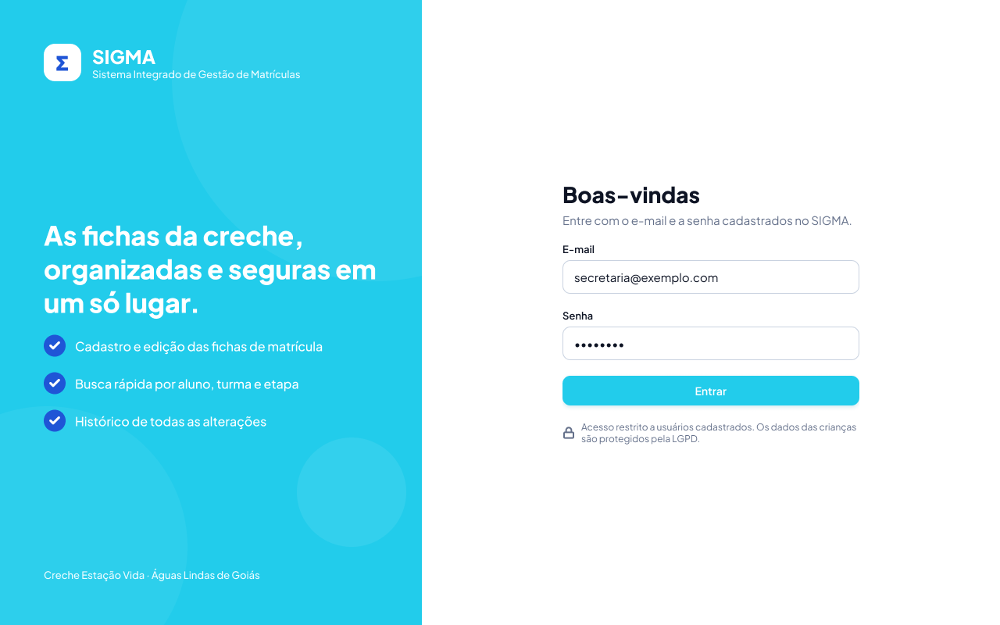
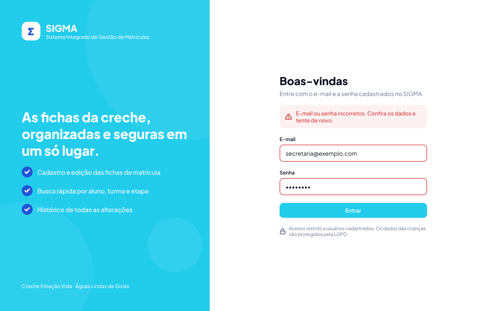

# UC01 - Gerenciar Autenticar

[← Voltar para o Painel de Casos de Uso](index.md) • [Catálogo Unificado de Requisitos](../8_requisitos.md)

## 1. Atores

**Atores principais:** Secretária, Administrador

## 2. Objetivo

Permitir que as secretárias e administradores da Creche Estação Vida entrem e saiam do sistema de forma segura, garantindo que o acesso aos dados dos alunos seja restrito apenas a usuários autorizados.

## 3. Pré-Condições

1. O ator deve possuir uma conta previamente cadastrada no sistema (e-mail e senha) por um Administrador.
2. O sistema deve possuir conexão ativa com a internet e com o banco de dados.

## 4. Fluxo Principal

**FP01 - Realizar Login com Sucesso (RF06)**

1. O ator acessa a página inicial do sistema SIGMA.
2. O sistema exibe o formulário de autenticação solicitando as credenciais. 
3. O ator insere seu e-mail (nome de usuário) e sua senha. 
4. O ator seleciona o botão de "Entrar".
5. O sistema valida as credenciais informadas no banco de dados. (FE01)
6. O sistema autoriza o acesso. A meta é que isso ocorra em menos de 2 segundos sob conexão de rede estável. (RNF05, FA02)
7. O sistema redireciona o ator para o painel principal (dashboard) da aplicação.

## 5. Fluxos Alternativos

**FA01 - Realizar Logout (RF07)** 

1. O ator, já autenticado, clica no botão ou ícone de "Sair" (Logout) no painel do sistema. 
2. O sistema encerra a sessão ativa do usuário. 
3. O sistema redireciona o ator de volta para a tela de login. 

**FA02 - Resposta acima da meta de desempenho (RNF05)**

1. O ator envia suas credenciais e o sistema responde em mais de 2 segundos, mas antes do tempo limite de espera (timeout).
2. O sistema mantém a tentativa em andamento e o fluxo segue normalmente a partir do passo 5 do FP01, ou pelo fluxo de exceção correspondente ao resultado da validação (FE01, FE04 ou FE05).
3. A lentidão não é tratada como falha de conexão: é um desvio da meta de desempenho (RNF05), e não uma indisponibilidade.

## 6. Fluxos de Exceção

Para evitar confusão entre conceitos diferentes, este caso de uso os distingue assim:

| Conceito | Definição neste caso de uso | Tratamento |
|---|---|---|
| Meta de desempenho (RNF05) | Autorizar o acesso em menos de 2 segundos sob conexão de rede estável. | Critério de qualidade verificado nos testes. Se excedida, o login continua normalmente (FA02). |
| Tempo limite de espera (timeout) | Tempo máximo que o sistema aguarda a resposta do servidor antes de interromper a tentativa. Deve ser maior que a meta de 2 segundos. O valor ainda não está definido e deve ser registrado pela equipe técnica. | Ao ser atingido, a tentativa é interrompida (FE03). |
| Indisponibilidade | Falta de comunicação com o servidor ou com o banco de dados. | A tentativa é interrompida com mensagem de erro (FE03). |

**FE01 - Credenciais Inválidas (Senha Incorreta ou Usuário Inexistente)**

1. O ator insere o e-mail e a senha.
2. O sistema verifica as credenciais e identifica que não há correspondência. (RNF02)
3. O sistema registra a tentativa falha.
4. O sistema exibe a mensagem: "E-mail ou senha incorretos."

**FE02 - Tentativa de Acesso Não Autenticado**

1. O ator tenta acessar diretamente a URL de uma rota interna do sistema sem ter feito login prévio. (RNF02)
2. O sistema identifica a ausência de uma sessão ativa válida. (RNF02)
3. O sistema bloqueia o acesso à rota solicitada, retornando código HTTP 401 (Unauthorized) na API. (RNF02)
4. O sistema redireciona o ator de volta para a tela de login. (RNF02)

**FE03 - Indisponibilidade do Servidor ou Timeout**

1. O ator insere as credenciais e tenta logar. 
2. O sistema tenta validar as credenciais, mas há indisponibilidade de comunicação com o servidor/banco de dados, ou a resposta não chega dentro do tempo limite de espera (timeout).
3. O sistema interrompe a tentativa e não cria a sessão.
4. O sistema exibe a mensagem de erro: "Não foi possível conectar ao servidor. Tente novamente mais tarde."

**FE04 - Conta Bloqueada por Tentativas Excedidas**

1. O ator tenta logar e falha pela 5ª vez consecutiva.
2. O sistema identifica o limite de tentativas atingido. (RN16)
3. O sistema bloqueia a conta temporariamente.
4. O sistema exibe a mensagem: "Conta temporariamente bloqueada por excesso de tentativas. Tente novamente em 15 minutos."

**FE05 - Conta Inativa**

1. O ator insere credenciais corretas, mas sua conta foi desativada por um administrador.
2. O sistema verifica o status da conta. (RN18)
3. O sistema nega o login e não cria a sessão.
4. O sistema exibe a mensagem: "Acesso negado. Sua conta encontra-se inativa. Procure a administração."

## 6.1 Diagrama de Atividades

O diagrama a seguir representa o fluxo principal (FP01), os fluxos alternativos (FA01 e FA02) e os fluxos de exceção (FE01 a FE05) deste caso de uso. Ações do ator aparecem em azul, ações do sistema em verde e exceções/alternativos em amarelo. Passe o mouse sobre uma etapa para destacar o caminho percorrido desde o início do fluxo até ela.

```mermaid-caminho
flowchart TD
    inicio(( )) --> a1["Acessar a página inicial do SIGMA"]
    a1 --> s1["Exibir formulário de autenticação"]
    fe02["FE02 - Rota interna sem sessão:<br/>HTTP 401 e volta ao login (RNF02)"] -.-> s1
    s1 --> a2["Inserir e-mail e senha<br/>e selecionar 'Entrar'"]
    a2 --> d1{"Servidor respondeu<br/>antes do timeout?"}
    d1 -- não --> fe03["FE03 - Indisponibilidade ou timeout:<br/>'Não foi possível conectar<br/>ao servidor. Tente novamente mais tarde.'"]
    d1 -- sim --> d2{"Credenciais válidas?<br/>(RNF02)"}
    d2 -- não --> fe01["FE01 - 'E-mail ou senha incorretos.'<br/>FE04 - 5ª falha seguida: bloqueio de 15 min (RN16)"]
    d2 -- sim --> d3{"Conta ativa?<br/>(RN18)"}
    d3 -- não --> fe05["FE05 - 'Acesso negado. Sua conta<br/>encontra-se inativa. Procure a administração.'"]
    d3 -- sim --> d4{"Resposta em até 2 s?<br/>(meta RNF05)"}
    d4 -- sim --> s2["Autorizar e redirecionar<br/>ao dashboard (RF06)"]
    d4 -- não --> fa02["FA02 - Resposta lenta: acesso segue<br/>normalmente; desvio da meta (RNF05)"]
    fa02 --> s2
    s2 -- sair --> fa01["FA01 - Logout (RF07): clicar em 'Sair',<br/>encerrar sessão e voltar ao login"]
    s2 --> fim((( )))
    rn17["RN17 - 30 min de inatividade<br/>encerram a sessão"] -.-> fim

    classDef ponto fill:#1a202c,stroke:#94a3b8
    class inicio,fim ponto
    class a1,a2 cls_cp
    class s1,s2 cls_uc
    class fe01,fe02,fe03,fe05,fa01,fa02,rn17 cls_pos
```

## 7. Regras de Negócio

| ID | Regra de Negócio | Justificativa |
|---|---|---|
| [RN16](../8_requisitos.md#rn16) | Bloqueio de acesso após 5 tentativas consecutivas de login inválidas. | Previne ataques de força bruta e protege o sistema. |
| [RN17](../8_requisitos.md#rn17) | Encerramento de sessão após 30 minutos de inatividade. | Protege dados sensíveis em caso de abandono de terminal. |
| [RN18](../8_requisitos.md#rn18) | Restrição de acesso aos usuário com status "Inativo" ou não cadastrados no sistema. | Garante que ex-funcionários percam acesso imediatamente. |

## 8. Requisitos Relacionados

| ID | Nome do Requisito | Relação com o Caso de Uso |
|---|---|---|
| [RF06](../8_requisitos.md#req-rf06) | Realizar login | Funcionalidade primária de entrada no sistema com e-mail e senha. |
| [RF07](../8_requisitos.md#req-rf07) | Realizar logout | Permite o encerramento seguro da sessão ativa pela secretária. |
| [RNF01](../8_requisitos.md#req-rnf01) | Privacidade de Dados LGPD | Restringe a visualização de qualquer dado exclusivamente a usuários autenticados. |
| [RNF02](../8_requisitos.md#req-rnf02) | Restrição de Acesso não Autenticado | Garante o bloqueio de acessos a rotas internas e redirecionamento caso não haja sessão. |
| [RNF05](../8_requisitos.md#req-rnf05) | Tempo de Resposta ao Logar | Define a meta de desempenho de 2 segundos para o sistema processar a entrada após o clique, sob conexão estável. Não define o timeout nem caracteriza falha de conexão. |

## 9. Protótipo

Telas do protótipo (Figma) relacionadas a este caso de uso. Clique em uma imagem para ampliá-la.

<figure class="prototipo" markdown="span">
  [{ loading=lazy }](../../assets/prototipos/uc01-login-desktop.png){ target=_blank }
  <figcaption>Figura 1 – Tela de login – desktop (RF06, RNF02)</figcaption>
</figure>

<figure class="prototipo" markdown="span">
  [{ loading=lazy }](../../assets/prototipos/uc01-login-erro-credenciais.png){ target=_blank }
  <figcaption>Figura 2 – Tela de login – erro de credenciais (RF06)</figcaption>
</figure>

<figure class="prototipo" markdown="span">
  [{ loading=lazy }](../../assets/prototipos/uc01-login-mobile.png){ target=_blank }
  <figcaption>Figura 3 – Tela de login – mobile, 360 px (RNF03)</figcaption>
</figure>

## 10. Aplicação do DoR

Esta seção registra a avaliação de prontidão deste Caso de Uso, conforme os critérios definidos em [Definition of Ready (DoR)](../9_dor_dod.md#91-definition-of-ready-dor). O checklist deve ser preenchido para o Caso de Uso ou para o conjunto de fluxos efetivamente selecionado para uma iteração. A presença deste modelo não significa que o Caso de Uso já foi aprovado.

### Identificação e delimitação da avaliação

- **Caso de Uso:** UC01 — Gerenciar Autenticar
- **Versão do Caso de Uso:** 2.0 (consolidada na fase de Elaboração)
- **Iteração planejada:** Iteração 4 - Construção (20/10 a 29/10)
- **Responsável(is) pela avaliação:** Lucas Peixoto e Equipe SIGMA
- **Data da avaliação:** 19/10/2026 (pré-Iteração 4, após validação do MVP em 06/10/2026 e montagem dos UCs em 11/10/2026; protótipos revalidados em 04/11/2026)
- **Representante consultada:** Cirlene Sena (diretora/coordenadora) e secretárias da Creche Estação Vida
- **Fluxos selecionados para a iteração:** FP01 (Login com sucesso), FA01 (Logout), FA02 (Resposta acima da meta de desempenho), FE01, FE02, FE03, FE04 e FE05
- **Fluxos excluídos desta iteração e justificativa:** Nenhum — todos os fluxos de autenticação do UC01 integram o escopo do MVP.
- **Objetivo(s) específico(s) e característica(s) do produto (OE/CP):** OE.3 - Segurança / CP4 - Controle de Acesso
- **Requisitos funcionais relacionados:** RF06, RF07
- **Requisitos não funcionais relacionados:** RNF01, RNF02, RNF05; 
- **Regras de negócio relacionadas:** RN16, RN17, RN18

### Checklist de prontidão

Para cada critério, selecionar uma única situação e registrar a evidência correspondente. Utilize **Não aplicável** somente quando houver justificativa. Utilize **Pendente de evidência** quando o atendimento ainda não puder ser comprovado.

| ID | Critério de verificação | Situação | Evidência / referência | Observações e pendências |
|---|---|---|---|---|
| DOR01 | O Caso de Uso está formalmente descrito, com atores, objetivo, pré-condições, pós-condições e fluxos principais, alternativos e de exceção aplicáveis claros e sem ambiguidades? | ☑ Atendido | Seções 1 a 6 deste arquivo (`uc01.md`). | Fluxos FP01, FA01, FA02 e FE01–FE05 descritos; implementação realizada em [PR #55](https://github.com/mdsreq-fga-unb/REQ-2026.2-T01-Sigma/pull/55) e [PR #60](https://github.com/mdsreq-fga-unb/REQ-2026.2-T01-Sigma/pull/60). |
| DOR02 | Os fluxos selecionados para a iteração estão identificados e delimitados, com indicação do que será desenvolvido agora e do que ficará para depois? | ☑ Atendido | [Cronograma e Entregas](../6_cronograma.md) (Iteração 4) e [MVP](../10_backlog.md). | Todos os fluxos de UC01 foram priorizados no MVP para a Iteração 4. |
| DOR03 | A rastreabilidade do escopo está demonstrada pela cadeia aplicável entre objetivo específico, característica do produto, RF/RNF e regras de negócio, conforme a Árvore de Rastreabilidade? | ☑ Atendido | Seção 8 deste arquivo e [Catálogo Unificado de Requisitos](../8_requisitos.md#uc01) (`OE.3` → `CP4` → `RF06, RF07` / `RNF01, RNF02, RNF05` / `RN16–RN18`). | Conferir vínculo de `RNF03` citado na Figura 3 (não impeditivo). |
| DOR04 | As regras de negócio necessárias foram compreendidas, registradas e verificadas quanto a contradições ou decisões essenciais em aberto? | ☑ Atendido | Seção 7 deste arquivo e [Catálogo Unificado de Requisitos](../8_requisitos.md). | Alinhar formalmente o texto resumido de `RN16` com a duração de 15 minutos descrita em `FE04` (não impeditivo). |
| DOR05 | Quando houver impacto na interface, existe protótipo ou wireframe suficientemente detalhado e validado para orientar os fluxos selecionados? | ☑ Atendido | Seção 9 deste arquivo (Figuras 1 a 3 — Figma) e validação com as secretárias registrada em 04/11/2026 ([Cronograma](../6_cronograma.md)). | Telas desktop, erro de login e mobile validadas. |
| DOR06 | As dependências técnicas, riscos, impactos arquiteturais e viabilidade de implementação foram analisados para o escopo selecionado? | ☑ Atendido | Migrações de banco ([PR #41](https://github.com/mdsreq-fga-unb/REQ-2026.2-T01-Sigma/pull/41)), autenticação JWT ([PR #55](https://github.com/mdsreq-fga-unb/REQ-2026.2-T01-Sigma/pull/55)) e integração Docker ([PR #65](https://github.com/mdsreq-fga-unb/REQ-2026.2-T01-Sigma/pull/65)). | Viabilidade técnica confirmada e entregue na Iteração 4. |
| DOR07 | A representante do projeto validou o entendimento e a adequação do escopo às necessidades e ao contexto de uso da Creche Estação Vida? | ☑ Atendido | [Ata de Reunião (06/10/2026)](../../reunioes/ata1.md) e validação do recorte em [MVP](../10_backlog.md#103-validacao-do-mvp-com-o-stakeholder). | Escopo aprovado pela diretora Cirlene Sena. |

### Pontos de atenção específicos deste Caso de Uso

- O FE04 informa bloqueio temporário por 15 minutos após cinco tentativas, enquanto a regra RN16 está resumida como bloqueio após cinco tentativas. Confirmar que a duração de 15 minutos está especificada na regra de negócio ou em decisão aprovada.
- Definir e registrar o valor do tempo limite de espera (timeout) do login, que deve ser maior que a meta de 2 segundos (RNF05). A meta de desempenho, o timeout e a indisponibilidade foram distinguidos na seção 6 e em FA02/FE03.
- O protótipo mobile referencia RNF03, mas RNF03 não aparece na tabela de requisitos relacionados da seção 8. Conferir a rastreabilidade e atualizar o relacionamento caso o requisito seja aplicável a este Caso de Uso.

### Resultado da avaliação

- **Resultado:** ☑ Ready
- **Pendências impeditivas:** Nenhuma para o escopo da Iteração 4.
- **Pendências não impeditivas:** Explicitar na descrição de `RN16` a duração de 15 minutos de bloqueio (`FE04`) conferir o vínculo de `RNF03` na seção 8 e registrar o valor do timeout do login.
- **Responsável pelo acompanhamento:** Lucas Peixoto
- **Data prevista para reavaliação:** Não aplicável (item já em construção/entregue na Iteração 4)
- **nao aparece*

> **Atenção:** O resultado **Ready** somente poderá ser marcado
> quando todos os critérios aplicáveis estiverem atendidos,
> as evidências estiverem registradas e não houver decisões
> essenciais ou contradições impeditivas em aberto.
>
> Caso contrário, o resultado deverá permanecer como
> **Not Ready** ou **Ainda não avaliado**.

## 11. Registro de Validação do DoD

Checklist de funcionalidades deste Caso de Uso, conforme os [Registros de Validação e Evidências do DoD](../registros-dod/index.md).

Visualizar checklist validado do UC01

<iframe src="../../registros-dod/pdfs/UC01_Gerenciar_Autenticar.pdf" width="100%" height="650" title="Checklist de funcionalidades do UC01" loading="lazy"></iframe>

Caso a visualização incorporada não esteja disponível no navegador, <a href="../../registros-dod/pdfs/UC01_Gerenciar_Autenticar.pdf" target="_blank" rel="noopener">abra o PDF em uma nova aba</a>.

---

[Próximo: UC02 - Gerenciar Usuários Administrativos →](uc02.md)