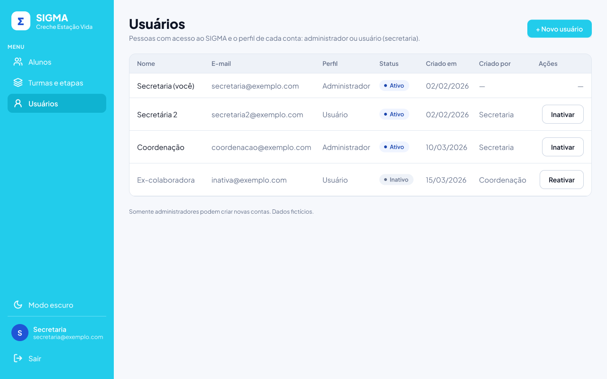
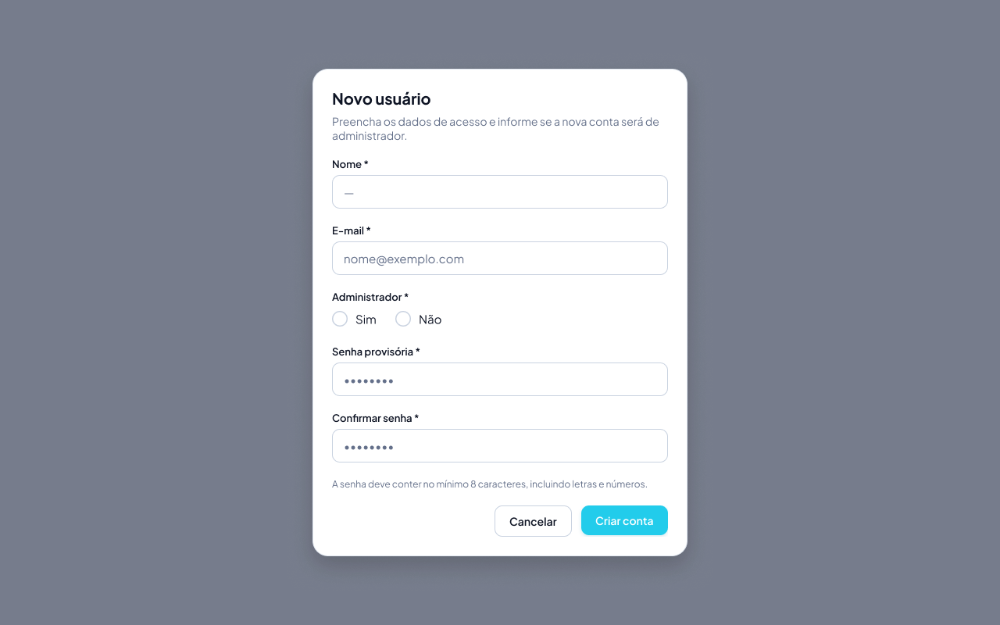
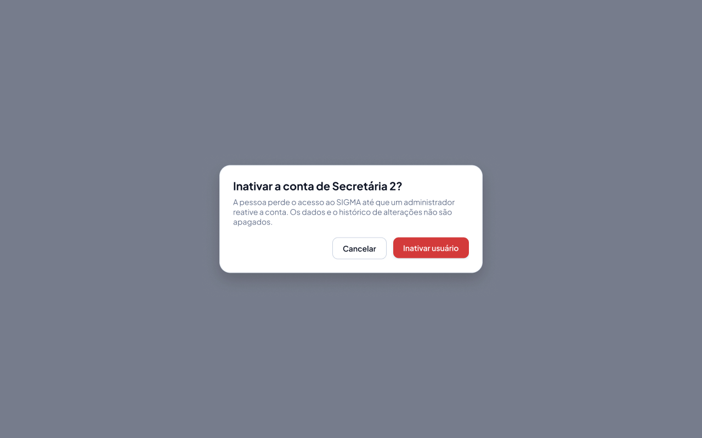

# UC02 - Gerenciar Usuários Administrativos

[← Voltar para o Painel de Casos de Uso](index.md) • [Catálogo Unificado de Requisitos](../8_requisitos.md)

## 1. Atores

**Ator principal:** Administrador

## 2. Objetivo

Permitir que usuários com perfil de Administrador devidamente autenticados no sistema possam cadastrar novas contas de acesso para membros da equipe (secretárias e administradores) e gerenciar seu status de acesso (inativação e reativação de contas).

## 3. Pré-Condições

1. O ator deve estar autenticado no sistema com perfil **Administrador** e status **Ativo**. (RN18)
2. O sistema deve possuir conexão ativa com o banco de dados para salvar ou atualizar as credenciais e o registro de auditoria.

## 4. Fluxo Principal

**FP01 - Cadastrar Novo Usuário (RF05)**

1. O ator acessa a seção de gerenciamento de usuários/configurações do sistema. (RNF02)
2. O ator seleciona a opção de "Novo Usuário" ou "Cadastrar Membro". 
3. O sistema apresenta o formulário de cadastro solicitando os dados necessários (nome, e-mail e senha). 
4. O ator preenche os dados do novo membro da equipe. 
5. O ator seleciona a opção de confirmar o cadastro. 
6. O sistema valida os dados fornecidos (verifica campos obrigatórios, regras de senha forte e unicidade do e-mail). (RN19, RN20)
7. O sistema cadastra o novo usuário no banco de dados com status ativo. (RN18)
8. O sistema exibe uma mensagem de sucesso informando que a conta foi criada. 
9. O sistema atualiza a lista exibindo o novo usuário cadastrado.

## 5. Fluxos Alternativos

**FA01 - Cancelar Cadastro**

1. Durante o preenchimento do formulário de novo usuário, o ator seleciona a opção de cancelar ou voltar.
2. O sistema descarta as informações preenchidas.
3. O sistema retorna para a tela anterior (listagem de usuários ou dashboard).
4. Nenhum registro é salvo no banco de dados.

**FA02 - Inativar Usuário (RF05)**

1. Na listagem de usuários, o Administrador seleciona um usuário com status ativo e aciona a opção "Inativar".
2. O sistema exibe um modal solicitando confirmação explícita da operação. (RN15)
3. O Administrador confirma a inativação. (FE05, FE06)
4. O sistema altera o status do usuário para inativo sem excluir fisicamente o registro (RN21), registra a operação na auditoria e bloqueia novos acessos dessa conta. (RN18)
5. O sistema atualiza a listagem exibindo o status "Inativo" e apresenta mensagem de sucesso.

**FA03 - Reativar Usuário (RF05)**

1. Na listagem de usuários, o Administrador seleciona um usuário com status inativo e aciona a opção "Reativar".
2. O sistema exibe um modal solicitando confirmação explícita da operação. (RN15)
3. O Administrador confirma a reativação. (FE06)
4. O sistema altera o status do usuário para ativo, registra a operação na auditoria e restabelece a permissão de login da conta. (RN18, RN21)
5. O sistema atualiza a listagem exibindo o status "Ativo" e apresenta mensagem de sucesso.

## 6. Fluxos de Exceção

**FE01 - Usuário (E-mail) Já Cadastrado**

1. O ator preenche o formulário e confirma o cadastro. 
2. O sistema verifica o banco de dados e identifica que o e-mail informado já existe. (RN19)
3. O sistema interrompe o processo de salvamento.
4. O sistema exibe a mensagem de erro: "Este e-mail já está em uso por outro usuário."

**FE02 - Campos Obrigatórios Vazios**

1. O ator deixa de preencher um campo obrigatório e tenta confirmar. 
2. O sistema identifica a ausência da informação.
3. O sistema interrompe o processo e alerta quais campos precisam ser preenchidos.

**FE03 - Falha de Conectividade**

1. O ator preenche os dados e clica em salvar. 
2. O sistema perde a conexão com o banco de dados durante a tentativa de registro.
3. O sistema não consegue concluir a operação.
4. O sistema exibe mensagem de erro orientando o ator a tentar novamente mais tarde.

**FE04 - Senha Fora do Padrão de Segurança**

1. O ator insere uma senha com menos de 8 caracteres ou sem letras, números e caracteres especiais. 
2. O sistema valida o padrão de segurança e reprova a senha. (RN20)
3. O sistema interrompe o salvamento.
4. O sistema exibe a mensagem: "A senha deve conter no mínimo 8 caracteres, incluindo letras, números e caracteres especiais."

**FE05 - Tentativa de Inativar a Própria Conta**

1. O Administrador tenta inativar a própria conta autenticada no sistema.
2. O sistema bloqueia a operação e exibe mensagem informando que não é possível inativar a própria conta.

**FE06 - Conta Já Está no Status Solicitado**

1. O Administrador solicita a inativação de uma conta já inativa ou a reativação de uma conta já ativa.
2. O sistema identifica o conflito de estado, interrompe a operação e informa que a conta já se encontra no status desejado.

## 7. Regras de Negócio

| ID | Regra de Negócio | Justificativa |
|---|---|---|
| [RN18](../8_requisitos.md#rn18) | Apenas contas com status "Ativo" podem acessar o sistema. | Garantir bloqueio imediato de contas inativadas. |
| [RN19](../8_requisitos.md#rn19) | Cadastro de usuário com e-mail único. | O e-mail é a chave de login; duplicatas geram falha de autenticação. |
| [RN20](../8_requisitos.md#rn20) | Senha com no mínimo 8 caracteres (letras, números e caracteres especiais). | Segurança de acesso e proteção de dados sensíveis exigida pela LGPD. |
| [RN21](../8_requisitos.md#rn21) | Impedimento da exclusão física de um usuário, apenas inativação. | Preservar a rastreabilidade e integridade das ações registradas no sistema. |

## 8. Requisitos Relacionados

| ID | Nome do Requisito | Relação com o Caso de Uso |
|---|---|---|
| [RF05](../8_requisitos.md#req-rf05) | Gerenciar Usuários (Cadastro e Manutenção de Acesso) | Funcionalidade central deste caso de uso, permitindo ao Administrador cadastrar, listar, inativar e reativar contas de acesso da equipe. |
| [RNF01](../8_requisitos.md#req-rnf01) | Privacidade de Dados LGPD | Restringe a gestão e dados cadastrais de usuários apenas a membros autorizados. |
| [RNF02](../8_requisitos.md#req-rnf02) | Restrição de Acesso não Autenticado | Garante que apenas usuários já autenticados possam acessar a tela de gestão de usuários. |

## 9. Protótipo

Telas do protótipo (Figma) relacionadas a este caso de uso. Clique em uma imagem para ampliá-la.

<figure class="prototipo" markdown="span">
  [{ loading=lazy }](../../assets/prototipos/uc02-usuarios-lista.png){ target=_blank }
  <figcaption>Figura 1 – Tela de usuários do sistema (RF05)</figcaption>
</figure>

<figure class="prototipo" markdown="span">
  [{ loading=lazy }](../../assets/prototipos/uc02-modal-novo-usuario.png){ target=_blank }
  <figcaption>Figura 2 – Modal de cadastro de novo usuário (RF05)</figcaption>
</figure>

<figure class="prototipo" markdown="span">
  [{ loading=lazy }](../../assets/prototipos/uc02-modal-inativar-usuario.png){ target=_blank }
  <figcaption>Figura 3 – Modal de inativação de usuário</figcaption>
</figure>

<figure class="prototipo" markdown="span">
  [{ loading=lazy }](../../assets/prototipos/uc02-modal-reativar-usuario.png){ target=_blank }
  <figcaption>Figura 4 – Modal de reativação de usuário</figcaption>
</figure>

## 10. Aplicação do DoR

Esta seção registra a avaliação de prontidão deste Caso de Uso, conforme os critérios definidos em [Definition of Ready (DoR)](../9_dor_dod.md#91-definition-of-ready-dor). O checklist deve ser preenchido para o Caso de Uso ou para o conjunto de fluxos efetivamente selecionado para uma iteração. A presença deste modelo não significa que o Caso de Uso já foi aprovado.

### Identificação e delimitação da avaliação

- **Caso de Uso:** UC02 — Gerenciar Usuários Administrativos
- **Versão do Caso de Uso:** 2.0 (consolidada na fase de Elaboração)
- **Iteração planejada:** Iteração 4 - Construção (20/10 a 29/10)
- **Responsável(is) pela avaliação:** Lucas Peixoto e Equipe SIGMA
- **Data da avaliação:** 19/10/2026 (pré-Iteração 4, após validação do MVP em 06/10/2026 e montagem dos UCs em 11/10/2026; protótipos revalidados em 04/11/2026)
- **Representante consultada:** Cirlene Sena (diretora/coordenadora) e secretárias da Creche Estação Vida
- **Fluxos selecionados para a iteração:** FP01 (Cadastrar Novo Usuário - RF05), FA01 (Cancelar Cadastro), FE01, FE02, FE03 e FE04
- **Fluxos excluídos desta iteração e justificativa:** Operações de inativação e reativação de conta (ilustradas nos protótipos da Seção 9, porém ainda sem fluxos textuais e regras detalhadas) ficaram fora desta iteração até refinamento completo da especificação.
- **Objetivo(s) específico(s) e característica(s) do produto (OE/CP):** OE.3 - Segurança / CP4 - Controle de Acesso
- **Requisitos funcionais relacionados:** RF05
- **Requisitos não funcionais relacionados:** RNF01, RNF02
- **Regras de negócio relacionadas:** RN18, RN19, RN20, RN21

### Checklist de prontidão

Para cada critério, selecionar uma única situação e registrar a evidência correspondente. Utilize **Não aplicável** somente quando houver justificativa. Utilize **Pendente de evidência** quando o atendimento ainda não puder ser comprovado.

| ID | Critério de verificação | Situação | Evidência / referência | Observações e pendências |
|---|---|---|---|---|
| DOR01 | O Caso de Uso está formalmente descrito, com atores, objetivo, pré-condições, pós-condições e fluxos principais, alternativos e de exceção aplicáveis claros e sem ambiguidades? | ☑ Atendido | Seções 1 a 6 deste arquivo (`uc02.md`) para `FP01`, `FA01` e `FE01`–`FE04`. | Implementado em [PR #61](https://github.com/mdsreq-fga-unb/REQ-2026.2-T01-Sigma/pull/61) e [PR #60](https://github.com/mdsreq-fga-unb/REQ-2026.2-T01-Sigma/pull/60). Fluxos de inativação/reativação ainda precisam ser descritos para iteração futura. |
| DOR02 | Os fluxos selecionados para a iteração estão identificados e delimitados, com indicação do que será desenvolvido agora e do que ficará para depois? | ☑ Atendido | Delimitação acima e [Cronograma e Entregas](../6_cronograma.md) (Iteração 4). | Escopo da iteração restrito ao cadastro de usuários (`RF05`). |
| DOR03 | A rastreabilidade do escopo está demonstrada pela cadeia aplicável entre objetivo específico, característica do produto, RF/RNF e regras de negócio, conforme a Árvore de Rastreabilidade? | ☑ Atendido | Seção 8 deste arquivo e [Catálogo Unificado de Requisitos](../8_requisitos.md#uc02) (`OE.3` → `CP4` → `RF05` / `RNF01, RNF02` / `RN18–RN21`). | Cadeia completa validada para `RF05`. |
| DOR04 | Existem critérios de aceitação verificáveis para os fluxos selecionados, coerentes com os requisitos e regras de negócio relacionados? | ☑ Atendido | Seções 5, 6 e 7 deste arquivo e `RN18`–`RN21` no [Catálogo Unificado](../8_requisitos.md). | Cobre unicidade de e-mail, campos obrigatórios e padrão de senha. |
| DOR05 | As regras de negócio necessárias foram compreendidas, registradas e verificadas quanto a contradições ou decisões essenciais em aberto? | ☑ Atendido | Seção 7 deste arquivo e [Catálogo Unificado de Requisitos](../8_requisitos.md). | Pendente apenas explicitar o perfil autorizado na pré-condição de gerenciamento (não impeditivo para `FP01`, tratado com `RN18`). |
| DOR06 | Quando houver impacto na interface, existe protótipo ou wireframe suficientemente detalhado e validado para orientar os fluxos selecionados? | ☑ Atendido | Seção 9 deste arquivo (Figuras 1 a 4 — Figma) e validação com as secretárias em 04/11/2026 ([Cronograma](../6_cronograma.md)). | Telas de cadastro e listagem validadas. |
| DOR07 | As dependências técnicas, riscos, impactos arquiteturais e viabilidade de implementação foram analisados para o escopo selecionado? | ☑ Atendido | Migrações de usuários ([PR #41](https://github.com/mdsreq-fga-unb/REQ-2026.2-T01-Sigma/pull/41)), backend ([PR #61](https://github.com/mdsreq-fga-unb/REQ-2026.2-T01-Sigma/pull/61)) e integração Docker ([PR #65](https://github.com/mdsreq-fga-unb/REQ-2026.2-T01-Sigma/pull/65)). | Viabilidade confirmada e entregue na Iteração 4. |
| DOR08 | A representante do projeto validou o entendimento e a adequação do escopo às necessidades e ao contexto de uso da Creche Estação Vida? | ☑ Atendido | [Ata de Reunião (06/10/2026)](../../reunioes/ata1.md) e [MVP](../10_backlog.md#103-validacao-do-mvp-com-o-stakeholder). | Escopo aprovado pela diretora Cirlene Sena. |

### Pontos de atenção específicos deste Caso de Uso

- O objetivo menciona criar contas e gerenciar o status de acesso, e há protótipos de inativação e reativação; entretanto, os fluxos textuais apresentados descrevem o cadastro e seu cancelamento, mas não detalham inativação ou reativação. Se essas operações entrarem na iteração, documentar seus fluxos, regras e critérios de aceitação antes de aprovar o DoR.
- Verificar se a autorização para cadastrar ou gerenciar usuários está delimitada por perfil. A pré-condição atual exige autenticação, mas não explicita um perfil autorizado específico.

### Resultado da avaliação

- **Resultado:** ☑ Ready (para o escopo selecionado: `FP01`, `FA01`, `FE01`–`FE04`)
- **Pendências impeditivas:** Nenhuma para `FP01` (cadastro de usuários). Para futuras iterações que incluam inativação/reativação, é obrigatório detalhar os respectivos fluxos e atualizar `RF05`.
- **Pendências não impeditivas:** Explicitar o perfil administrador na pré-condição de autorização do `UC02`.
- **Responsável pelo acompanhamento:** Lucas Peixoto
- **Data prevista para reavaliação:** Antes da iteração que contemplar inativação/reativação de contas

> **Atenção:** O resultado **Ready** somente poderá ser marcado
> quando todos os critérios aplicáveis estiverem atendidos,
> as evidências estiverem registradas e não houver decisões
> essenciais ou contradições impeditivas em aberto.
>
> Caso contrário, o resultado deverá permanecer como
> **Not Ready** ou **Ainda não avaliado**.
---

[← Anterior: UC01 - Gerenciar Autenticar](uc01.md) | [Próximo: UC03 - Gerenciar Quadros de Avisos →](uc03.md)
