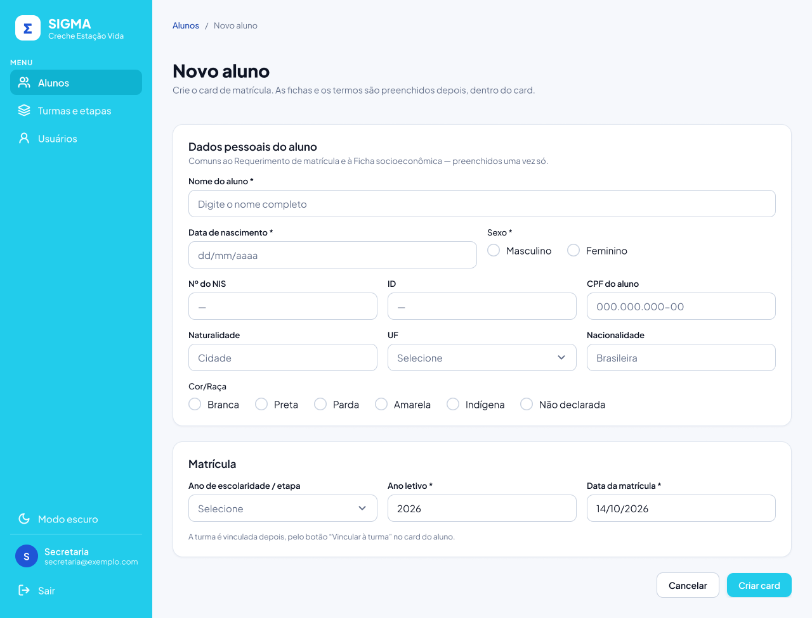
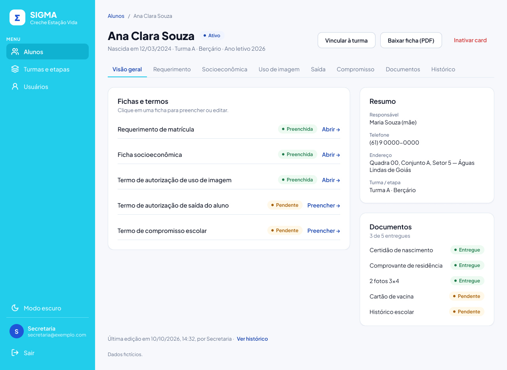
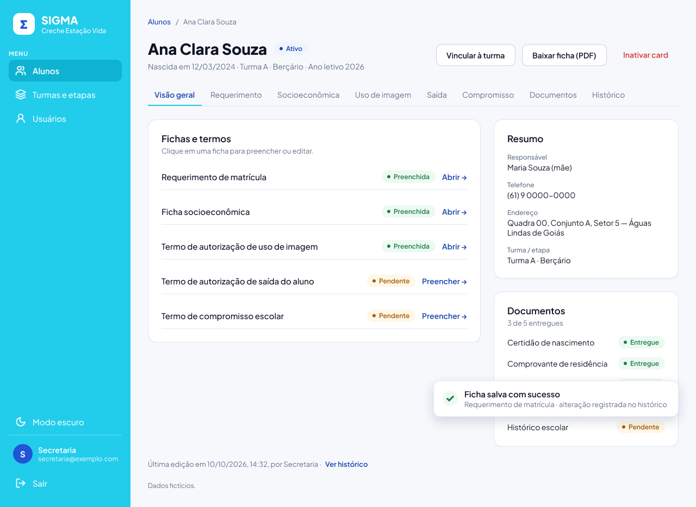
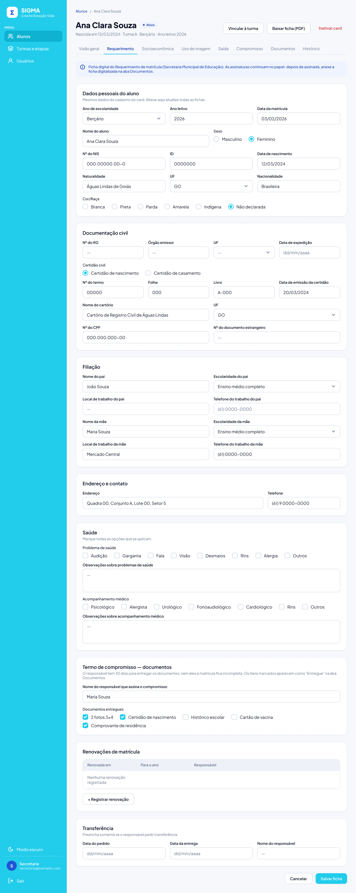
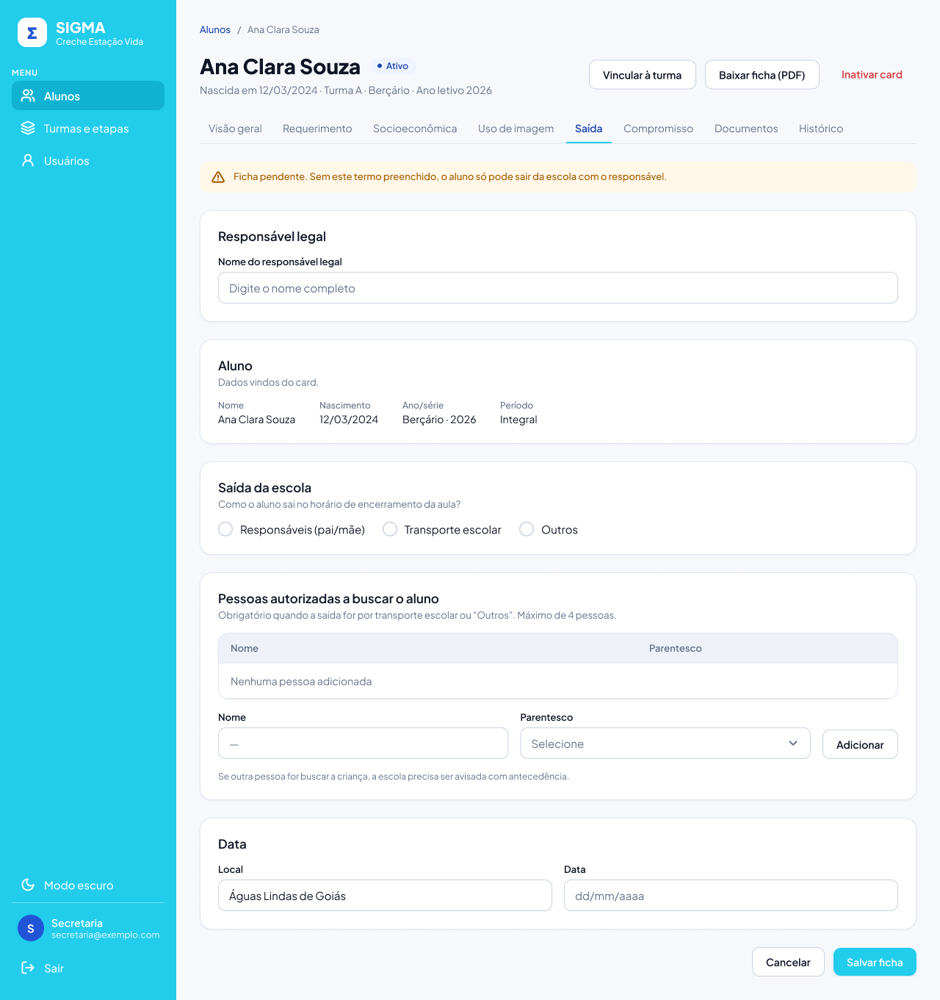
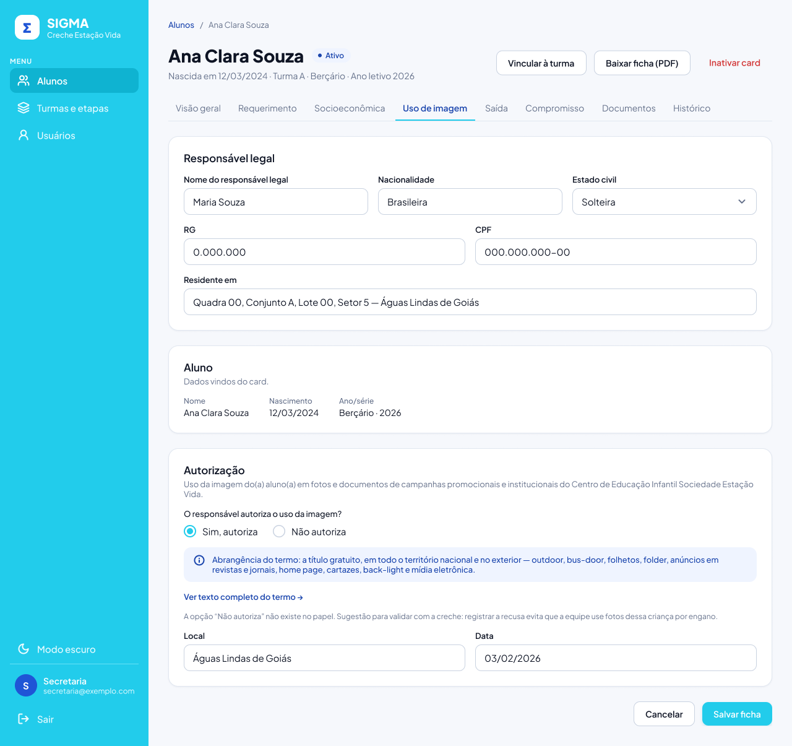
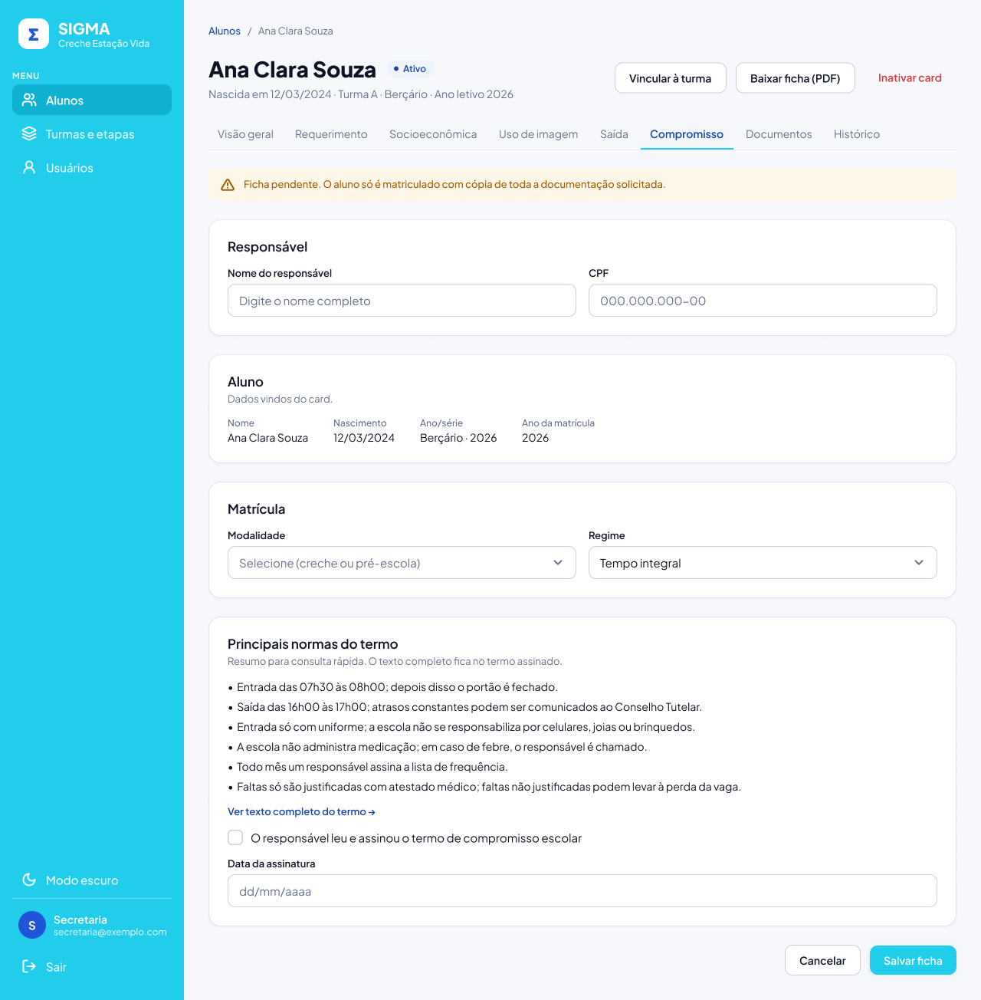
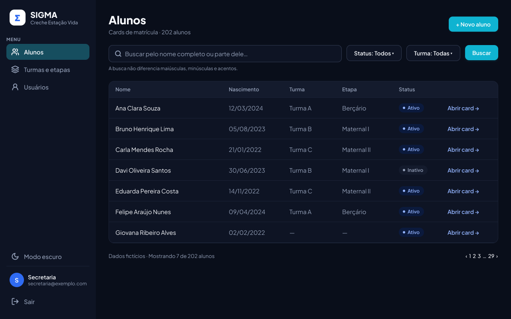
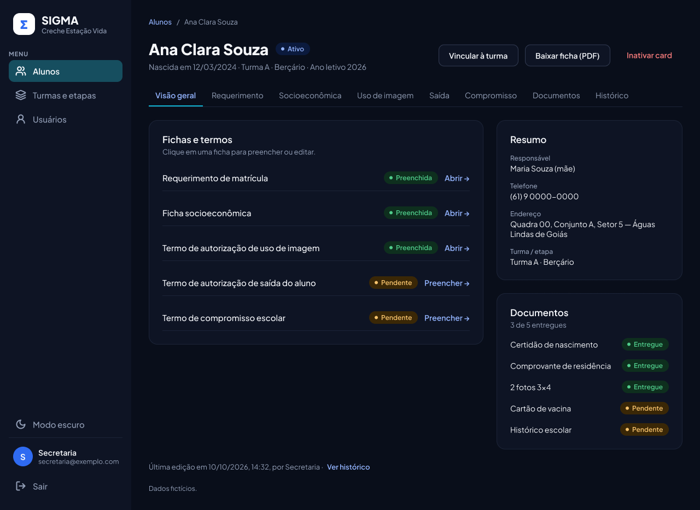
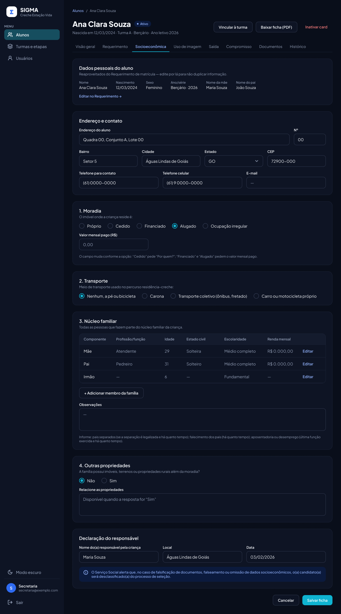

# UC04 - Gerenciar Fichas de Matrícula

[← Voltar para o Painel de Casos de Uso](index.md) • [Catálogo Unificado de Requisitos](../8_requisitos.md)

## 1. Atores

**Atores principais:** Equipe Administrativa (Secretárias, Coordenadoras e Diretora).

## 2. Objetivo

Permitir que a equipe administrativa crie cards de aluno e preencha todas as fichas associadas (socioeconômico, autorização de imagem, saída e compromisso escolar), centralizando os dados em cards de matrícula. Além disso, visa permitir a ativação, reativação ou inativação de uma matrícula, guardar o histórico de edições dos cards atuais e exigir a confirmação de salvamento para garantir a atualização correta dos dados.

## 3. Pré-condições

1. O ator deve estar autenticado no sistema SIGMA.
2. A conta do ator deve estar com o status "Ativo".
3. A sessão do ator não pode ter excedido 30 minutos de inatividade contínua.
4. O ator deve possuir perfil da equipe administrativa (acesso total).
5. O sistema deve possuir conexão ativa com o backend (FastAPI/Python).
6. O backend deve estar integrado ao banco de dados PostgreSQL.

## 4. Fluxo Principal

**FP01 - Cadastrar Card de Aluno e Preencher Fichas (RF08, RF09)**

1. O ator acessa a seção de gerenciamento de matrículas e seleciona a opção para criar um novo card. 
2. O sistema apresenta o formulário inicial para os dados do aluno. 
3. O ator preenche os dados cadastrais básicos do aluno e seleciona a turma e etapa de ensino ativa correspondente (RN02, UC07).
4. O sistema avança para as abas ou seções de preenchimento das fichas obrigatórias (Socioeconômica, Imagem, Saída, Compromisso Escolar, Requerimento). 
5. O ator preenche todas as informações necessárias nas fichas. 
6. O ator aciona a opção de salvar os dados.
7. O sistema solicita a confirmação do salvamento. (RN15, FA05)
8. O ator confirma a operação. 
9. O sistema valida todos os campos obrigatórios, o vínculo com turma/etapa e verifica se não há conflitos de duplicidade. (RN02, RN06, RN07, FE01, FE02)
10. O sistema registra o card do aluno e as fichas preenchidas no banco de dados em menos de 5 segundos. (RNF08, RNF01, FE04)
11. O sistema altera o status da matrícula para ativa (mediante fichas completas e vínculo com turma/etapa) e exibe mensagem de sucesso. (RN01, RN02, RN03)

## 5. Fluxos Alternativos

**FA01 - Editar Fichas de Matrícula (RF10, RF17)**

1. O ator acessa a lista de cards de matrícula e seleciona um aluno com matrícula ativa. (FE03)
2. O ator aciona a opção de edição.
3. O sistema carrega os dados atuais das fichas.
4. O ator altera as informações desejadas.
5. O ator aciona a opção de salvar e confirma a operação. (RN15)
6. O sistema valida os campos, registra o novo estado no banco e salva um registro no histórico de edições do card. (RN06, FE01, FE02, FE04)
7. O sistema exibe mensagem de sucesso.

**FA02 - Inativar Matrícula (Pós-MVP) (RF11, RF17)**

1. O ator acessa a lista de cards e seleciona um aluno.
2. O ator aciona a opção de inativar a matrícula.
3. O sistema solicita confirmação para a inativação. (RN15)
4. O ator confirma.
5. O sistema altera o status do card para inativo, bloqueando futuras edições, e salva a alteração no histórico. (RN10)

**FA03 - Reativar Matrícula (Pós-MVP) (RF12, RF17)**

1. O ator busca por um aluno com status inativo e acessa seu card.
2. O ator aciona a opção de reativar a matrícula.
3. O sistema solicita confirmação. (RN15)
4. O ator confirma.
5. O sistema altera o status para ativo, liberando novamente a edição, e registra a ação no histórico. (RN10)

**FA04 - Consultar Histórico de Edições (RF17)**

1. O ator acessa o card de um aluno (ativo ou inativo).
2. O ator aciona a opção para visualizar o histórico de alterações.
3. O sistema exibe a lista de edições anteriores, mostrando data, autor e o que foi modificado.

**FA05 - Cancelar Criação ou Edição**

1. Durante o preenchimento ou edição de uma ficha, o ator aciona a opção de cancelar.
2. O sistema descarta as informações inseridas ou alteradas. (RN15)
3. O sistema retorna à visualização anterior, sem registrar nenhuma modificação no banco de dados.

## 6. Fluxos de Exceção

**FE01 - Fichas Obrigatórias Incompletas (RF09, RF10)**

1. O ator tenta confirmar a criação ou edição sem preencher todos os campos obrigatórios das fichas exigidas.
2. O sistema identifica a ausência dos dados. (RN06)
3. O sistema impede o salvamento e não ativa a matrícula. (RN03)
4. O sistema destaca os campos faltantes e exibe mensagem de erro.

**FE02 - Duplicidade de Cadastro (CPF ou Matrícula) (RF08)**

1. O ator tenta salvar um novo card ou editar um existente informando um número de matrícula ou CPF que já consta no banco de dados.
2. O sistema identifica a duplicidade durante a validação. (RN07)
3. O sistema impede o salvamento e avisa ao ator sobre o conflito de dados.

**FE03 - Tentativa de Edição em Matrícula Inativa (RF10, RF11, RF12)**

1. O ator acessa o card de um aluno inativo.
2. O sistema identifica o status da matrícula e oculta ou desabilita os botões de edição das fichas. (RN10)
3. O ator só consegue visualizar os dados ou acionar a reativação. (FA03)

**FE04 - Falha de Conectividade ou Tempo de Resposta Excedido**

1. O ator confirma o salvamento dos dados.
2. Caso a persistência ultrapasse o tempo esperado de 5 segundos, o sistema exibe o indicativo *"A operação está demorando mais que o esperado"* e disponibiliza a opção de **cancelar** para tentar novamente ou continuar aguardando. (RNF08)
3. Se o ator optar por cancelar ou ocorrer falha definitiva de conexão/erro no banco, o sistema interrompe a operação sem salvar dados parciais e exibe mensagem orientando a tentar novamente.

## 7. Regras de Negócio

| ID | Regra de Negócio | Justificativa | Requisitos Relacionados |
|---|---|---|---|
| [RN01](../8_requisitos.md#rn01) | Cada aluno pode ter apenas uma matrícula ativa por vez. | Evita duplicidade de registros e conflitos de turma. | [RF08](../8_requisitos.md#req-rf08), [RF09](../8_requisitos.md#req-rf09) |
| [RN02](../8_requisitos.md#rn02) | Toda matrícula ativa deve estar vinculada a exatamente uma turma e a uma etapa (selecionada no cadastro ou na alocação em `UC07`). | Estrutura organizacional da creche e integridade referencial no banco (`turma_id` obrigatório). | [RF08](../8_requisitos.md#req-rf08), [RF13](../8_requisitos.md#req-rf13) |
| [RN03](../8_requisitos.md#rn03) | Uma matrícula só pode ser considerada ativa após o preenchimento completo das fichas obrigatórias (Termo de compromisso escolar, Autorização de uso de Imagem, Autorização de saída, Socioeconômica e Requerimento de Matrícula) **e** o vínculo com uma turma e etapa ativas (`RN02`). | Garantir conformidade documental e alocação escolar completa. | [RF09](../8_requisitos.md#req-rf09), [RF10](../8_requisitos.md#req-rf10), [RF13](../8_requisitos.md#req-rf13) |
| [RN06](../8_requisitos.md#rn06) | Campos obrigatórios devem ser validados antes do salvamento. | Garantir conformidade cadastral. | [RF09](../8_requisitos.md#req-rf09), [RF10](../8_requisitos.md#req-rf10), [RF13](../8_requisitos.md#req-rf13) |
| [RN07](../8_requisitos.md#rn07) | Impedir cadastro de dois alunos com a mesma matrícula ou CPF. | Evita conflito e sobreposição de dados. | [RF08](../8_requisitos.md#req-rf08), [RF21](../8_requisitos.md#req-rf21) |
| [RN10](../8_requisitos.md#rn10) | Uma matrícula inativa não poderá ser editada, só pode ser consultada e reativada. | Garante que registros inativos não sejam alterados indevidamente. | [RF10](../8_requisitos.md#req-rf10), [RF11](../8_requisitos.md#req-rf11), [RF13](../8_requisitos.md#req-rf13), [RF14](../8_requisitos.md#req-rf14) |
| [RN15](../8_requisitos.md#rn15) | Operações de salvamento, alteração, inativação ou exclusão exigem confirmação explícita ("Confirmar" ou "Cancelar") antes de persistir os dados (regra transversal que consolida o antigo RF23). | Evita salvamentos ou alterações acidentais de dados. | [RF10](../8_requisitos.md#req-rf10) |

## 8. Requisitos Relacionados

| ID | Nome do Requisito | Relação com o Caso de Uso |
|---|---|---|
| [RF08](../8_requisitos.md#req-rf08) | Cadastrar Card de Aluno | Permite a criação do registro base do aluno no sistema. |
| [RF09](../8_requisitos.md#req-rf09) | Preenchimento de Fichas | Viabiliza o registro das informações obrigatórias para ativação da matrícula. |
| [RF10](../8_requisitos.md#req-rf10) | Editar Fichas do Card | Permite manter os dados do aluno permanentemente atualizados. |
| [RF11](../8_requisitos.md#req-rf11) | Inativar Card de Aluno | Permite suspender ou desativar o registro sem exclusão física (Adiado pós-MVP em ata). |
| [RF12](../8_requisitos.md#req-rf12) | Reativar Card de Aluno | Permite retornar um registro inativo ao status ativo (Adiado pós-MVP em ata). |
| [RF17](../8_requisitos.md#req-rf17) | Apresentar Histórico de Edições | Garante auditoria e rastreabilidade das modificações realizadas. |
| [RNF01](../8_requisitos.md#req-rnf01) | Privacidade de Dados LGPD | Proteção rígida aos dados sensíveis das crianças e famílias atendidas. |
| [RNF02](../8_requisitos.md#req-rnf02) | Restrição de Acesso não Autenticado | Impede qualquer acesso não autenticado às fichas de matrícula. |
| [RNF08](../8_requisitos.md#req-rnf08) | Tempo de Resposta para Salvar Ficha | Garante salvamento em menos de 5 segundos para 95% das operações. |

## 9. Protótipo

Telas do protótipo (Figma) relacionadas a este caso de uso. Clique em uma imagem para ampliá-la.

### Cadastro do card

<figure class="prototipo" markdown="span">
  [{ loading=lazy }](../../assets/prototipos/uc04-cadastrar-card.png){ target=_blank }
  <figcaption>Figura 1 – Tela de cadastro de novo card de matrícula (RF08)</figcaption>
</figure>

### Card do aluno

<figure class="prototipo" markdown="span">
  [{ loading=lazy }](../../assets/prototipos/uc04-card-visao-geral.png){ target=_blank }
  <figcaption>Figura 2 – Card do aluno – visão geral (RF08, RF11)</figcaption>
</figure>

<figure class="prototipo" markdown="span">
  [{ loading=lazy }](../../assets/prototipos/uc04-card-inativo.png){ target=_blank }
  <figcaption>Figura 3 – Card do aluno – matrícula inativa (RF11, RF12)</figcaption>
</figure>

<figure class="prototipo" markdown="span">
  [{ loading=lazy }](../../assets/prototipos/uc04-card-ficha-salva.png){ target=_blank }
  <figcaption>Figura 4 – Card do aluno – ficha salva (RF23, RNF08)</figcaption>
</figure>

### Fichas e termos

<figure class="prototipo" markdown="span">
  [{ loading=lazy }](../../assets/prototipos/uc04-ficha-requerimento-matricula.png){ target=_blank }
  <figcaption>Figura 5 – Ficha – requerimento de matrícula (RF09, RF10)</figcaption>
</figure>

<figure class="prototipo" markdown="span">
  [{ loading=lazy }](../../assets/prototipos/uc04-ficha-socioeconomica.png){ target=_blank }
  <figcaption>Figura 6 – Ficha – socioeconômica (RF09, RF10)</figcaption>
</figure>

<figure class="prototipo" markdown="span">
  [{ loading=lazy }](../../assets/prototipos/uc04-termo-autorizacao-saida.png){ target=_blank }
  <figcaption>Figura 7 – Termo – autorização de saída do aluno (RF09, RF10)</figcaption>
</figure>

<figure class="prototipo" markdown="span">
  [{ loading=lazy }](../../assets/prototipos/uc04-termo-autorizacao-imagem.png){ target=_blank }
  <figcaption>Figura 8 – Termo – autorização de uso de imagem (RF09, RF10)</figcaption>
</figure>

<figure class="prototipo" markdown="span">
  [{ loading=lazy }](../../assets/prototipos/uc04-termo-compromisso-escolar.png){ target=_blank }
  <figcaption>Figura 9 – Termo – compromisso escolar (RF09, RF10)</figcaption>
</figure>

### Histórico de edições

<figure class="prototipo" markdown="span">
  [{ loading=lazy }](../../assets/prototipos/uc04-historico-edicoes.png){ target=_blank }
  <figcaption>Figura 10 – Histórico de edições (RF17)</figcaption>
</figure>

### Modais

<figure class="prototipo" markdown="span">
  [{ loading=lazy }](../../assets/prototipos/uc04-modal-inativar-card.png){ target=_blank }
  <figcaption>Figura 11 – Modal de inativação do card (RF11)</figcaption>
</figure>

<figure class="prototipo" markdown="span">
  [{ loading=lazy }](../../assets/prototipos/uc04-modal-confirmar-salvamento.png){ target=_blank }
  <figcaption>Figura 12 – Modal de confirmação de salvamento (RF23)</figcaption>
</figure>

### Modo escuro (RNF04)

<figure class="prototipo" markdown="span">
  [{ loading=lazy }](../../assets/prototipos/uc04-escuro-lista-alunos.png){ target=_blank }
  <figcaption>Figura 13 – Lista de alunos em modo escuro (RNF04)</figcaption>
</figure>

<figure class="prototipo" markdown="span">
  [{ loading=lazy }](../../assets/prototipos/uc04-escuro-card-aluno.png){ target=_blank }
  <figcaption>Figura 14 – Card do aluno em modo escuro (RNF04)</figcaption>
</figure>

<figure class="prototipo" markdown="span">
  [{ loading=lazy }](../../assets/prototipos/uc04-escuro-ficha-socioeconomica.png){ target=_blank }
  <figcaption>Figura 15 – Ficha socioeconômica em modo escuro (RNF04)</figcaption>
</figure>

---

[← Anterior: UC03 - Gerenciar Quadros de Avisos](uc03.md) | [Próximo: UC05 - Gerenciar Documentos Digitais →](uc05.md)
