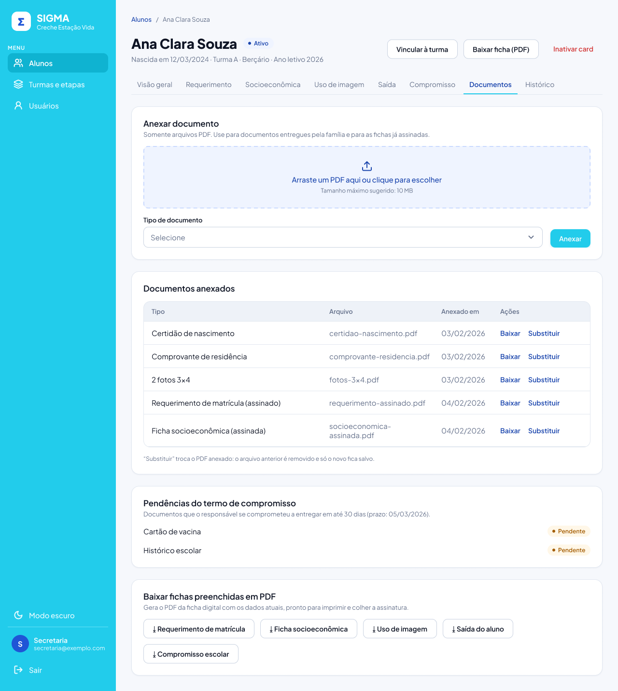

# UC05 - Gerenciar Documentos Digitais

[← Voltar para o Painel de Casos de Uso](index.md) • [Catálogo Unificado de Requisitos](../8_requisitos.md)

## 1. Atores

**Ator principal:** Secretárias da instituição

## 2. Objetivo

Realizar upload de documentos digitalizados em PDF (anexando-os à ficha correspondente), realizar download individual das fichas ou dos anexos e substituir documentos incorretos caso necessário.

## 3. Pré-Condições

1. O card de matrícula deve estar criado previamente.
2. A conta do ator deve estar com o status ativo.
3. A conta do ator deve estar autenticada no sistema.
4. O documento tem que estar em formato PDF.

## 4. Fluxo Principal

**FP01 - Anexar um novo documento (RF14, RF16)**

1. O ator realiza a autenticação. (RNF02)
2. O ator realiza a busca de um card de matrícula.
3. O ator seleciona o card desejado.
4. O sistema apresenta as fichas e documentos daquele card.
5. O ator aciona o botão de fazer o upload de arquivo.
6. O sistema irá abrir uma tela do explorador de arquivos.
7. O ator seleciona o arquivo em formato PDF ou arrasta para a área de upload. (RN05, FE01)
8. O sistema carrega o arquivo e realiza o upload. (RNF01)
9. O sistema apresenta uma mensagem de ação realizada com sucesso.
10. O sistema agora disponibiliza o documento para download em formato PDF.

## 5. Fluxos Alternativos

**FA01 - Editar um documento já existente (RF15, RF16)**

1. O ator acessa um card de um aluno.
2. O ator seleciona o documento que deseja editar.
3. O sistema irá abrir o explorador de arquivos.
4. O ator seleciona o novo documento ou arrasta ele para a área de upload. (RN05, FE01)
5. O autor aciona o botão de "salvar documento", e em seguida um de "tem certeza?".
6. O sistema vai realizar o upload do novo documento. (RNF01)
7. O sistema vai disponibilizar o download do novo documento.
8. O sistema deve disponibilizar a versão atualizada do documento.
9. O sistema vai retornar uma mensagem de "ação realizada com sucesso".

## 6. Fluxos de Exceção

**FE01 - Formato inválido**

1. O sistema identifica o formato do documento que não seja formato PDF.
2. Não permite a ação e dá uma notificação de "formato de arquivo inválido". (RN05)

## 7. Regras de Negócio

| ID | Regra de Negócio | Justificativa | Requisitos Relacionados |
|---|---|---|---|
| [RN05](../8_requisitos.md#rn05) | Todos os documentos anexados devem estar em formato PDF. | Padronização e compatibilidade. | [RF14](../8_requisitos.md#req-rf14), [RF15](../8_requisitos.md#req-rf15) |
| [RN10](../8_requisitos.md#rn10) | Uma matrícula inativa não poderá ser editada nem receber novos anexos. | Preservar integridade de registros inativos. | [RF14](../8_requisitos.md#req-rf14), [RF15](../8_requisitos.md#req-rf15) |

## 8. Requisitos Relacionados

| ID | Nome do Requisito | Relação com o Caso de Uso |
|---|---|---|
| [RF14](../8_requisitos.md#req-rf14) | Anexar documentos | Permite ao usuário anexar cópias digitalizadas em PDF às fichas de matrícula do aluno. |
| [RF15](../8_requisitos.md#req-rf15) | Editar/Substituir documentos | Permite a substituição controlada de arquivos em anexo com erro ou desatualizados. |
| [RF16](../8_requisitos.md#req-rf16) | Baixar fichas e documentos | Permite o download individual de fichas preenchidas ou anexos comprobatórios em formato PDF. |
| [RNF01](../8_requisitos.md#req-rnf01) | Privacidade de Dados LGPD | Proteção e guarda confidencial dos documentos digitalizados dos alunos. |
| [RNF02](../8_requisitos.md#req-rnf02) | Restrição de Acesso não Autenticado | Impede downloads e uploads por pessoas não autorizadas. |

## 9. Protótipo

Telas do protótipo (Figma) relacionadas a este caso de uso. Clique em uma imagem para ampliá-la.

<figure class="prototipo" markdown="span">
  [{ loading=lazy }](../../assets/prototipos/uc05-documentos-digitais.png){ target=_blank }
  <figcaption>Figura 1 – Tela de documentos digitais (RF14, RF15, RF16)</figcaption>
</figure>

<figure class="prototipo" markdown="span">
  [{ loading=lazy }](../../assets/prototipos/uc05-modal-substituir-documento.png){ target=_blank }
  <figcaption>Figura 2 – Modal de substituição de documento (RF15)</figcaption>
</figure>

## 10. Aplicação do DoR

Esta seção registra a avaliação de prontidão deste Caso de Uso, conforme os critérios definidos em [Definition of Ready (DoR)](../9_dor_dod.md#91-definition-of-ready-dor). O checklist deve ser preenchido para o Caso de Uso ou para o conjunto de fluxos efetivamente selecionado para uma iteração. A presença deste modelo não significa que o Caso de Uso já foi aprovado.

### Identificação e delimitação da avaliação

- **Caso de Uso:** UC05 — Gerenciar Documentos Digitais
- **Versão do Caso de Uso:** 2.0 (consolidada na fase de Elaboração)
- **Iteração planejada:** Iteração 6 / Transição (tabelas de banco criadas em [PR #69](https://github.com/mdsreq-fga-unb/REQ-2026.2-T01-Sigma/pull/69); implementação dos fluxos aguarda resolução das pendências de especificação)
- **Responsável(is) pela avaliação:** Lucas Peixoto e Equipe SIGMA
- **Data da avaliação:** 05/11/2026 (pré-Iteração 6, após validação dos protótipos com as secretárias em 04/11/2026)
- **Representante consultada:** Cirlene Sena (diretora/coordenadora) e secretárias da Creche Estação Vida
- **Fluxos selecionados para a iteração:** FP01 (Anexar novo documento - RF14), FA01 (Editar/Substituir documento - RF15) e FE01 (Formato inválido) — download individual (`RF16`) pendente de detalhamento
- **Fluxos excluídos desta iteração e justificativa:** Nenhum excluído do MVP, porém a implementação completa depende de fechar as pendências de `RF15` e `RF16`.
- **Objetivo(s) específico(s) e característica(s) do produto (OE/CP):** OE.2 - Preservar Informações / CP5 - Gerenciamento de Documentos
- **Requisitos funcionais relacionados:** RF14, RF15, RF16
- **Requisitos não funcionais relacionados:** RNF01, RNF02
- **Regras de negócio relacionadas:** RN05, RN10

### Checklist de prontidão

Para cada critério, selecionar uma única situação e registrar a evidência correspondente. Utilize **Não aplicável** somente quando houver justificativa. Utilize **Pendente de evidência** quando o atendimento ainda não puder ser comprovado.

| ID | Critério de verificação | Situação | Evidência / referência | Observações e pendências |
|---|---|---|---|---|
| DOR01 | O Caso de Uso está formalmente descrito, com atores, objetivo, pré-condições, pós-condições e fluxos principais, alternativos e de exceção aplicáveis claros e sem ambiguidades? | ☑ Não atendido | Seções 1 a 6 deste arquivo (`uc05.md`). | `RF16` (download individual) é citado no objetivo/card, mas não possui fluxo detalhado descrevendo a ação de baixar. |
| DOR02 | Os fluxos selecionados para a iteração estão identificados e delimitados, com indicação do que será desenvolvido agora e do que ficará para depois? | ☑ Atendido | Delimitação acima e [Cronograma e Entregas](../6_cronograma.md) (Iteração 6). | Escopo do MVP identificado (`CP5`). |
| DOR03 | A rastreabilidade do escopo está demonstrada pela cadeia aplicável entre objetivo específico, característica do produto, RF/RNF e regras de negócio, conforme a Árvore de Rastreabilidade? | ☑ Atendido | Seção 8 deste arquivo e [Catálogo Unificado de Requisitos](../8_requisitos.md#uc05) (`OE.2` → `CP5` → `RF14–RF16` / `RNF01, RNF02` / `RN05, RN10`). | Cadeia rastreada no catálogo. |
| DOR04 | Existem critérios de aceitação verificáveis para os fluxos selecionados, coerentes com os requisitos e regras de negócio relacionados? | ☑ Pendente de evidência | Seções 5, 6 e 7 deste arquivo. | Faltam critérios verificáveis para download (`RF16`) e tratamento do arquivo anterior na substituição (`RF15`). |
| DOR05 | As regras de negócio necessárias foram compreendidas, registradas e verificadas quanto a contradições ou decisões essenciais em aberto? | ☑ Não atendido | Seção 7 deste arquivo e `RN05, RN10` no [Catálogo Unificado](../8_requisitos.md). | Decisão em aberto sobre substituição (`RF15`): retenção/exclusão do documento anterior e proteção contra perda ou exposição indevida. |
| DOR06 | Quando houver impacto na interface, existe protótipo ou wireframe suficientemente detalhado e validado para orientar os fluxos selecionados? | ☑ Atendido | Seção 9 deste arquivo (Figuras 1 e 2 — Figma) e validação com as secretárias em 04/11/2026. | Modais de upload e substituição validados. |
| DOR07 | As dependências técnicas, riscos, impactos arquiteturais e viabilidade de implementação foram analisados para o escopo selecionado? | ☑ Atendido | Tabelas de documentos digitais criadas em [PR #69](https://github.com/mdsreq-fga-unb/REQ-2026.2-T01-Sigma/pull/69). | Estrutura de persistência definida; falta definir armazenamento/retenção de arquivos na substituição. |
| DOR08 | A representante do projeto validou o entendimento e a adequação do escopo às necessidades e ao contexto de uso da Creche Estação Vida? | ☑ Atendido | [Ata de Reunião (06/10/2026)](../../reunioes/ata1.md) e [MVP](../10_backlog.md#103-validacao-do-mvp-com-o-stakeholder). | Necessidade de anexar e baixar documentos validada. |

### Pontos de atenção específicos deste Caso de Uso

- O objetivo e RF16 incluem o download individual de fichas/documentos, mas os fluxos atuais descrevem a disponibilização do arquivo para download, sem detalhar explicitamente a ação do ator para baixar. Se o download estiver no escopo, descrever o comportamento esperado e seus critérios de aceitação.
- Confirmar o comportamento esperado da substituição previsto em RF15, inclusive o tratamento do documento anterior e a proteção contra perda ou exposição indevida de dados. Registrar a decisão aprovada, sem presumir retenção de versões anteriores.

### Resultado da avaliação

- **Resultado:** ☑ Not Ready
- **Pendências impeditivas:** Detalhar o fluxo de download individual (`RF16`) no `uc05.md` e registrar a decisão sobre substituição/retenção de documentos anteriores (`RF15`).
- **Pendências não impeditivas:** Nenhuma adicional após resolução dos itens impeditivos.
- **Responsável pelo acompanhamento:** Lucas Peixoto
- **Data prevista para reavaliação:** Antes da implementação dos endpoints/telas de documentos digitais (Iteração 8 - Transição)

> **Atenção:** O resultado **Ready** somente poderá ser marcado
> quando todos os critérios aplicáveis estiverem atendidos,
> as evidências estiverem registradas e não houver decisões
> essenciais ou contradições impeditivas em aberto.
>
> Caso contrário, o resultado deverá permanecer como
> **Not Ready** ou **Ainda não avaliado**.
---

[← Anterior: UC04 - Gerenciar Fichas de Matrícula](uc04.md) | [Próximo: UC06 - Gerenciar Estrutura Escolar (Etapas e Turmas) →](uc06.md)
