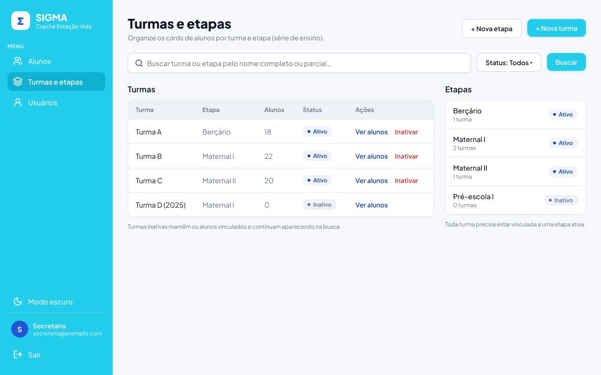
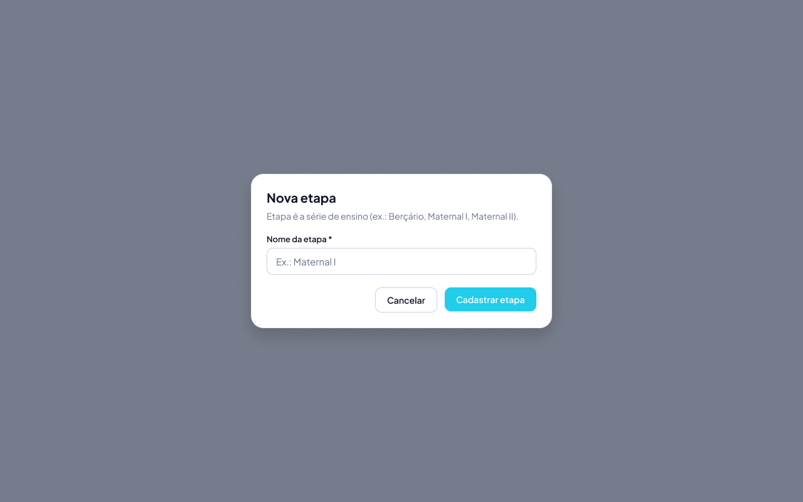
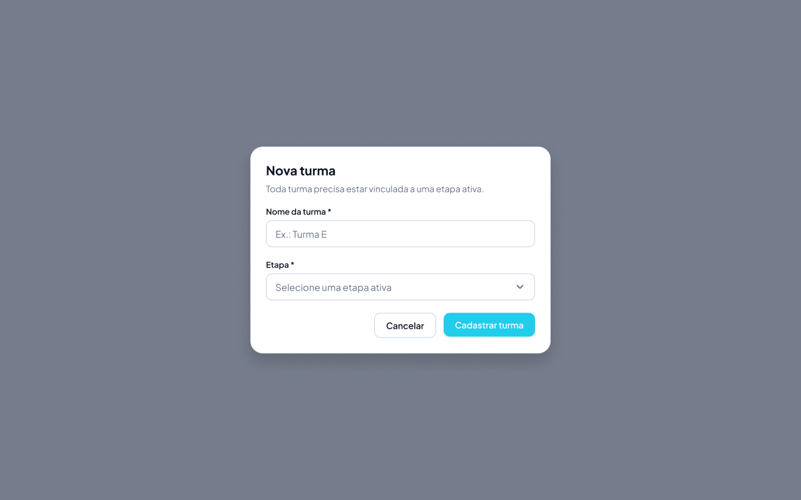
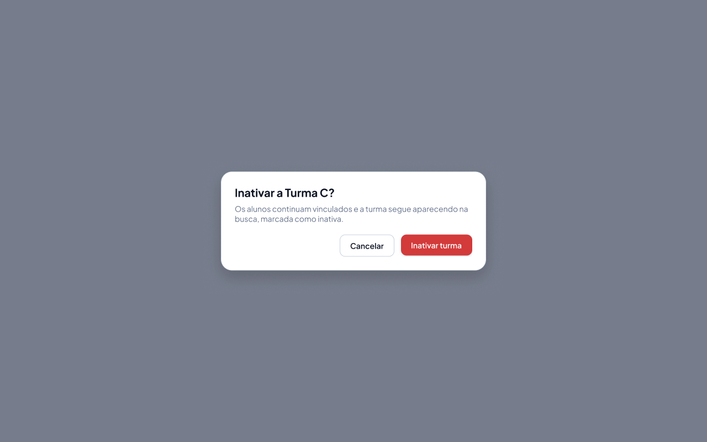

# UC06 - Gerenciar Estrutura Escolar (Etapas e Turmas)

[← Voltar para o Painel de Casos de Uso](index.md) • [Catálogo Unificado de Requisitos](../8_requisitos.md)

## 1. Atores

**Atores principais:** Secretária, Administrador

## 2. Objetivo

Permitir que o administrador e os membros da secretaria organizem a estrutura escolar da instituição por meio do cadastro de etapas e turmas existentes na creche, da vinculação de uma turma à sua etapa e da inativação de turmas e etapas que não estejam mais em uso.

## 3. Pré-Condição

1. O ator deve estar autenticado no sistema.
2. O sistema deve possuir conexão ativa com o banco de dados.
3. Para cadastrar uma turma ou vinculá-la a uma etapa, deve existir pelo menos uma etapa com status "ativo".

## 4. Fluxo Principal

**FP01 - Cadastrar Etapa (RF18)**

1. O ator acessa a funcionalidade de criar uma nova etapa.
2. O sistema exibe o formulário de cadastro de etapa.
3. O ator informa o nome da etapa.
4. O ator seleciona o botão "Salvar".
5. O sistema valida o preenchimento dos campos obrigatórios. (RN22, FE01)
6. O sistema verifica se não existe uma etapa cadastrada com o mesmo nome. (RN13, FE02)
7. O sistema registra a etapa com status "ativo". (FE06)
8. O sistema exibe a mensagem "Etapa cadastrada com sucesso".

## 5. Fluxos Alternativos

**FA01 - Cancelar Operação**

1. Em qualquer formulário de FP01, FA02, FA03 ou na confirmação do FA04, o ator seleciona "Cancelar".
2. O sistema descarta os dados informados, sem registrar nenhuma alteração.
3. O sistema retorna à tela anterior.

**FA02 - Cadastrar Turma (RF24)**

1. O ator acessa a funcionalidade de criar uma nova turma.
2. O sistema exibe o formulário de cadastro de turma, listando apenas as etapas com status "ativo" para seleção. (RN11, FE04)
3. O ator informa o nome da turma e seleciona a etapa à qual ela pertence. (RN04)
4. O ator seleciona o botão "Salvar".
5. O sistema valida o preenchimento dos campos obrigatórios. (RN22, FE01)
6. O sistema verifica se não existe outra turma com o mesmo nome dentro da etapa selecionada. (RN14, FE03)
7. O sistema registra a turma com status "ativo", vinculada à etapa selecionada. (RN04, FE06)
8. O sistema exibe a mensagem: "Turma cadastrada com sucesso".

**FA03 - Vincular Turma à Etapa (Pós-MVP) (RF20)**

1. O ator busca e seleciona uma turma cadastrada.
2. O ator acessa a funcionalidade de vincular à etapa.
3. O sistema exibe a lista de etapas com status "ativo". (RN11, FE04)
4. O ator seleciona a etapa desejada.
5. O sistema verifica se a turma e a etapa selecionadas estão com status "ativo". (RN11, FE05)
6. O sistema verifica se não existe outra turma com o mesmo nome na etapa de destino. (RN14, FE03)
7. O sistema registra o vínculo entre a turma e a etapa. (RN04, FE06)
8. O sistema exibe a mensagem: "Turma vinculada à etapa com sucesso."

**FA04 - Inativar Turma ou Etapa (Pós-MVP) (RF19)**

1. O ator busca e seleciona uma turma ou etapa com status "ativo".
2. O ator seleciona a opção "inativar".
3. O sistema solicita a confirmação da operação, com as opções "Confirmar" e "Cancelar". (FA01)
4. O ator seleciona "Confirmar".
5. O sistema altera o status da turma ou etapa para "inativo". (FE06)
6. O sistema mantém todos os vínculos já existentes (alunos e turmas). (RN12)
7. O sistema passa a exibir o registro nas buscas identificado com o status "inativo".
8. O sistema exibe a mensagem: "Registro inativado com sucesso."

## 6. Fluxos de Exceção

**FE01 - Campos Obrigatórios Não Preenchidos**

1. O ator seleciona "Salvar" sem preencher todos os campos obrigatórios (FP01, FA02 ou FA03).
2. O sistema identifica os campos pendentes. (RN22)
3. O sistema destaca os campos não preenchidos e não realiza o cadastro.
4. O sistema exibe a mensagem: "Preencha todos os campos obrigatórios."

**FE02 - Etapa com Nome Duplicado**

1. O ator informa, no FP01, o nome de uma etapa que já existe no sistema.
2. O sistema identifica a duplicidade. (RN13)
3. O sistema não realiza o cadastro.
4. O sistema exibe a mensagem: "Já existe uma etapa cadastrada com esse nome."

**FE03 - Turma com Nome Duplicado na Mesma Etapa**

1. O ator informa, no FA02 ou FA03, uma turma com um nome já existente na etapa selecionada.
2. O sistema identifica a duplicidade dentro da etapa. (RN14)
3. O sistema não realiza o cadastro ou o vínculo.
4. O sistema exibe a mensagem: "Já existe uma turma com esse nome na etapa."

**FE04 - Nenhuma Etapa Ativa Disponível**

1. O ator tenta cadastrar uma turma (FA02) ou vinculá-la a uma etapa (FA03).
2. O sistema identifica que não há nenhuma etapa com status "ativo". (RN04, RN11)
3. O sistema impede a continuidade da operação.
4. O sistema exibe a mensagem: "Não há etapas ativas cadastradas. Cadastre uma etapa antes de continuar."

**FE05 - Tentativa de Vínculo com Registro Inativo**

1. O ator tenta vincular uma turma inativa a uma etapa, ou uma turma a uma etapa inativa.
2. O sistema identifica que um dos registros está com status "inativo". (RN11)
3. O sistema não realiza o vínculo.
4. O sistema exibe a mensagem: "Não é possível criar vínculos com turmas ou etapas inativas."

**FE06 - Falha de Conexão**

1. O ator seleciona "Salvar" ou "Confirmar" em FP01, FA02, FA03 ou FA04.
2. O sistema tenta registrar a operação, mas há indisponibilidade de comunicação com o servidor/banco de dados.
3. O sistema não registra nenhuma alteração.
4. O sistema exibe a mensagem: "Não foi possível conectar ao servidor. Tente novamente mais tarde."

## 7. Regras de Negócio

| ID | Regra de Negócio | Justificativa |
|---|---|---|
| [RN04](../8_requisitos.md#rn04) | Uma turma deve estar obrigatoriamente vinculada a uma etapa existente. | Garante integridade organizacional: não pode existir turma desvinculada. |
| [RN11](../8_requisitos.md#rn11) | Só turmas e etapas ativas podem receber novos vínculos. | Evita alocar novas turmas ou alunos em estruturas inativas. |
| [RN12](../8_requisitos.md#rn12) | Inativar uma turma ou etapa não elimina os vínculos existentes. | Preserva o histórico de formação e matrícula dos alunos. |
| [RN13](../8_requisitos.md#rn13) | Impedir cadastro de duas etapas com o mesmo nome. | Evita ambiguidade e conflito de dados na escola. |
| [RN14](../8_requisitos.md#rn14) | Impedir cadastro de duas turmas com o mesmo nome dentro da mesma etapa. | Evita duplicidade de salas dentro do mesmo segmento. |
| [RN22](../8_requisitos.md#rn22) | O cadastro de etapa exige nome; cadastro de turma exige nome e etapa vinculada. | Garante o preenchimento dos dados fundamentais. |

## 8. Requisitos Relacionados

| ID | Nome do Requisito | Relação com o Caso de Uso |
|---|---|---|
| [RF18](../8_requisitos.md#req-rf18) | Cadastrar Etapa | Permite o cadastro de novas etapas (séries de ensino) no sistema. |
| [RF19](../8_requisitos.md#req-rf19) | Inativar turma e etapa | Permite inativar turmas e etapas mantendo vínculos e histórico (Adiado pós-MVP). |
| [RF20](../8_requisitos.md#req-rf20) | Vincular turma à etapa | Permite associar turmas a etapas ativas (Adiado pós-MVP). |
| [RF24](../8_requisitos.md#req-rf24) | Cadastrar Turma | Permite o cadastro de novas turmas vinculadas a etapas válidas. |
| [RNF02](../8_requisitos.md#req-rnf02) | Restrição de Acesso não Autenticado | Restringe o gerenciamento de estrutura escolar a usuários autenticados. |
| [RNF07](../8_requisitos.md#req-rnf07) | Tempo de resposta para busca de turmas/etapas | Assegura carregamento e busca de estruturas escolares em menos de 2s. |

## 9. Protótipo

Telas do protótipo (Figma) relacionadas a este caso de uso. Clique em uma imagem para ampliá-la.

<figure class="prototipo" markdown="span">
  [{ loading=lazy }](../../assets/prototipos/uc06-turmas-etapas.png){ target=_blank }
  <figcaption>Figura 1 – Tela de turmas e etapas (RF18–RF20, RF22, RF24)</figcaption>
</figure>

<figure class="prototipo" markdown="span">
  [{ loading=lazy }](../../assets/prototipos/uc06-modal-nova-etapa.png){ target=_blank }
  <figcaption>Figura 2 – Modal de nova etapa (RF18)</figcaption>
</figure>

<figure class="prototipo" markdown="span">
  [{ loading=lazy }](../../assets/prototipos/uc06-modal-nova-turma.png){ target=_blank }
  <figcaption>Figura 3 – Modal de nova turma (RF20, RF24)</figcaption>
</figure>

<figure class="prototipo" markdown="span">
  [{ loading=lazy }](../../assets/prototipos/uc06-modal-inativar-turma.png){ target=_blank }
  <figcaption>Figura 4 – Modal de inativação de turma (RF19)</figcaption>
</figure>

## 10. Aplicação do DoR

Esta seção registra a avaliação de prontidão deste Caso de Uso, conforme os critérios definidos em [Definition of Ready (DoR)](../9_dor_dod.md#91-definition-of-ready-dor). O checklist deve ser preenchido para o Caso de Uso ou para o conjunto de fluxos efetivamente selecionado para uma iteração. A presença deste modelo não significa que o Caso de Uso já foi aprovado.

### Identificação e delimitação da avaliação

- **Caso de Uso:** UC06 — Gerenciar Estrutura Escolar (Etapas e Turmas)
- **Versão do Caso de Uso:** 2.0 (consolidada na fase de Elaboração)
- **Iteração planejada:** Iteração 7 - Construção (13/11 a 19/11)
- **Responsável(is) pela avaliação:** Lucas Peixoto e Equipe SIGMA
- **Data da avaliação:** 12/11/2026 (pré-Iteração 7, após validação dos protótipos com as secretárias em 04/11/2026)
- **Representante consultada:** Cirlene Sena (diretora/coordenadora) e secretárias da Creche Estação Vida
- **Fluxos selecionados para a iteração:** FP01 (Cadastrar Etapa - RF18), FA01 (Cancelar Operação), FA02 (Cadastrar Turma vinculada à Etapa - RF24) e FE01 a FE06
- **Fluxos excluídos desta iteração e justificativa:** FA03 (Vincular Turma à Etapa - RF20) e FA04 (Inativar Turma ou Etapa - RF19) são Pós-MVP conforme decisão de 06/10/2026 ([MVP](../10_backlog.md#103-validacao-do-mvp-com-o-stakeholder)).
- **Objetivo(s) específico(s) e característica(s) do produto (OE/CP):** OE.1 - Organização Administrativa / CP7 - Turmas e Etapas
- **Requisitos funcionais relacionados:** RF18, RF19, RF20, RF24
- **Requisitos não funcionais relacionados:** RNF02, RNF07
- **Regras de negócio relacionadas:** RN04, RN11, RN12, RN13, RN14, RN22

### Checklist de prontidão

Para cada critério, selecionar uma única situação e registrar a evidência correspondente. Utilize **Não aplicável** somente quando houver justificativa. Utilize **Pendente de evidência** quando o atendimento ainda não puder ser comprovado.

| ID | Critério de verificação | Situação | Evidência / referência | Observações e pendências |
|---|---|---|---|---|
| DOR01 | O Caso de Uso está formalmente descrito, com atores, objetivo, pré-condições, pós-condições e fluxos principais, alternativos e de exceção aplicáveis claros e sem ambiguidades? | ☑ Atendido | Seções 1 a 6 deste arquivo (`uc06.md`). | Fluxos do MVP (`FP01`, `FA01`, `FA02`, `FE01`–`FE06`) implementados em [PR #57](https://github.com/mdsreq-fga-unb/REQ-2026.2-T01-Sigma/pull/57), [PR #53](https://github.com/mdsreq-fga-unb/REQ-2026.2-T01-Sigma/pull/53) e [PR #60](https://github.com/mdsreq-fga-unb/REQ-2026.2-T01-Sigma/pull/60). |
| DOR02 | Os fluxos selecionados para a iteração estão identificados e delimitados, com indicação do que será desenvolvido agora e do que ficará para depois? | ☑ Atendido | Delimitação acima, [MVP](../10_backlog.md) e [Cronograma](../6_cronograma.md) (Iteração 7). | `FA03` e `FA04` separados para Pós-MVP. |
| DOR03 | A rastreabilidade do escopo está demonstrada pela cadeia aplicável entre objetivo específico, característica do produto, RF/RNF e regras de negócio, conforme a Árvore de Rastreabilidade? | ☑ Atendido | Seção 8 deste arquivo e [Catálogo Unificado de Requisitos](../8_requisitos.md#uc06) (`OE.1` → `CP7` → `RF18, RF24` / `RNF02, RNF07` / `RN04, RN11–RN14, RN22`). | Cadeia completa validada para o escopo do MVP. |
| DOR04 | Existem critérios de aceitação verificáveis para os fluxos selecionados, coerentes com os requisitos e regras de negócio relacionados? | ☑ Atendido | Seções 5, 6 e 7 deste arquivo e `RN04, RN11–RN14, RN22` no [Catálogo Unificado](../8_requisitos.md). | Cobre unicidade de etapa/turma e vínculo obrigatório da turma a uma etapa ativa. |
| DOR05 | As regras de negócio necessárias foram compreendidas, registradas e verificadas quanto a contradições ou decisões essenciais em aberto? | ☑ Atendido | Seção 7 deste arquivo e [Catálogo Unificado de Requisitos](../8_requisitos.md). | `FA02` atende ao MVP criando turma já vinculada à etapa (`RN04`/`RF24`). |
| DOR06 | Quando houver impacto na interface, existe protótipo ou wireframe suficientemente detalhado e validado para orientar os fluxos selecionados? | ☑ Atendido | Seção 9 deste arquivo (Figuras 1 a 4 — Figma) e validação com as secretárias em 04/11/2026 ([Cronograma](../6_cronograma.md)). | Telas de etapas e turmas validadas. |
| DOR07 | As dependências técnicas, riscos, impactos arquiteturais e viabilidade de implementação foram analisados para o escopo selecionado? | ☑ Atendido | Backend em [PR #57](https://github.com/mdsreq-fga-unb/REQ-2026.2-T01-Sigma/pull/57), frontend em [PR #53](https://github.com/mdsreq-fga-unb/REQ-2026.2-T01-Sigma/pull/53)/[PR #60](https://github.com/mdsreq-fga-unb/REQ-2026.2-T01-Sigma/pull/60) e integração Docker em [PR #65](https://github.com/mdsreq-fga-unb/REQ-2026.2-T01-Sigma/pull/65). | Viabilidade confirmada e implementada. |
| DOR08 | A representante do projeto validou o entendimento e a adequação do escopo às necessidades e ao contexto de uso da Creche Estação Vida? | ☑ Atendido | [Ata de Reunião (06/10/2026)](../../reunioes/ata1.md) e [MVP](../10_backlog.md#103-validacao-do-mvp-com-o-stakeholder). | Escopo aprovado pela diretora Cirlene Sena. |

### Pontos de atenção específicos deste Caso de Uso

- FA03 — Vincular Turma à Etapa e FA04 — Inativar Turma ou Etapa estão identificados como Pós-MVP. Não os incluir na iteração atual sem decisão de repriorização registrada.
- O FA02 cadastra a turma já vinculada a uma etapa, conforme RF24 e RN04. Verificar se esse fluxo é suficiente para o escopo atual ou se a operação separada de RF20 realmente será necessária em iteração posterior.

### Resultado da avaliação

- **Resultado:** ☑ Ready (para os fluxos do MVP selecionados: `FP01`, `FA01`, `FA02`, `FE01`–`FE06`)
- **Pendências impeditivas:** Nenhuma para o escopo do MVP.
- **Pendências não impeditivas:** Avaliar no Pós-MVP se `RF20` (`FA03`) continuará necessário dado o comportamento de `FA02` (`RF24`).
- **Responsável pelo acompanhamento:** Lucas Peixoto
- **Data prevista para reavaliação:** Não aplicável para o MVP (reavaliar apenas no ciclo Pós-MVP)

> **Atenção:** O resultado **Ready** somente poderá ser marcado
> quando todos os critérios aplicáveis estiverem atendidos,
> as evidências estiverem registradas e não houver decisões
> essenciais ou contradições impeditivas em aberto.
>
> Caso contrário, o resultado deverá permanecer como
> **Not Ready** ou **Ainda não avaliado**.
---

[← Anterior: UC05 - Gerenciar Documentos Digitais](uc05.md) | [Próximo: UC07 - Alocar Alunos →](uc07.md)
