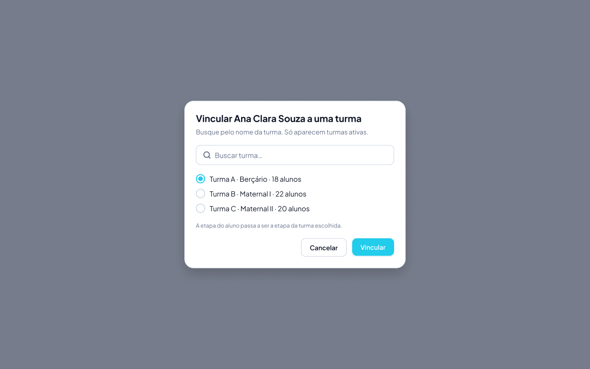

# UC07 - Alocar Alunos

[← Voltar para o Painel de Casos de Uso](index.md) • [Catálogo Unificado de Requisitos](../8_requisitos.md)

## 1. Atores

**Atores principais:** Administrador, Secretárias.

## 2. Objetivo

Permitir que o administrador ou as secretárias alterem a turma de um aluno com matrícula ativa, assegurando que cada aluno pertença a exatamente uma turma e uma etapa. A alocação inicial do aluno ocorre no cadastro do card ([UC04](uc04.md), FP01); este caso de uso atende apenas às alterações posteriores (transferência de turma) e não ativa matrículas.

## 3. Pré-Condição

1. O ator deve estar autenticado no sistema e possuir autorização para realizar alocação de alunos.
2. Deve existir pelo menos uma etapa cadastrada com status "ativo".
3. Deve existir pelo menos uma turma cadastrada com status "ativo" e vinculada a uma etapa ativa.
4. O aluno selecionado deve estar cadastrado e com matrícula ativa no sistema. Pelas regras RN02 e RN03, isso implica que ele já foi alocado a uma turma e etapa ativas no cadastro ([UC04](uc04.md)). (RN10)
5. O sistema deve possuir conexão ativa com o banco de dados.

## 4. Fluxo Principal

**FP01 - Alterar a turma de um aluno com matrícula ativa (RF13, RF21, RF22)**

1. O ator acessa a funcionalidade de alocação de alunos.
2. O ator pesquisa o aluno desejado informando o nome completo ou parcial. (FE01)
3. O sistema retorna os resultados correspondentes em menos de 2 segundos. (RNF06)
4. O ator seleciona o card de aluno a ser alterado.
5. O sistema exibe a turma e a etapa atuais do aluno e confirma que a matrícula está ativa. (RN03, RN10, FE06)
6. O ator pesquisa ou seleciona a nova turma.
7. O sistema retorna as turmas disponíveis em menos de 2 segundos. (RNF07)
8. O sistema valida se a turma e a etapa de destino estão ativas e se a turma escolhida é diferente da atual. (RN11, FE02, FE03)
9. O ator seleciona a opção "Salvar" ou "Confirmar". (FA01, FE04)
10. O sistema remove o vínculo anterior e registra o novo vínculo, mantendo o aluno em exatamente uma turma. (RN02, RN08, FE05)
11. O sistema exibe a mensagem de confirmação: "Alocação atualizada com sucesso."

> A alocação inicial do aluno não é um fluxo deste caso de uso: ela ocorre no cadastro do card ([UC04](uc04.md), FP01, passo 3).

## 5. Fluxos Alternativos

**FA01 - Cancelar alteração**

1. Em qualquer momento antes da confirmação, o ator seleciona a opção "Cancelar".
2. O sistema descarta os dados informados e não altera a turma do aluno.
3. O sistema retorna à tela anterior.

## 6. Fluxos de Exceção

**FE01 - Aluno não encontrado**

1. O ator realiza a busca por um aluno e nenhum registro corresponde ao termo informado.
2. O sistema exibe a mensagem: "Nenhum aluno encontrado."
3. O sistema permite que o ator refine os termos da busca e tente novamente.

**FE02 - Turma ou etapa inativa selecionada**

1. O ator tenta alocar um aluno a uma turma com status "inativo", ou a uma turma cuja etapa vinculada esteja inativa.
2. O sistema identifica que a turma ou etapa não está ativa. (RN11)
3. O sistema impede a alocação.
4. O sistema exibe a mensagem: "Não é possível alocar alunos em turmas ou etapas inativas."

**FE03 - Turma de destino igual à turma atual**

1. O ator seleciona como destino a turma em que o aluno já está alocado.
2. O sistema identifica que não há alteração a registrar.
3. O sistema informa que o aluno já está nessa turma e mantém o vínculo existente. (RN08)
4. O sistema permite que o ator escolha outra turma ou cancele a operação.

**FE04 - Campos obrigatórios não preenchidos**

1. O ator tenta confirmar a alteração sem preencher ou selecionar todas as informações obrigatórias.
2. O sistema identifica os campos obrigatórios ausentes.
3. O sistema interrompe o salvamento da associação. (RN06)
4. O sistema informa quais informações precisam ser preenchidas.
5. O sistema permite que o ator corrija os dados e tente novamente.

**FE05 - Falha no registro da alocação**

1. O ator confirma a alteração após selecionar o aluno e a nova turma.
2. O sistema tenta registrar a associação no banco de dados.
3. O sistema identifica uma falha de comunicação ou de persistência que impede a conclusão da operação.
4. O sistema informa que não foi possível concluir a alocação e orienta o ator a tentar novamente.
5. O sistema não apresenta a operação como concluída sem a confirmação do registro.

**FE06 - Matrícula sem status ativo**

1. O ator seleciona o card de um aluno cuja matrícula não está ativa.
2. O sistema identifica o status da matrícula. (RN10)
3. O sistema impede a alteração e informa que a turma só pode ser alterada em matrículas ativas.

## 7. Regras de Negócio

| ID | Regra de Negócio | Justificativa |
|---|---|---|
| [RN02](../8_requisitos.md#rn02) | Toda matrícula ativa deve estar vinculada a exatamente uma turma e uma etapa. | Garante a organização e enturmação da creche (`turma_id` obrigatório). |
| [RN03](../8_requisitos.md#rn03) | Uma matrícula só pode ser considerada ativa após o preenchimento completo das fichas obrigatórias (`UC04`) e o vínculo com turma e etapa ativas (`RN02`). | Garante conformidade documental e enturmação completa. |
| [RN04](../8_requisitos.md#rn04) | Uma turma deve estar obrigatoriamente vinculada a uma etapa existente. | Impede turmas sem estrutura curricular. |
| [RN06](../8_requisitos.md#rn06) | Campos obrigatórios devem ser validados antes do salvamento. | Assegura consistência relacional. |
| [RN08](../8_requisitos.md#rn08) | Um aluno não pode estar matriculado em duas turmas simultaneamente. | Evita conflitos de horário e sobrecarga de vagas. |
| [RN10](../8_requisitos.md#rn10) | Matrícula inativa não pode ter alocação alterada. | Preserva histórico de alunos inativos. |
| [RN11](../8_requisitos.md#rn11) | Só turmas e etapas ativas podem receber novos vínculos. | Evita alocar alunos em turmas extintas. |

## 8. Requisitos Relacionados

| ID | Nome do Requisito | Relação com o Caso de Uso |
|---|---|---|
| [RF13](../8_requisitos.md#req-rf13) | Vincular aluno a turma | Funcionalidade central deste caso de uso, responsável por relacionar o card do aluno a uma turma. |
| [RF21](../8_requisitos.md#req-rf21) | Buscar aluno pelo nome | Permite localizar o aluno para a alocação de forma ágil. |
| [RF22](../8_requisitos.md#req-rf22) | Buscar turmas e etapas | Permite localizar a turma à qual o aluno será alocado. |
| [RNF02](../8_requisitos.md#req-rnf02) | Restrição de Acesso não Autenticado | Garante que apenas secretárias/administradores autorizados aloquem alunos. |
| [RNF06](../8_requisitos.md#req-rnf06) | Tempo de Resposta ao Buscar Aluno | Retorna informações do aluno em menos de 2s para 95% das buscas. |
| [RNF07](../8_requisitos.md#req-rnf07) | Tempo de Resposta para Buscar Turmas | Retorna informações de turmas em menos de 2s para 95% das buscas. |

## 9. Protótipo

Telas do protótipo (Figma) relacionadas a este caso de uso. Clique em uma imagem para ampliá-la.

<figure class="prototipo" markdown="span">
  [{ loading=lazy }](../../assets/prototipos/uc07-modal-vincular-turma.png){ target=_blank }
  <figcaption>Figura 1 – Modal de vinculação do aluno à turma (RF13, RF22)</figcaption>
</figure>

## 10. Aplicação do DoR

Esta seção registra a avaliação de prontidão deste Caso de Uso, conforme os critérios definidos em [Definition of Ready (DoR)](../9_dor_dod.md#91-definition-of-ready-dor). O checklist deve ser preenchido para o Caso de Uso ou para o conjunto de fluxos efetivamente selecionado para uma iteração. A presença deste modelo não significa que o Caso de Uso já foi aprovado.

### Identificação e delimitação da avaliação

- **Caso de Uso:** UC07 — Alocar Alunos
- **Versão do Caso de Uso:** 2.0 (consolidada na fase de Elaboração)
- **Iteração planejada:** Iteração 7 - Construção (13/11 a 19/11)
- **Responsável(is) pela avaliação:** Lucas Peixoto e Equipe SIGMA
- **Data da avaliação:** 12/11/2026 (pré-Iteração 7, após validação dos protótipos com as secretárias em 04/11/2026)
- **Representante consultada:** Cirlene Sena (diretora/coordenadora) e secretárias da Creche Estação Vida
- **Fluxos selecionados para a iteração:** FP01 (Alterar a turma de um aluno com matrícula ativa), FA01 (Cancelar alteração) e FE01 a FE06. A alocação inicial é tratada no [UC04](uc04.md) (FP01).
- **Fluxos excluídos desta iteração e justificativa:** Nenhum — todos os fluxos de alocação integram o MVP (`CP7`/`CP1`).
- **Objetivo(s) específico(s) e característica(s) do produto (OE/CP):** OE.1 - Organização Administrativa / CP7, CP1
- **Requisitos funcionais relacionados:** RF13, RF21, RF22
- **Requisitos não funcionais relacionados:** RNF02, RNF06, RNF07
- **Regras de negócio relacionadas:** RN02, RN03, RN04, RN06, RN08, RN10, RN11

### Checklist de prontidão

Para cada critério, selecionar uma única situação e registrar a evidência correspondente. Utilize **Não aplicável** somente quando houver justificativa. Utilize **Pendente de evidência** quando o atendimento ainda não puder ser comprovado.

| ID | Critério de verificação | Situação | Evidência / referência | Observações e pendências |
|---|---|---|---|---|
| DOR01 | O Caso de Uso está formalmente descrito, com atores, objetivo, pré-condições, pós-condições e fluxos principais, alternativos e de exceção aplicáveis claros e sem ambiguidades? | ☑ Atendido | Seções 1 a 6 deste arquivo (`uc07.md`). | Fluxos descritos; modal de vinculação iniciado no frontend ([PR #71](https://github.com/mdsreq-fga-unb/REQ-2026.2-T01-Sigma/pull/71)). |
| DOR02 | Os fluxos selecionados para a iteração estão identificados e delimitados, com indicação do que será desenvolvido agora e do que ficará para depois? | ☑ Atendido | Delimitação acima e [Cronograma e Entregas](../6_cronograma.md) (Iteração 7). | Escopo de alocação e transferência delimitado. |
| DOR03 | A rastreabilidade do escopo está demonstrada pela cadeia aplicável entre objetivo específico, característica do produto, RF/RNF e regras de negócio, conforme a Árvore de Rastreabilidade? | ☑ Atendido | Seção 8 deste arquivo e [Catálogo Unificado de Requisitos](../8_requisitos.md#uc07) (`OE.1` → `CP7, CP1` → `RF13, RF21, RF22` / `RNF02, RNF06, RNF07`). | Cadeia rastreada no catálogo. |
| DOR04 | As regras de negócio necessárias foram compreendidas, registradas e verificadas quanto a contradições ou decisões essenciais em aberto? | ☑ Pendente de evidência | Seção 7 deste arquivo, `RN02, RN03` no [Catálogo Unificado](../8_requisitos.md) e [UC04](uc04.md) (seção 4). | Sequência decidida e registrada: alocação inicial no `UC04` (FP01) e `UC07` apenas para alterações posteriores de matrículas ativas. Falta a evidência da confirmação pela representante da creche. |
| DOR05 | Quando houver impacto na interface, existe protótipo ou wireframe suficientemente detalhado e validado para orientar os fluxos selecionados? | ☑ Atendido | Seção 9 deste arquivo (Figura 1 — Figma) e validação com as secretárias em 04/11/2026 ([Cronograma](../6_cronograma.md)). | Modal de vinculação validado. |
| DOR06 | As dependências técnicas, riscos, impactos arquiteturais e viabilidade de implementação foram analisados para o escopo selecionado? | ☑ Pendente de evidência | Tabelas no banco ([PR #69](https://github.com/mdsreq-fga-unb/REQ-2026.2-T01-Sigma/pull/69)) e modal no frontend ([PR #71](https://github.com/mdsreq-fga-unb/REQ-2026.2-T01-Sigma/pull/71)). | Documentar garantia transacional de `RN08` no `FP01` (passo 10) (evitar vínculo duplo ou perda de vínculo em caso de falha). |
| DOR07 | A representante do projeto validou o entendimento e a adequação do escopo às necessidades e ao contexto de uso da Creche Estação Vida? | ☑ Atendido | [Ata de Reunião (06/10/2026)](../../reunioes/ata1.md) e [MVP](../10_backlog.md#103-validacao-do-mvp-com-o-stakeholder). | Necessidade de alocação e transferência validada. |

### Pontos de atenção específicos deste Caso de Uso

- A relação entre `RN02` e `RN03` foi resolvida na especificação: a alocação inicial ocorre no cadastro do card (`UC04`, FP01) e este caso de uso só altera a turma de matrículas ativas, de modo que nenhuma matrícula ativa fica sem turma e não há dependência circular. Confirmar a decisão com a representante da creche e alinhar o protótipo "Cadastrar card", que indica a turma sendo vinculada depois.
- O FP01 (passo 10) remove o vínculo anterior e registra o novo. Definir e documentar como a operação garante a regra RN08, evitando que o aluno fique vinculado simultaneamente a duas turmas ou sem vínculo em caso de falha durante a transferência.

### Resultado da avaliação

- **Resultado:** ☑ Not Ready
- **Pendências impeditivas:** Confirmar com a representante a sequência registrada entre `UC04` e `UC07` (`RN02` e `RN03`); especificar o tratamento atômico de `RN08` na transferência de turma (`FP01`, passo 10).
- **Pendências não impeditivas:** Nenhuma adicional após resolução dos itens acima.
- **Responsável pelo acompanhamento:** Lucas Peixoto
- **Data prevista para reavaliação:** Durante a Iteração 7 (até 19/11/2026, antes da integração final de alocação)

> **Atenção:** O resultado **Ready** somente poderá ser marcado
> quando todos os critérios aplicáveis estiverem atendidos,
> as evidências estiverem registradas e não houver decisões
> essenciais ou contradições impeditivas em aberto.
>
> Caso contrário, o resultado deverá permanecer como
> **Not Ready** ou **Ainda não avaliado**.
---

[← Anterior: UC06 - Gerenciar Estrutura Escolar (Etapas e Turmas)](uc06.md) | [Próximo: UC08 - Consultar Registros (Busca) →](uc08.md)
