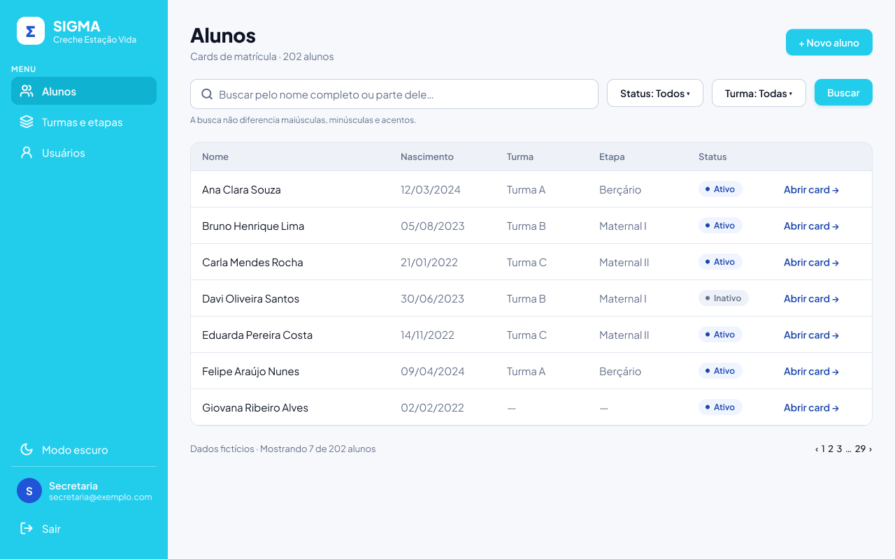
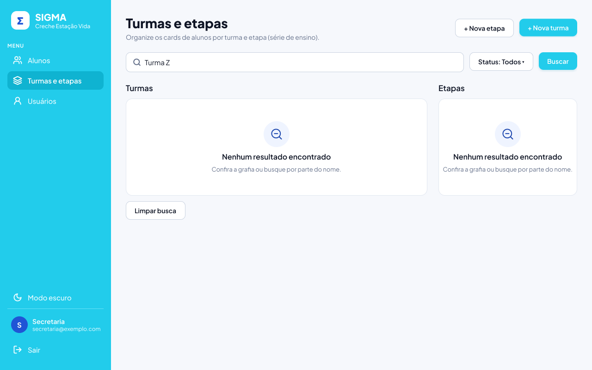

# UC08 - Consultar Registros (Busca)

[← Voltar para o Painel de Casos de Uso](index.md) • [Catálogo Unificado de Requisitos](../8_requisitos.md)

## 1. Atores

**Atores principais:** Equipe administrativa (Secretárias, Coordenadoras e Diretora).

## 2. Objetivo

Permitir que a secretária autenticada busque alunos por nome completo ou parcial para abrir o card do aluno, bem como busque turmas e etapas cadastradas no sistema, garantindo agilidade no atendimento e na localização de informações em substituição à procura física em pastas e armários.

## 3. Pré-Condições

- O ator deve estar autenticado no sistema (RF06, RNF02).
- A conta do ator deve estar com o status "ativo" (RN18).
- O sistema deve estar conectado ao banco de dados PostgreSQL.

## 4. Fluxo Principal

**FP01 - Buscar Aluno pelo Nome (RF21)**

1. O ator acessa a funcionalidade de busca de alunos no sistema. (FE03, FE04)
2. O sistema exibe o campo de pesquisa.
3. O ator insere o nome completo ou parcial do aluno. (FA02)
4. O ator confirma a busca clicando no ícone de pesquisa ou pressionando "Enter".
5. O sistema processa a consulta no banco de dados desconsiderando letras maiúsculas, minúsculas e acentos gráficos. (FE01, FE02)
6. O sistema retorna e exibe a lista de alunos correspondentes em tempo inferior a 2 segundos. (RNF06, FA01)
7. O ator seleciona o aluno desejado na lista de resultados.
8. O sistema direciona o ator para o card de matrícula do aluno selecionado.

## 5. Fluxos Alternativos

**FA01 - Nenhum Registro Encontrado (RF21, RF22)**

1. O ator insere um termo de busca que não possui correspondência no banco de dados.
2. O sistema processa a consulta.
3. O sistema não encontra nenhum registro correspondente.
4. O sistema exibe na tela a mensagem informativa: "Nenhum resultado encontrado".
5. O ator pode refazer a busca com outro termo.

**FA02 - Busca Parcial (RF21, RF22)**

1. O ator insere apenas as letras iniciais ou um trecho do nome do aluno, turma ou etapa.
2. O sistema processa a consulta buscando correspondências parciais.
3. O sistema exibe todos os registros que contêm o termo informado em qualquer posição do nome.
4. O ator localiza o registro desejado entre os resultados parciais exibidos.

**FA03 - Buscar Turmas e Etapas (RF22)**

1. O ator acessa a funcionalidade de busca de turmas e etapas. (FE03, FE04)
2. O sistema exibe o campo de pesquisa correspondente.
3. O ator insere o nome completo ou parcial da turma ou da etapa. (FA02)
4. O ator confirma a busca.
5. O sistema processa a consulta no banco de dados. (FE01, FE02)
6. O sistema retorna e exibe a lista de turmas e etapas correspondentes em tempo inferior a 2 segundos. (RNF07, FA01)
7. O ator visualiza os resultados, que indicam o status ("ativo" ou "inativo") de cada registro. (RN12)

## 6. Fluxos de Exceção

**FE01 - Falha de Conectividade (RF21, RF22)**

1. O ator tenta realizar uma busca.
2. O sistema não consegue se conectar ao backend.
3. O sistema não conclui a operação.
4. O sistema exibe mensagem de falha de conexão.
5. O sistema orienta o ator a tentar novamente quando a conexão for restabelecida.

**FE02 - Erro interno no banco de dados (RF21, RF22)**

1. O ator realiza uma busca válida.
2. O sistema tenta consultar os dados no banco.
3. O banco de dados retorna erro ou indisponibilidade.
4. O sistema cancela a operação.
5. O sistema exibe mensagem de erro interno.

**FE03 - Tentativa de Acesso sem Autenticação (RF06, RF21, RF22)**

1. O ator tenta acessar a funcionalidade de busca sem estar autenticado.
2. O sistema identifica a ausência de sessão válida. (RNF02)
3. O sistema bloqueia o acesso. (RNF02)
4. O sistema direciona o ator para a tela de autenticação. (RNF02)

**FE04 - Conta com Status "inativo"**

1. O ator tenta acessar a funcionalidade de busca com conta inativa. (RN18)
2. O sistema identifica que a conta está inativa. (RN18)
3. O sistema bloqueia o acesso ao sistema. (RN18)
4. O sistema informa ao ator que a conta está inativa. (RN18)

## 7. Regras de Negócio

| ID | Regra de Negócio | Aplicação no UC08 | Justificativa |
|---|---|---|---|
| [RN07](../8_requisitos.md#rn07) | Impedir cadastro de dois alunos com a mesma matrícula ou CPF | Garante que os resultados da busca sejam únicos e sem duplicidades | Evita conflito de dados. |
| [RN11](../8_requisitos.md#rn11) | Só turmas e etapas ativas podem receber novos vínculos | A busca pode retornar turmas/etapas inativas, mas elas não podem receber novos alunos | Evita alocar matrículas em estruturas inativas. |
| [RN12](../8_requisitos.md#rn12) | Inativar uma turma ou etapa não elimina os vínculos existentes | Turmas/etapas inativas aparecem na busca, identificadas com status "inativo" | Preserva o histórico de alocação dos alunos. |
| [RN13](../8_requisitos.md#rn13) | Impedir cadastro de duas etapas com o mesmo nome | Garante que a busca por etapas não retorne duplicatas | Evita ambiguidade na seleção. |
| [RN14](../8_requisitos.md#rn14) | Impedir cadastro de duas turmas com o mesmo nome na mesma etapa | Garante que a busca por turmas não retorne duplicatas dentro do mesmo segmento | Evita conflito de dados. |
| [RN18](../8_requisitos.md#rn18) | Apenas contas com status "Ativo" podem acessar o sistema | Impede que contas inativas realizem buscas | Garante proteção dos dados da creche exigida pela LGPD. |

## 8. Requisitos Relacionados

| ID | Nome do Requisito | Relação com o Caso de Uso |
|---|---|---|
| [RF21](../8_requisitos.md#req-rf21) | Buscar aluno pelo nome | Permite que a secretária busque alunos por nome completo ou parcial, sem diferenciar maiúsculas, minúsculas e acentos, retornando os dados de registro de matrícula. |
| [RF22](../8_requisitos.md#req-rf22) | Buscar turmas e etapas | Permite que a secretária busque turmas e etapas por nome completo ou parcial, exibindo mensagem "Nenhum resultado encontrado" quando não houver registros. |
| [RNF02](../8_requisitos.md#req-rnf02) | Restrição de Acesso não Autenticado | Assegura que consultas aos alunos ocorram apenas sob sessão autenticada. |
| [RNF06](../8_requisitos.md#req-rnf06) | Tempo de resposta para buscar aluno | Retorna os resultados da consulta de alunos em menos de 2 segundos para 95% das requisições. |
| [RNF07](../8_requisitos.md#req-rnf07) | Tempo de resposta para buscar turmas ou etapas | Retorna os resultados da busca de turmas ou etapas em menos de 2 segundos para 95% das requisições. |

## 9. Protótipo

Telas do protótipo (Figma) relacionadas a este caso de uso. Clique em uma imagem para ampliá-la.

<figure class="prototipo" markdown="span">
  [{ loading=lazy }](../../assets/prototipos/uc08-lista-busca-alunos.png){ target=_blank }
  <figcaption>Figura 1 – Tela de lista e busca de alunos (RF21)</figcaption>
</figure>

<figure class="prototipo" markdown="span">
  [{ loading=lazy }](../../assets/prototipos/uc08-busca-sem-resultado.png){ target=_blank }
  <figcaption>Figura 2 – Busca de turmas e etapas sem resultado (RF22)</figcaption>
</figure>

## 10. Aplicação do DoR

Esta seção registra a avaliação de prontidão deste Caso de Uso, conforme os critérios definidos em [Definition of Ready (DoR)](../9_dor_dod.md#91-definition-of-ready-dor). O checklist deve ser preenchido para o Caso de Uso ou para o conjunto de fluxos efetivamente selecionado para uma iteração. A presença deste modelo não significa que o Caso de Uso já foi aprovado.

### Identificação e delimitação da avaliação

- **Caso de Uso:** UC08 — Consultar Registros (Busca)
- **Versão do Caso de Uso:** 2.0 (consolidada na fase de Elaboração)
- **Iteração planejada:** Iteração 7 - Construção (13/11 a 19/11)
- **Responsável(is) pela avaliação:** Lucas Peixoto e Equipe SIGMA
- **Data da avaliação:** 12/11/2026 (pré-Iteração 7, após validação dos protótipos com as secretárias em 04/11/2026)
- **Representante consultada:** Cirlene Sena (diretora/coordenadora) e secretárias da Creche Estação Vida
- **Fluxos selecionados para a iteração:** FP01 (Buscar Aluno pelo Nome - RF21), FA01 (Nenhum Registro Encontrado), FA02 (Busca Parcial), FA03 (Buscar Turmas e Etapas - RF22) e FE01 a FE04
- **Fluxos excluídos desta iteração e justificativa:** Nenhum — todos os fluxos de busca integram o escopo do MVP.
- **Objetivo(s) específico(s) e característica(s) do produto (OE/CP):** OE.1 - Organização e Continuidade / CP3, CP7
- **Requisitos funcionais relacionados:** RF21, RF22
- **Requisitos não funcionais relacionados:** RNF02, RNF06, RNF07
- **Regras de negócio relacionadas:** RN07, RN11, RN12, RN13, RN14, RN18

### Checklist de prontidão

Para cada critério, selecionar uma única situação e registrar a evidência correspondente. Utilize **Não aplicável** somente quando houver justificativa. Utilize **Pendente de evidência** quando o atendimento ainda não puder ser comprovado.

| ID | Critério de verificação | Situação | Evidência / referência | Observações e pendências |
|---|---|---|---|---|
| DOR01 | O Caso de Uso está formalmente descrito, com atores, objetivo, pré-condições, pós-condições e fluxos principais, alternativos e de exceção aplicáveis claros e sem ambiguidades? | ☑ Atendido | Seções 1 a 6 deste arquivo (`uc08.md`). | Fluxos de busca de turmas/etapas e alunos descritos e implementados em [PR #53](https://github.com/mdsreq-fga-unb/REQ-2026.2-T01-Sigma/pull/53), [PR #57](https://github.com/mdsreq-fga-unb/REQ-2026.2-T01-Sigma/pull/57), [PR #60](https://github.com/mdsreq-fga-unb/REQ-2026.2-T01-Sigma/pull/60) e [PR #71](https://github.com/mdsreq-fga-unb/REQ-2026.2-T01-Sigma/pull/71). |
| DOR02 | Os fluxos selecionados para a iteração estão identificados e delimitados, com indicação do que será desenvolvido agora e do que ficará para depois? | ☑ Atendido | Delimitação acima, [MVP](../10_backlog.md) e [Cronograma](../6_cronograma.md) (Iteração 7). | Busca de alunos (`RF21`) e busca de turmas/etapas (`RF22`) selecionadas para o MVP. |
| DOR03 | A rastreabilidade do escopo está demonstrada pela cadeia aplicável entre objetivo específico, característica do produto, RF/RNF e regras de negócio, conforme a Árvore de Rastreabilidade? | ☑ Atendido | Seção 8 deste arquivo e [Catálogo Unificado de Requisitos](../8_requisitos.md#uc08) (`OE.1` → `CP3, CP7` → `RF21, RF22` / `RNF02, RNF06, RNF07`). | Cadeia completa validada. |
| DOR04 | Existem critérios de aceitação verificáveis para os fluxos selecionados, coerentes com os requisitos e regras de negócio relacionados? | ☑ Atendido | Seções 5, 6 e 7 deste arquivo e `RNF06, RNF07` no [Catálogo Unificado](../8_requisitos.md). | Cobre busca parcial, case-insensitive/sem acento, ausência de resultado e limites de tempo. |
| DOR05 | As regras de negócio necessárias foram compreendidas, registradas e verificadas quanto a contradições ou decisões essenciais em aberto? | ☑ Atendido | Seção 7 deste arquivo e [Catálogo Unificado de Requisitos](../8_requisitos.md). | Regras de visibilidade e autorização (`RN18`) compreendidas sem contradições impeditivas. |
| DOR06 | Quando houver impacto na interface, existe protótipo ou wireframe suficientemente detalhado e validado para orientar os fluxos selecionados? | ☑ Atendido | Seção 9 deste arquivo (Figuras 1 e 2 — Figma) e validação com as secretárias em 04/11/2026 ([Cronograma](../6_cronograma.md)). | Telas de busca e estado vazio validadas. |
| DOR07 | As dependências técnicas, riscos, impactos arquiteturais e viabilidade de implementação foram analisados para o escopo selecionado? | ☑ Atendido | Endpoints de estrutura ([PR #57](https://github.com/mdsreq-fga-unb/REQ-2026.2-T01-Sigma/pull/57)) e telas de busca ([PR #53](https://github.com/mdsreq-fga-unb/REQ-2026.2-T01-Sigma/pull/53), [PR #71](https://github.com/mdsreq-fga-unb/REQ-2026.2-T01-Sigma/pull/71)). | Viabilidade confirmada; medição dos tempos de `RNF06`/`RNF07` prevista nos testes integrados da Iteração 7. |
| DOR08 | A representante do projeto validou o entendimento e a adequação do escopo às necessidades e ao contexto de uso da Creche Estação Vida? | ☑ Atendido | [Ata de Reunião (06/10/2026)](../../reunioes/ata1.md) e [MVP](../10_backlog.md#103-validacao-do-mvp-com-o-stakeholder). | Escopo aprovado pela diretora Cirlene Sena. |

### Pontos de atenção específicos deste Caso de Uso

- Delimitar se a iteração contempla a busca de alunos, a busca de turmas/etapas ou ambas. Embora estejam no mesmo Caso de Uso, são comportamentos distintos e podem ser planejados em incrementos separados.
- Verificar se os critérios de aceitação cobrem busca completa e parcial, desconsideração de maiúsculas/minúsculas e acentos, ausência de resultados, indicação de status e os limites de tempo definidos em RNF06 e RNF07.

### Resultado da avaliação

- **Resultado:** ☑ Ready
- **Pendências impeditivas:** Nenhuma para o escopo da Iteração 7.
- **Pendências não impeditivas:** Registrar evidências de medição de desempenho (`RNF06`/`RNF07`) nos testes integrados e no registro de DoD da entrega.
- **Responsável pelo acompanhamento:** Lucas Peixoto
- **Data prevista para reavaliação:** Não aplicável (item em construção na Iteração 7)

> **Atenção:** O resultado **Ready** somente poderá ser marcado
> quando todos os critérios aplicáveis estiverem atendidos,
> as evidências estiverem registradas e não houver decisões
> essenciais ou contradições impeditivas em aberto.
>
> Caso contrário, o resultado deverá permanecer como
> **Not Ready** ou **Ainda não avaliado**.
---

[← Anterior: UC07 - Alocar Alunos](uc07.md)
